# Práctica 1 – Monte Alto y la Conectividad

## Curso

Redes de Computadoras 2
Ingeniería en Ciencias y Sistemas
Facultad de Ingeniería
Universidad de San Carlos de Guatemala

## Grupo

Grupo: 28
Periodo: Primer Semestre 2026

## Integrantes

| Carné     |             Nombre             |
| --------- | :----------------------------: |
| 202302220 |  Enner Esaí Mendizabal Castro  |
| 202202410 | Marcos Daniel Bonifasi de Leon |
| 202300670 | David Estuardo Barrios Ramírez |

## 1. Introducción

La presente documentación corresponde al desarrollo de la Práctica 1: “Monte Alto y la conectividad”, cuyo objetivo es el diseño, implementación y validación de una red LAN segmentada y segura, utilizando Cisco Packet Tracer como herramienta de simulación.

El escenario planteado representa la infraestructura de red de un colegio que ha crecido de forma desordenada, provocando problemas de conectividad, pérdida de paquetes y dificultad en la administración de la red. A partir de esta problemática, se propone una solución basada en buenas prácticas de redes, aplicando segmentación lógica, protocolos de redundancia, enrutamiento dinámico y políticas de seguridad.

## 2. Objetivo General

Diseñar e implementar una red LAN funcional que permita la comunicación eficiente y segura entre los distintos departamentos del colegio Monte Alto, mediante:

- Segmentación de la red usando VLANs.

- Administración centralizada de VLANs con VTP.

- Implementación de Spanning Tree Protocol para evitar bucles y analizar tiempos de convergencia.

- Uso de protocolos de enrutamiento dinámico para la comunicación entre redes.

- Aplicación de medidas de seguridad en los puertos de acceso.

## 3. Objetivos Específicos

- Configurar al menos 6 VLANs distribuidas entre dos edificios.

- Garantizar la correcta propagación de VLANs mediante VTP.

- Implementar PVST y Rapid PVST, analizando y comparando sus tiempos de convergencia.

- Configurar EIGRP, RIP y OSPF en los routers correspondientes.

- Verificar la comunicación:
  - Intra-VLAN

  - Inter-VLAN

  - Entre ambos edificios

- Aplicar Port Security para restringir el acceso no autorizado a la red.

- Documentar detalladamente todas las configuraciones realizadas.

## 4. Alcance del Proyecto

El alcance de la práctica incluye:

- Configuración básica de switches y routers.

- Diseño e implementación de la topología solicitada.

- Creación y administración de VLANs por nivel académico.

- Configuración de enlaces trunk y puertos access.

- Implementación de VTP en modo servidor y cliente.

- Aplicación de Spanning Tree Protocol en sus versiones PVST y Rapid PVST.

- Configuración de protocolos de enrutamiento dinámico.

- Pruebas de conectividad y análisis de convergencia.

- Elaboración de documentación técnica completa en formato Markdown.

Quedan fuera del alcance de esta práctica la implementación en equipos reales y la aplicación de mecanismos avanzados de seguridad a nivel de firewall.

## 5. Metodología de Trabajo

Para el desarrollo del proyecto se siguió la siguiente metodología:

- Análisis de los requerimientos técnicos de la práctica.

- Diseño de la topología lógica y física.

- División del trabajo por áreas técnicas entre los integrantes del grupo.

- Implementación progresiva de las configuraciones en Cisco Packet Tracer.

- Validación mediante pruebas de conectividad y simulación de fallas.

- Documentación detallada de cada configuración realizada.

- Control de versiones y seguimiento del proyecto mediante GitHub.

## 6. Herramientas y Recursos Utilizados

- Cisco Packet Tracer

- GitHub (repositorio del proyecto)

- Markdown para documentación técnica

- Material de apoyo proporcionado en el curso:
  - CCNA Desde Cero

  - Repositorio de clases del curso

## 7. Diseño de la Topología de Red

### 7.1 Descripción General

La topología de red fue diseñada bajo un esquema jerárquico, separando la infraestructura en dos edificios (izquierdo y derecho), cada uno con switches de acceso y un router dedicado, los cuales se interconectan a través de un router central.

Este diseño permite:

- Segmentación lógica mediante VLANs.

- Redundancia y control de bucles con STP.

- Escalabilidad para futuras expansiones.

- Separación clara entre capa de acceso, distribución y capa de red.

### 7.2 Topología Principal

La topología principal se compone de dos edificios interconectados a través de routers centrales, asegurando redundancia y escalabilidad. Cada edificio cuenta con un switch de distribución principal que concentra los enlaces troncales y se comunica tanto lateralmente con otros switches de distribución, como verticalmente con switches de acceso. Esta estructura jerárquica garantiza una administración centralizada y facilita la propagación automática de VLANs mediante VTP.

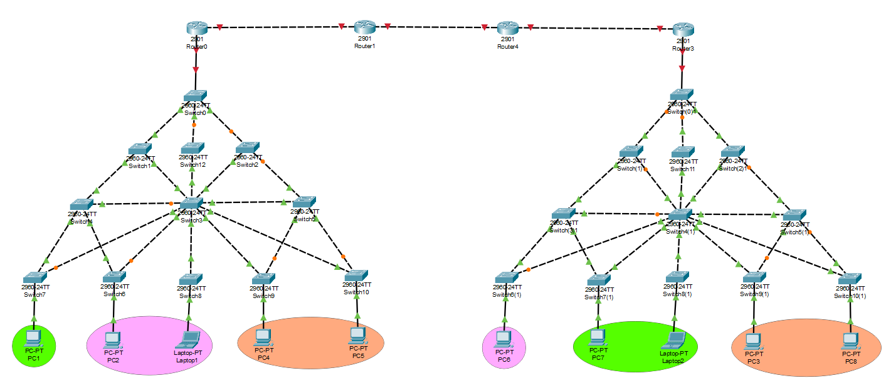

### 7.3 Asignación de puertos

#### 7.3.1 Enlaces entre dispositivos (Nivel 0)

| Dispositivo Origen | Puerto Origen | Dispositivo Destino | Puerto Destino |
| ------------------ | ------------- | ------------------- | -------------- |
| Router0            | Gig0/0        | Router1             | Gig0/0         |
| Router1            | Gig0/1        | Router4             | Gig0/0         |
| Router4            | Gig0/1        | Router3             | Gig0/0         |

#### 7.3.2 Enlaces entre dispositivos - Edificio Izquierdo

**Nivel 1:**

| Dispositivo Origen | Puerto Origen | Dispositivo Destino | Puerto Destino |
| ------------------ | ------------- | ------------------- | -------------- |
| Router0            | Gig0/1        | Switch0             | Gig0/1         |

**Nivel 2:**

| Dispositivo Origen | Puerto Origen | Dispositivo Destino | Puerto Destino |
| ------------------ | ------------- | ------------------- | -------------- |
| Switch0            | FaE0/24       | Switch1             | FaE0/24        |
| Switch0            | FaE0/23       | Switch12            | FaE0/24        |
| Switch0            | FaE0/22       | Switch2             | FaE0/24        |

**Nivel 3:**

| Dispositivo Origen | Puerto Origen | Dispositivo Destino | Puerto Destino |
| ------------------ | ------------- | ------------------- | -------------- |
| Switch1            | FaE0/23       | Switch4             | FaE0/24        |
| Switch1            | FaE0/22       | Switch3             | FaE0/24        |
| Switch12           | FaE0/23       | Switch3             | FaE0/23        |
| Switch2            | FaE0/23       | Switch3             | FaE0/22        |
| Switch2            | FaE0/22       | Switch5             | FaE0/24        |

**Nivel 4:**

| Dispositivo Origen | Puerto Origen | Dispositivo Destino | Puerto Destino |
| ------------------ | ------------- | ------------------- | -------------- |
| Switch4            | FaE0/23       | Switch3             | FaE0/21        |
| Switch3            | FaE0/20       | Switch5             | FaE0/23        |
| Switch4            | FaE0/22       | Switch7             | FaE0/24        |
| Switch4            | FaE0/21       | Switch6             | FaE0/24        |
| Switch3            | FaE0/19       | Switch7             | FaE0/23        |
| Switch3            | FaE0/18       | Switch6             | FaE0/23        |
| Switch3            | FaE0/17       | Switch8             | FaE0/24        |
| Switch3            | FaE0/16       | Switch9             | FaE0/24        |
| Switch3            | FaE0/15       | Switch10            | FaE0/24        |
| Switch5            | FaE0/22       | Switch9             | FaE0/23        |
| Switch5            | FaE0/21       | Switch10            | FaE0/23        |

**Nivel 5:**

| Dispositivo Origen | Puerto Origen | Dispositivo Destino | Puerto Destino |
| ------------------ | ------------- | ------------------- | -------------- |
| Switch7            | FaE0/22       | PC1                 | FaE0           |
| Switch6            | FaE0/22       | PC2                 | FaE0           |
| Switch8            | FaE0/23       | Laptop1             | FaE0           |
| Switch9            | FaE0/22       | PC4                 | FaE0           |
| Switch10           | FaE0/22       | PC5                 | FaE0           |

#### 7.3.3 Enlaces entre dispositivos - Edificio Derecho

**Nivel 1:**

| Dispositivo Origen | Puerto Origen | Dispositivo Destino | Puerto Destino |
| ------------------ | ------------- | ------------------- | -------------- |
| Router3            | Gig0/1        | Switch(0)1          | Gig0/1         |

**Nivel 2:**

| Dispositivo Origen | Puerto Origen | Dispositivo Destino | Puerto Destino |
| ------------------ | ------------- | ------------------- | -------------- |
| Switch(0)1         | FaE0/24       | Switch(1)1          | FaE0/24        |
| Switch(0)1         | FaE0/23       | Switch11            | FaE0/24        |
| Switch(0)1         | FaE0/22       | Switch(2)1          | FaE0/24        |

**Nivel 3:**

| Dispositivo Origen | Puerto Origen | Dispositivo Destino | Puerto Destino |
| ------------------ | ------------- | ------------------- | -------------- |
| Switch(1)1         | FaE0/23       | Switch(3)1          | FaE0/24        |
| Switch(1)1         | FaE0/22       | Switch(4)1          | FaE0/24        |
| Switch11           | FaE0/23       | Switch(4)1          | FaE0/23        |
| Switch(2)1         | FaE0/23       | Switch(4)1          | FaE0/22        |
| Switch(2)1         | FaE0/22       | Switch(5)1          | FaE0/24        |

**Nivel 4:**

| Dispositivo Origen | Puerto Origen | Dispositivo Destino | Puerto Destino |
| ------------------ | ------------- | ------------------- | -------------- |
| Switch(3)1         | FaE0/23       | Switch(4)1          | FaE0/21        |
| Switch(4)1         | FaE0/20       | Switch(5)1          | FaE0/23        |
| Switch(3)1         | FaE0/22       | Switch(6)1          | FaE0/24        |
| Switch(3)1         | FaE0/21       | Switch(7)1          | FaE0/24        |
| Switch(4)1         | FaE0/19       | Switch(6)1          | FaE0/23        |
| Switch(4)1         | FaE0/18       | Switch(7)1          | FaE0/23        |
| Switch(4)1         | FaE0/17       | Switch(8)1          | FaE0/24        |
| Switch(4)1         | FaE0/16       | Switch(9)1          | FaE0/24        |
| Switch(4)1         | FaE0/15       | Switch(10)1         | FaE0/24        |
| Switch(5)1         | FaE0/22       | Switch(9)1          | FaE0/23        |
| Switch(5)1         | FaE0/21       | Switch(10)1         | FaE0/23        |

**Nivel 5:**

| Dispositivo Origen | Puerto Origen | Dispositivo Destino | Puerto Destino |
| ------------------ | ------------- | ------------------- | -------------- |
| Switch(6)1         | FaE0/22       | PC6                 | FaE0           |
| Switch(7)1         | FaE0/22       | PC7                 | FaE0           |
| Switch(8)1         | FaE0/23       | Laptop2             | FaE0           |
| Switch(9)1         | FaE0/22       | PC3                 | FaE0           |
| Switch(10)1        | FaE0/22       | PC8                 | FaE0           |


## 8. Configuración Básica de Switches

Antes de implementar las VLANs y los protocolos de resiliencia, se configuró la base de todos los switches de la topología aplicando estándares de nomenclatura y seguridad definidos para el **Grupo 28**. Esta fase inicial sentó las bases para una administración consistente y ordenada de la infraestructura.

### 8.1 Estandarización de Nombres (Hostnames)

Se aplicó el formato `SW#A_G#B` donde `#A` representa el identificador secuencial del dispositivo y `#B` el número de grupo (28).

Comando utilizado para configurar el hostname en cada switch:

```bash
enable
configure terminal
hostname SW1_G28
exit
copy running-config startup-config
```

| Dispositivo Original | Nuevo Hostname |
| -------------------- | -------------- |
| Router0 (Izq)        | R0_G28         |
| Switch0 (Izq)        | SW0_G28        |
| Switch1              | SW1_G28        |
| Switch12             | SW12_G28       |
| Switch2              | SW2_G28        |
| Switch4              | SW4_G28        |
| Switch3              | SW3_G28        |
| Switch5              | SW5_G28        |
| Switch7              | SW7_G28        |
| Switch6              | SW6_G28        |
| Switch8              | SW8_G28        |
| Switch9              | SW9_G28        |
| Switch10             | SW10_G28       |
| Router1 (Centro)     | R1_G28         |
| Router4 (Centro)     | R4_G28         |
| Router3 (Der)        | R3_G28         |
| Switch(0)1 (Der)     | SW(0)1_G28     |
| Switch(1)1           | SW(1)1_G28     |
| Switch11             | SW11_G28       |
| Switch(2)1           | SW(2)1_G28     |
| Switch(3)1           | SW(3)1_G28     |
| Switch(4)1           | SW(4)1_G28     |
| Switch(5)1           | SW(5)1_G28     |
| Switch(6)1           | SW(6)1_G28     |
| Switch(7)1           | SW(7)1_G28     |
| Switch(8)1           | SW(8)1_G28     |
| Switch(9)1           | SW(9)1_G28     |
| Switch(10)1          | SW(10)1_G28    |

## 9. Configuración del Protocolo VTP y Troncales

Antes de la creación de las VLANs, se preparó la infraestructura de capa 2 configurando enlaces troncales y el protocolo de administración VTP para garantizar la coherencia de la base de datos de VLANs en toda la topología.

### 9.1 Configuración de Enlaces Troncales (Trunks)

Se configuraron en modo `trunk` todas las interfaces que interconectan dispositivos de red (Switch-Switch y Switch-Router) para permitir el transporte de tramas etiquetadas bajo el estándar 802.1Q.

**Edificio Izquierdo:**

- Switch0 (SW0_G28)
  - Conecta a: Router0 (G0/1), Switch1 (F0/24), Switch12 (F0/23), Switch2 (F0/22)

    ```bash
    enable
    configure terminal
    interface range fa0/22 - 24, gig0/1
    switchport mode trunk
    exit
    copy running-config startup-config
    ```

- Switch1 (SW1_G28)
  - Conecta a: Switch0 (F0/24), Switch4 (F0/23), Switch3 (F0/22)

    ```bash
    enable
    configure terminal
    interface range fa0/22 - 24
    switchport mode trunk
    exit
    copy running-config startup-config
    ```

- Switch12 (SW12_G28)
  - Conecta a: Switch0 (F0/24), Switch3 (F0/23)

    ```bash
    enable
    configure terminal
    interface range fa0/23 - 24
    switchport mode trunk
    exit
    copy running-config startup-config
    ```

- Switch2 (SW2_G28)
  - Conecta a: Switch0 (F0/24), Switch3 (F0/23), Switch5 (F0/22)

  ```bash
  enable
  configure terminal
  interface range fa0/22 - 24
  switchport mode trunk
  exit
  copy running-config startup-config
  ```

- Switch4 (SW4_G28)
  - Conecta a: Switch1 (F0/24), Switch3 (F0/23), Switch7 (F0/22), Switch6 (F0/21)

  ```bash
  enable
  configure terminal
  interface range fa0/21 - 24
  switchport mode trunk
  exit
  copy running-config startup-config
  ```

- Switch3 (SW3_G28)
  - Conecta a: Switch1 (F0/24), Switch12 (F0/23), Switch2 (F0/22), Switch4 (F0/21), Switch5 (F0/20), Switch7 (F0/19), Switch6 (F0/18), Switch8 (F0/17), Switch9 (F0/16), Switch10 (F0/15)

  ```bash
  enable
  configure terminal
  interface range fa0/15 - 24
  switchport mode trunk
  exit
  copy running-config startup-config
  ```

- Switch5 (SW5_G28)
  - Conecta a: Switch2 (F0/24), Switch3 (F0/23), Switch9 (F0/22), Switch10 (F0/21)

  ```bash
  enable
  configure terminal
  interface range fa0/21 - 24
  switchport mode trunk
  exit
  copy running-config startup-config
  ```

- Switch7 (SW7_G28)
  - Conecta a: Switch4 (F0/24), Switch3 (F0/23)

  ```bash
  enable
  configure terminal
  interface range fa0/23 - 24
  switchport mode trunk
  exit
  copy running-config startup-config
  ```

- Switch6 (SW6_G28)
  - Conecta a: Switch4 (F0/24), Switch3 (F0/23)

  ```bash
  enable
  configure terminal
  interface range fa0/23 - 24
  switchport mode trunk
  exit
  copy running-config startup-config
  ```

- Switch8 (SW8_G28)
  - Conecta a: Switch3 (F0/24)

  ```bash
  enable
  configure terminal
  interface fa0/24
  switchport mode trunk
  exit
  copy running-config startup-config
  ```

- Switch9 (SW9_G28)
  - Conecta a: Switch3 (F0/24), Switch5 (F0/23)

  ```bash
  enable
  configure terminal
  interface range fa0/23 - 24
  switchport mode trunk
  exit
  copy running-config startup-config
  ```

- Switch10 (SW10_G28)
  - Conecta a: Switch3 (F0/24), Switch5 (F0/23)

  ```bash
  enable
  configure terminal
  interface range fa0/23 - 24
  switchport mode trunk
  exit
  copy running-config startup-config
  ```

**Edificio Derecho:**

- Switch(0)1 (SW(0)1_G28)
  - Conecta a: Router3 (G0/1), Switch(1)1 (F0/24), Switch11 (F0/23), Switch(2)1 (F0/22)

  ```bash
  enable
  configure terminal
  interface range fa0/22 - 24, gig0/1
  switchport mode trunk
  exit
  copy running-config startup-config
  ```

- Switch(1)1 (SW(1)1_G28)
  - Conecta a: Switch(0)1 (F0/24), Switch(3)1 (F0/23), Switch(4)1 (F0/22)

  ```bash
  enable
  configure terminal
  interface range fa0/22 - 24
  switchport mode trunk
  exit
  copy running-config startup-config
  ```

- Switch11 (SW11_G28)
  - Conecta a: Switch(0)1 (F0/24), Switch(4)1 (F0/23)
  ```bash
  enable
  configure terminal
  interface range fa0/23 - 24
  switchport mode trunk
  exit
  copy running-config startup-config
  ```
- Switch(2)1 (SW(2)1_G28)
  - Conecta a: Switch(0)1 (F0/24), Switch(4)1 (F0/23), Switch(5)1 (F0/22)

  ```bash
  enable
  configure terminal
  interface range fa0/22 - 24
  switchport mode trunk
  exit
  copy running-config startup-config
  ```

- Switch(3)1 (SW(3)1_G28)
  - Conecta a: Switch(1)1 (F0/24), Switch(4)1 (F0/23), Switch(6)1 (F0/22), Switch(7)1 (F0/21)

  ```bash
  enable
  configure terminal
  interface range fa0/21 - 24
  switchport mode trunk
  exit
  copy running-config startup-config
  ```

- Switch(4)1 (SW(4)1_G28)
  - Conecta a: Switch(1)1 (F0/24), Switch11 (F0/23), Switch(2)1 (F0/22), Switch(3)1 (F0/21), Switch(5)1 (F0/20), Switch(6)1 (F0/19), Switch(7)1 (F0/18), Switch(8)1 (F0/17), Switch(9)1 (F0/16), Switch(10)1 (F0/15)

  ```bash
  enable
  configure terminal
  interface range fa0/15 - 24
  switchport mode trunk
  exit
  copy running-config startup-config
  ```

- Switch(5)1 (SW(5)1_G28)
  - Conecta a: Switch(2)1 (F0/24), Switch(4)1 (F0/23), Switch(9)1 (F0/22), Switch(10)1 (F0/21)

  ```bash
  enable
  configure terminal
  interface range fa0/21 - 24
  switchport mode trunk
  exit
  copy running-config startup-config
  ```

- Switch(6)1 (SW(6)1_G28)
  - Conecta a: Switch(3)1 (F0/24), Switch(4)1 (F0/23)

  ```bash
  enable
  configure terminal
  interface range fa0/23 - 24
  switchport mode trunk
  exit
  copy running-config startup-config
  ```

- Switch(7)1 (SW(7)1_G28)
  - Conecta a: Switch(3)1 (F0/24), Switch(4)1 (F0/23)

  ```bash
  enable
  configure terminal
  interface range fa0/23 - 24
  switchport mode trunk
  exit
  copy running-config startup-config
  ```

- Switch(8)1 (SW(8)1_G28)
  - Conecta a: Switch(4)1 (F0/24)

  ```bash
  enable
  configure terminal
  interface fa0/24
  switchport mode trunk
  exit
  copy running-config startup-config
  ```

- Switch(9)1 (SW(9)1_G28)
  - Conecta a: Switch(4)1 (F0/24), Switch(5)1 (F0/23)

  ```bash
  enable
  configure terminal
  interface range fa0/23 - 24
  switchport mode trunk
  exit
  copy running-config startup-config
  ```

- Switch(10)1 (SW(10)1_G28)
  - Conecta a: Switch(4)1 (F0/24), Switch(5)1 (F0/23)
  ```bash
  enable
  configure terminal
  interface range fa0/23 - 24
  switchport mode trunk
  exit
  copy running-config startup-config
  ```

**Verificación de Trunks:**

Para verificar la correcta configuración de los enlaces troncales, se utilizó el comando `show interfaces trunk` en cada switch, confirmando que las interfaces correspondientes están operando en modo trunk y transportando las VLANs configuradas.

- Edificio Izquierdo (Ejemplo en SW0_G28):

  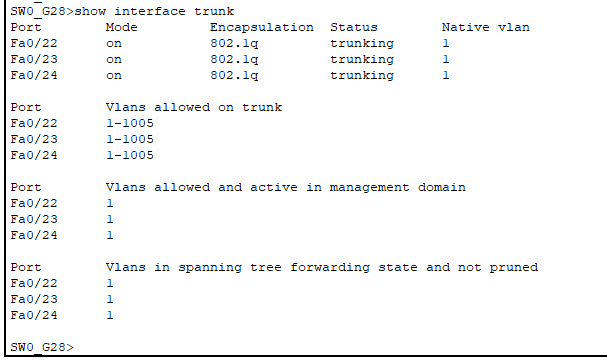

- Edificio Izquierdo (Ejemplo en SW3_G28):

  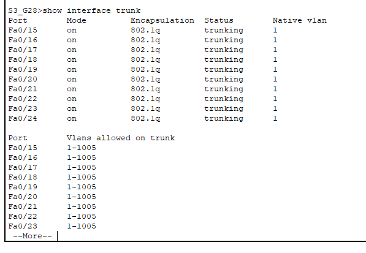

- Edificio Derecho (Ejemplo en SW(0)1_G28):

  

- Edificio Derecho (Ejemplo en SW(4)1_G28):

  

### 9.2 Configuración del Protocolo VTP (VLAN Trunking Protocol)

Se implementó el protocolo VTP versión 2 para centralizar la administración de la base de datos de VLANs. Esto permite crear las VLANs únicamente en los switches de distribución y que se propaguen automáticamente a la capa de acceso, reduciendo errores humanos y garantizando la consistencia de la red.

**Parámetros de Configuración:**

| Parámetro   | Valor configurado | Descripción                                                          |
| ----------- | ----------------- | -------------------------------------------------------------------- |
| Dominio VTP | `redes2_G28`      | Identificador único del dominio administrativo.                      |
| Contraseña  | `redes2grupo28`   | Clave MD5 para evitar que switches no autorizados alteren las VLANs. |
| Versión     | `2`               | Versión por defecto compatible con la infraestructura actual.        |

**Roles Asignados**
Para cumplir con el diseño jerárquico y proteger la red, se asignaron los siguientes roles:

1. **Modo Server:** Únicamente en los switches principales de cada edificio. Tienen permiso para crear, eliminar y modificar VLANs.

- Edificio Izquierdo: Switch0 (SW0_G28)

- Edificio Derecho: Switch(0)1 (SW(0)1_G28)

2. **Modo Client:** En todos los switches de acceso y distribución secundaria. Estos dispositivos solo escuchan y replican la configuración de VLANs recibida del servidor, sin posibilidad de alterar la base de datos localmente.

- Dispositivos: Resto de switches (SW1_G28, SW2_G28, SW11_G28, etc.).

**Comandos Implementados:**
**En Switches Servidores (Switch0 y Switch(0)1):**

```bash
configure terminal
vtp domain G28
vtp password redes2grupo28
vtp mode server
copy running-config startup-config
```

**En Switches Clientes (Todos los demás switches):**

```bash
configure terminal
vtp domain G28
vtp password redes2grupo28
vtp mode client
copy running-config startup-config
```

**Verificación de VTP:**

Para verificar la correcta configuración y propagación de VLANs mediante VTP, se utilizó el comando `show vtp status` en cada switch, confirmando que el dominio, contraseña, versión y modo están correctamente configurados.

- Edificio Izquierdo (Ejemplo en SW0_G28 - Servidor):

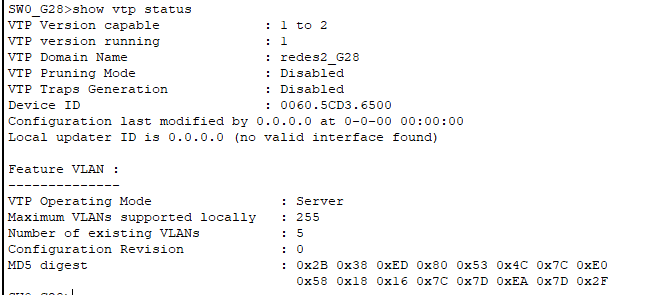

- Edificio Izquierdo (Ejemplo en SW4_G28 - Cliente):

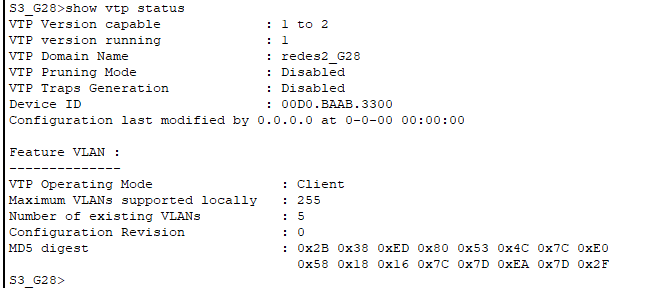

- Edificio Derecho (Ejemplo en SW(0)1_G28 - Servidor):


- Edificio Derecho (Ejemplo en SW(3)1_G28 - Cliente):


### 9.3 Creación y Asignación de VLANs

Se procedió a la creación de las VLANs en los switches servidores VTP. Gracias a la configuración previa, estas se replicaron automáticamente a los switches de acceso, donde finalmente se asignaron los puertos correspondientes a los dispositivos finales.

#### VLANs Creadas - Edificio Izquierdo

**(Configuradas en SW0_G28)**

- **VLAN 11:** PRIMARIA
- **VLAN 21:** BASICOS
- **VLAN 31:** BACHILLERATO

#### VLANs Creadas - Edificio Derecho

**(Configuradas en SW(0)1_G28)**

- **VLAN 61:** PRIMARIA
- **VLAN 71:** BASICOS
- **VLAN 81:** BACHILLERATO

**En Edificio Izquierdo (Switch0 / SW0_G28):**

```bash
enable
configure terminal
vlan 11
name PRIMARIA
exit
vlan 21
name BASICOS
exit
vlan 31
name BACHILLERATO
exit
copy running-config startup-config
```

**En Edificio Derecho (Switch(0)1 / SW(0)1_G28):**

```bash
enable
configure terminal
vlan 61
name PRIMARIA
exit
vlan 71
name BASICOS
exit
vlan 81
name BACHILLERATO
exit
copy running-config startup-config
```

#### Evidencia de Propagación

Se verificó en los switches de borde que las VLANs fueron recibidas correctamente mediante VTP, gracias al comando `show vlan brief`, confirmando que todas las VLANs creadas en los servidores están presentes en los clientes.

- Edificio Izquierdo (Ejemplo en SW4_G28):

  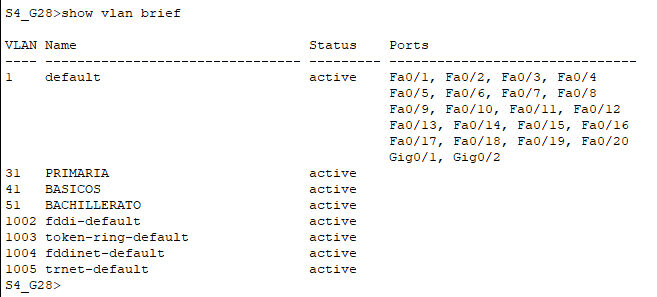

- Edificio Derecho (Ejemplo en SW(3)1_G28):
  

#### Asignación de Puertos de Acceso

Se configuraron las interfaces de red que conectan a los dispositivos finales en modo `access` y se asignaron a las VLANs correspondientes según la segmentación lógica (Primaria, Básicos, Bachillerato) y la ubicación física (Puerto Fa0/22 o Fa0/23).

#### Tabla de Asignación - Edificio Izquierdo

| Dispositivo  | Interfaz | Equipo Final | Perfil/VLAN Asignada   |
| :----------- | :------- | :----------- | :--------------------- |
| **SW7_G28**  | Fa0/22   | PC1          | Básicos (VLAN 21)      |
| **SW6_G28**  | Fa0/22   | PC2          | Bachillerato (VLAN 31) |
| **SW8_G28**  | Fa0/23   | Laptop1      | Bachillerato (VLAN 31) |
| **SW9_G28**  | Fa0/22   | PC4          | Primaria (VLAN 11)     |
| **SW10_G28** | Fa0/22   | PC5          | Primaria (VLAN 11)     |

**1. Switch7 (SW7_G28) - PC1 (Básicos - VLAN 21)**

```bash
enable
configure terminal
interface fa0/22
switchport mode access
switchport access vlan 21
exit
copy running-config startup-config
```

**2. Switch6 (SW6_G28) - PC2 (Bachillerato - VLAN 31)**

```bash
enable
configure terminal
interface fa0/22
switchport mode access
switchport access vlan 31
exit
copy running-config startup-config
```

**3. Switch8 (SW8_G28) - Laptop1 (Bachillerato - VLAN 31)**

```bash
enable
configure terminal
interface fa0/23
switchport mode access
switchport access vlan 31
exit
copy running-config startup-config
```

**4. Switch9 (SW9_G28) - PC4 (Primaria - VLAN 11)**

```bash
enable
configure terminal
interface fa0/22
switchport mode access
switchport access vlan 11
exit
copy running-config startup-config
```

**5. Switch10 (SW10_G28) - PC5 (Primaria - VLAN 11)**

```bash
enable
configure terminal
interface fa0/22
switchport mode access
switchport access vlan 11
exit
copy running-config startup-config
```

#### Tabla de Asignación - Edificio Derecho

| Dispositivo     | Interfaz | Equipo Final | Perfil/VLAN Asignada   |
| :-------------- | :------- | :----------- | :--------------------- |
| **SW(6)1_G28**  | Fa0/22   | PC6          | Bachillerato (VLAN 81) |
| **SW(7)1_G28**  | Fa0/22   | PC7          | Básicos (VLAN 71)      |
| **SW(8)1_G28**  | Fa0/23   | Laptop2      | Básicos (VLAN 71)      |
| **SW(9)1_G28**  | Fa0/22   | PC3          | Primaria (VLAN 61)     |
| **SW(10)1_G28** | Fa0/22   | PC8          | Primaria (VLAN 61)     |

**1. Switch(6)1 (SW(6)1_G28) - PC6 (Bachillerato - VLAN 81)**

```bash
enable
configure terminal
interface fa0/22
switchport mode access
switchport access vlan 81
exit
copy running-config startup-config
```

**2. Switch(7)1 (SW(7)1_G28) - PC7 (Básicos - VLAN 71)**

```bash
enable
configure terminal
interface fa0/22
switchport mode access
switchport access vlan 71
exit
copy running-config startup-config
```

**3. Switch(8)1 (SW(8)1_G28) - Laptop2 (Básicos - VLAN 71)**

```bash
enable
configure terminal
interface fa0/23
switchport mode access
switchport access vlan 71
exit
copy running-config startup-config
```

**4. Switch(9)1 (SW(9)1_G28) - PC3 (Primaria - VLAN 61)**

```bash
enable
configure terminal
interface fa0/22
switchport mode access
switchport access vlan 61
exit
copy running-config startup-config
```

**5. Switch(10)1 (SW(10)1_G28) - PC8 (Primaria - VLAN 61)**

```bash
enable
configure terminal
interface fa0/22
switchport mode access
switchport access vlan 61
exit
copy running-config startup-config
```

#### Verificación de Asignación

Para verificar que los puertos de acceso están correctamente asignados a las VLANs, se utilizó el comando `show vlan brief` en cada switch, confirmando que las interfaces correspondientes están en modo access y asignadas a la VLAN correcta.

- Edificio Izquierdo (Ejemplo en SW9_G28):

  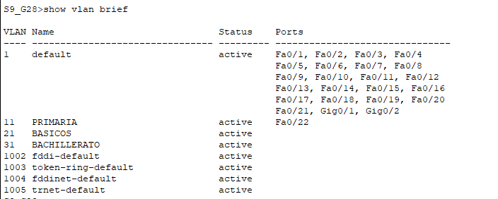

- Edificio Derecho (Ejemplo en SW(7)1_G28):
  

#### Direccionamiento IP - Edificio Izquierdo

A continuación se presenta la tabla de direccionamiento IP asignada a los dispositivos finales del Edificio Izquierdo:

| Dispositivo | VLAN (ID)          | Dirección IP   | Máscara de Subred | Default Gateway |
| :---------- | :----------------- | :------------- | :---------------- | :-------------- |
| PC4         | Primaria (11)      | 192.178.11.10  | 255.255.255.0     | 192.178.11.1    |
| PC5         | Primaria (11)      | 192.178.11.11  | 255.255.255.0     | 192.178.11.1    |
| PC1         | Básicos (21)       | 192.178.21.10  | 255.255.255.0     | 192.178.21.1    |
| PC2         | Bachillerato (31)  | 192.178.31.10  | 255.255.255.0     | 192.178.31.1    |
| Laptop1     | Bachillerato (31)  | 192.178.31.11  | 255.255.255.0     | 192.178.31.1    |

#### Direccionamiento IP - Edificio Derecho

A continuación se presenta la tabla de direccionamiento IP asignada a los dispositivos finales del Edificio Derecho:

| Dispositivo | VLAN (ID)          | Dirección IP   | Máscara de Subred | Default Gateway |
| :---------- | :----------------- | :------------- | :---------------- | :-------------- |
| PC3         | Primaria (61)      | 192.178.61.10  | 255.255.255.0     | 192.178.61.1    |
| PC8         | Primaria (61)      | 192.178.61.11  | 255.255.255.0     | 192.178.61.1    |
| PC7         | Básicos (71)       | 192.178.71.10  | 255.255.255.0     | 192.178.71.1    |
| Laptop2     | Básicos (71)       | 192.178.71.11  | 255.255.255.0     | 192.178.71.1    |
| PC6         | Bachillerato (81)  | 192.178.81.10  | 255.255.255.0     | 192.178.81.1    |

### 9.4 Seguridad de Puertos (Port Security)

Siguiendo las políticas de seguridad establecidas, se configuró `port-security` en las interfaces de acceso pertenecientes a la VLAN de **Básicos**. Esta medida previene que usuarios no autorizados conecten dispositivos ajenos a la red o utilicen hubs para extender la red.

#### Políticas Aplicadas

1.  **Activación:** Se habilitó la seguridad en el puerto.
2.  **Límite:** Máximo **1 dirección MAC** permitida por puerto.
3.  **Aprendizaje:** Se configuró `mac-address sticky` para que el switch aprenda la MAC del dispositivo legítimo conectado actualmente y la guarde en la configuración.
4.  **Acción de Violación:** Modo `shutdown`. Si se detecta una MAC diferente o más de una, el puerto se apagará automáticamente.

#### Puertos Protegidos

| Edificio  | Dispositivo | Interfaz | VLAN         | Equipo Autorizado |
| :-------- | :---------- | :------- | :----------- | :---------------- |
| Izquierdo | SW7_G28     | Fa0/22   | 21 (Básicos) | PC1               |
| Derecho   | SW(7)1_G28  | Fa0/22   | 71 (Básicos) | PC7               |
| Derecho   | SW(8)1_G28  | Fa0/23   | 71 (Básicos) | Laptop2           |

#### Comandos Utilizados

**Configuración en Edificio Izquierdo**

**1. En Switch7 (SW7_G28)**

```bash
enable
configure terminal
interface fa0/22
switchport mode access
switchport port-security
switchport port-security maximum 1
switchport port-security violation shutdown
switchport port-security mac-address sticky
exit
do write memory
```

**Configuración en Edificio Derecho**

**2. En Switch(7)1 (SW(7)1_G28)**

```bash
enable
configure terminal
interface fa0/22
switchport mode access
switchport port-security
switchport port-security maximum 1
switchport port-security violation shutdown
switchport port-security mac-address sticky
exit
do write memory
```

**3. En Switch(8)1 (SW(8)1_G28)**

```bash
enable
configure terminal
interface fa0/23
switchport mode access
switchport port-security
switchport port-security maximum 1
switchport port-security violation shutdown
switchport port-security mac-address sticky
exit
do write memory
```

#### Verificación de Port Security

Para verificar la correcta configuración de `port-security`, se utilizó el comando `show port-security interface [interfaz]` en cada switch, confirmando que la seguridad está habilitada, el límite de MACs es correcto, la acción de violación es `shutdown` y que la MAC del dispositivo autorizado ha sido aprendida y guardada.

- Edificio Izquierdo (Ejemplo en SW7_G28):

  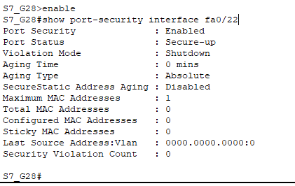

- Edificio Derecho (Ejemplo en SW(7)1_G28):

  

- Edificio Derecho (Ejemplo en SW(8)1_G28):

  


## 10. Configuración de STP (Spanning Tree Protocol)

### 10.1 Introducción general a STP

El Protocolo del Árbol de Expansión (STP) es esencial para garantizar la redundancia de la red sin introducir bucles de capa 2, que causan tormentas de broadcast y congestionamiento. Para esta práctica se implementaron dos versiones del protocolo en los edificios:

- **PVST (Per-VLAN Spanning Tree):** Versión tradicional que calcula un árbol de expansión independiente por cada VLAN, permitiendo un control más granular pero con tiempos de convergencia más lentos.
- **Rapid PVST (Rapid Per-VLAN Spanning Tree):** Versión mejorada basada en el estándar 802.1w que reduce significativamente los tiempos de convergencia utilizando un mecanismo de negociación Proposal/Agreement.

### 10.2 Edificio Izquierdo: PVST (Per-VLAN Spanning Tree)

En el Edificio Izquierdo se implementó PVST para evaluar el comportamiento de convergencia del protocolo tradicional. La topología designa un Root Bridge principal que coordina el árbol de expansión para todas las VLANs del edificio.

#### Parámetros de Configuración - Edificio Izquierdo

| Parámetro            | Valor                          | Descripción                                                                    |
| -------------------- | ------------------------------ | ------------------------------------------------------------------------------ |
| Modo STP             | PVST                           | Protocolo de árbol de expansión estándar por VLAN                             |
| Root Bridge Primario | Switch0 (SW0_G28)              | Coordina el árbol de todas las VLANs (11, 21, 31)                             |
| Root Bridge Secundario | Switch1 (SW1_G28)            | Asume la función si el primario falla                                         |
| VLANs Protegidas     | 11 (Primaria), 21 (Básicos), 31 (Bachillerato) | Cada una con su árbol independiente |

#### Roles Asignados - Edificio Izquierdo

1. **Switch0 (SW0_G28) - Root Bridge Primario:** Principal responsable del árbol de expansión. Como está conectado directamente al Router0, tiene la mejor posición para coordinar la topología.

2. **Switch1 (SW1_G28) - Root Bridge Secundario:** Actúa como respaldo de redundancia. Si el Switch0 falla, este asume automáticamente la función de Root Bridge.

3. **Demás Switches:** Operan en modo PVST estándar, calculando puertos Root, Designados y Bloqueados según el árbol generado.

#### Comandos Implementados

**En el Switch Principal (SW0_G28):**

```bash
enable
configure terminal
spanning-tree mode pvst
spanning-tree vlan 11,21,31 root primary
exit
copy running-config startup-config
```

**En el Switch Secundario (SW1_G28):**

Este switch actuará como respaldo de redundancia, asumiendo el rol de Root Bridge en caso de que el primario falle.

```bash
enable
configure terminal
spanning-tree mode pvst
spanning-tree vlan 11,21,31 root secondary
exit
copy running-config startup-config
```

**En todos los demás switches del Edificio Izquierdo:**

```bash
enable
configure terminal
spanning-tree mode pvst
exit
copy running-config startup-config
```

### 10.3 Edificio Derecho: Rapid-PVST

En el Edificio Derecho se implementó Rapid PVST para demostrar la mejora de convergencia en escenarios de redundancia. Este protocolo es superior en términos de tiempo de recuperación ante fallos de enlaces.

#### Parámetros de Configuración - Edificio Derecho

| Parámetro            | Valor                          | Descripción                                                                    |
| -------------------- | ------------------------------ | ------------------------------------------------------------------------------ |
| Modo STP             | Rapid PVST                     | Protocolo mejorado con convergencia rápida (estándar 802.1w)                  |
| Root Bridge Primario | Switch(0)1 (SW(0)1_G28)        | Coordina el árbol de todas las VLANs (61, 71, 81)                             |
| Root Bridge Secundario | Switch(1)1 (SW(1)1_G28)      | Asume la función si el primario falla                                         |
| VLANs Protegidas     | 61 (Primaria), 71 (Básicos), 81 (Bachillerato) | Cada una con su árbol independiente |
| Mecanismo de Convergencia | Proposal/Agreement           | Negociación punto a punto para activación rápida de puertos               |

#### Roles Asignados - Edificio Derecho

1. **Switch(0)1 (SW(0)1_G28) - Root Bridge Primario:** Principal responsable del árbol de expansión rápido. Como está conectado directamente al Router3, tiene la mejor posición para coordinar la topología.

2. **Switch(1)1 (SW(1)1_G28) - Root Bridge Secundario:** Actúa como respaldo de redundancia. Ante una falla del primario, asume automáticamente el rol de Root Bridge.

3. **Demás Switches:** Operan en modo Rapid PVST con negociación directa, permitiendo transiciones de puerto bloc al estado forwarding sin pasar por estados intermedios.

#### Comandos Implementados

**En el Switch Principal (SW(0)1_G28):**

```bash
enable
configure terminal
spanning-tree mode rapid-pvst
spanning-tree vlan 61,71,81 root primary
exit
copy running-config startup-config
```

**En el Switch Secundario (SW(1)1_G28):**

Este switch actuará como respaldo de redundancia, asumiendo el rol de Root Bridge en caso de que el primario falle.

```bash
enable
configure terminal
spanning-tree mode rapid-pvst
spanning-tree vlan 61,71,81 root secondary
exit
copy running-config startup-config
```

**En todos los demás switches del Edificio Derecho:**

```bash
enable
configure terminal
spanning-tree mode rapid-pvst
exit
copy running-config startup-config
```


### 10.4 Estudio Comparativo de Convergencia

Para validar la efectividad de ambos protocolos y demostrar las ventajas del Rapid PVST, se realizaron pruebas de convergencia simulando la caída controlada de enlaces troncales principales. El objetivo fue medir el tiempo que tarda cada protocolo en recalcular la topología y restaurar el tráfico de usuarios a través de rutas redundantes.

#### 10.4.1 Pruebas en Edificio Izquierdo (PVST)

**Resultados de Convergencia - PVST**

| Protocolo | Enlace Abatido | Tiempo de Recuperación | Estado Final |
| :--- | :--- | :--- | :--- |
| **PVST** | Troncal Principal (SW3_G28 - SW1_G28) | **~42 segundos** | Convergencia exitosa con recuperación de conectividad |


**Metodología de prueba:**

- Se identificó un puerto en estado Blocking (Naranja) en la capa de acceso.

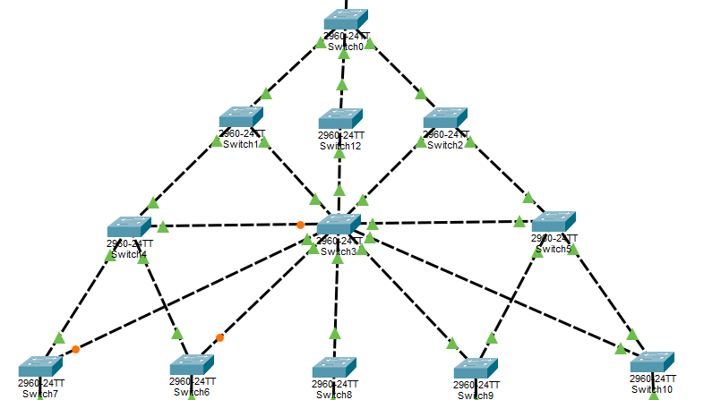

- Se inició un ping continuo entre dos hosts de la misma VLAN (en este caso entre PC4 y PC5, ambos en VLAN 11 - Primaria) para monitorear la conectividad.

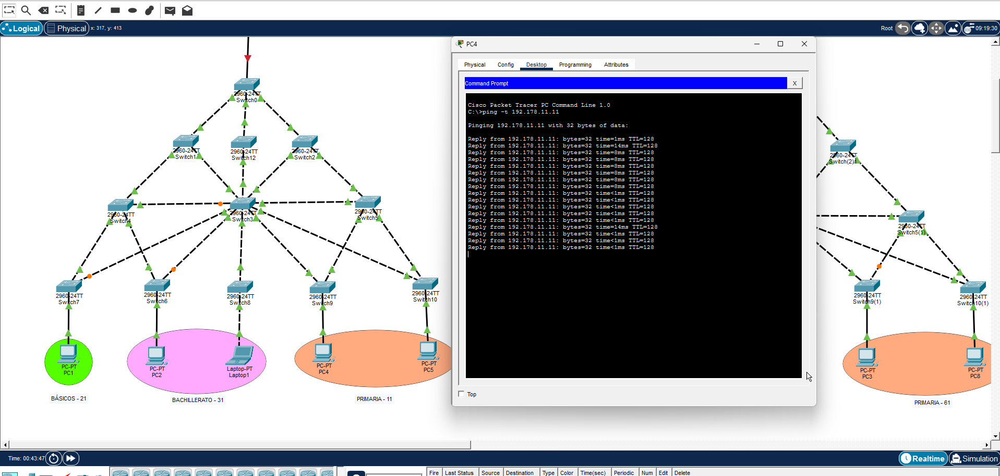

- Se desconectó físicamente el enlace Forwarding (Verde) principal.

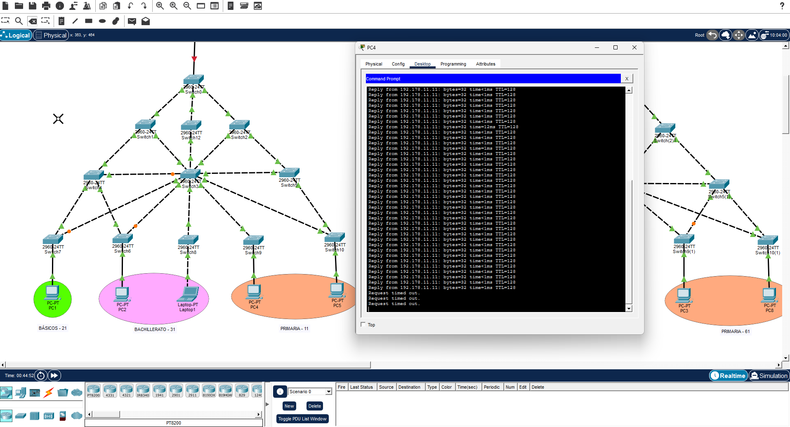


- Se cronometró el tiempo desde la desconexión hasta la recuperación de la conectividad (cuando el puerto bloqueado se activó en estado Forwarding). El protocolo PVST tardó aproximadamente **42 segundos** en recalcular la topología y restaurar el tráfico. 

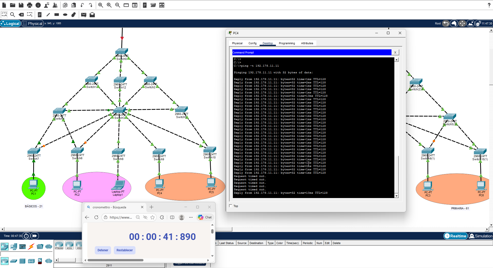

#### 10.4.2 Pruebas en Edificio Derecho (Rapid-PVST)

**Resultados de Convergencia - Rapid PVST**

| Protocolo | Enlace Abatido | Tiempo de Recuperación | Estado Final |
| :--- | :--- | :--- | :--- |
| **Rapid-PVST** | Troncal Principal (SW(4)1_G28 - SW(1)1_G28) | **< 1 segundo** | Convergencia inmediata sin pérdida notable de conectividad |


**Metodología de prueba:**

- Se identificó un puerto en estado Blocking (Naranja) en la capa de acceso.

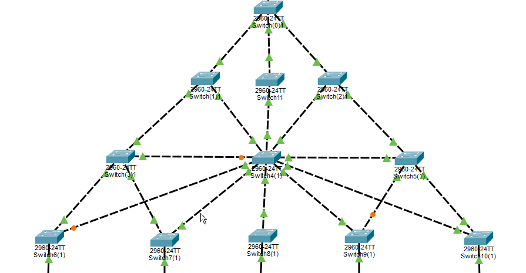

- Se inició un ping continuo entre dos hosts de la misma VLAN (en este caso entre PC3 y PC8, ambos en VLAN 61 - Primaria) para monitorear la conectividad.

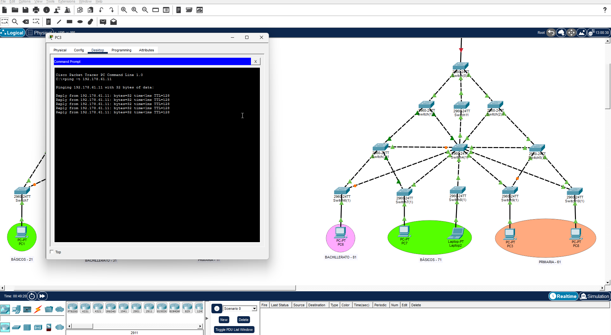

- Se desconectó físicamente el enlace Forwarding (Verde) principal.

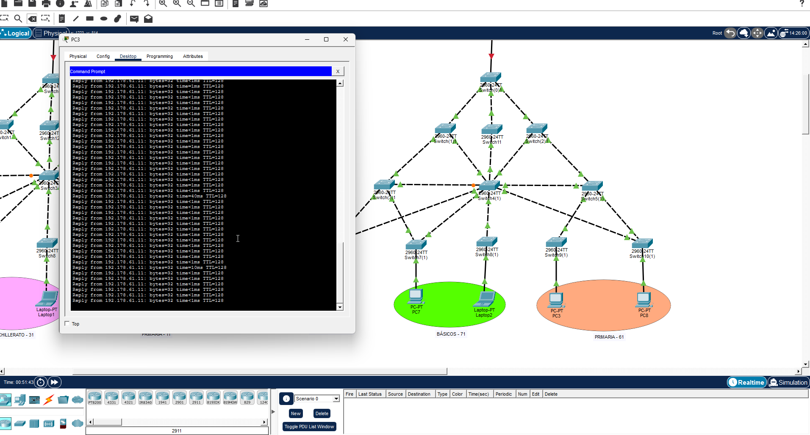

- Se cronometró el tiempo desde la desconexión hasta la recuperación de la conectividad. El protocolo Rapid-PVST mostró una convergencia casi instantánea, con un tiempo menor a **1 segundo** (prácticamente imperceptible), demostrando la efectividad del mecanismo de negociación Proposal/Agreement.

### 10.5 Análisis Comparativo y Justificación Técnica

Tras realizar las pruebas en ambos escenarios, se observa una diferencia crítica en el rendimiento:

| Escenario | Tiempo Promedio | Calificación |
| :--- | :--- | :--- |
| **PVST (Izquierda)** | ~40 - 50 seg | Lento |
| **Rapid-PVST (Derecha)** | 0 - 2 seg | Óptimo |

**¿Por qué ocurre esta diferencia?**

1.  **Edificio Izquierdo (PVST):** Este protocolo utiliza el algoritmo estándar de STP (802.1D) con tiempos conservadores de convergencia. Cuando el switch detecta un cambio de topología, el puerto designado de respaldo no se activa inmediatamente. Debe transitar obligatoriamente por los estados intermedios de **Listening** (15 segundos) y **Learning** (15 segundos) antes de alcanzar el estado **Forwarding**. Sumado al tiempo de detección del cambio de topología (Max Age de 20 segundos aproximadamente), el total acumulado justifica los ~42 segundos observados en la prueba.

2.  **Edificio Derecho (Rapid-PVST):** La versión mejorada basada en 802.1w elimina completamente los temporizadores de escucha y aprendizaje. Implementa un mecanismo inteligente de negociación denominado **Proposal/Agreement** (Propuesta y Acuerdo). Al detectar un cambio de topología, el switch negocia directamente con sus vecinos punto a punto. Si el enlace de respaldo es confirmado como punto a punto y seguro, el puerto se desbloquea automáticamente sin pasar por estados intermedios, logrando convergencia prácticamente instantánea (< 1 segundo).

### 10.6 Conclusión y Recomendación Final

Tras completar las pruebas de convergencia y analizar el comportamiento de ambos protocolos en escenarios de redundancia, los resultados demuestran una diferencia crítica en el rendimiento:

**Recomendación:** Se valida la implementación de **Rapid-PVST en el Edificio Derecho** como la solución superior para este entorno educativo.

**Justificación Técnica:**

En un contexto de educación formal como el Colegio Monte Alto, la continuidad de servicio es fundamental:

- Una interrupción de 40 segundos (PVST) sería catastrófica para:
  - Exámenes en línea (pérdida de sesión, retraso importante)
  - Videoconferencias de clases en tiempo real (desconexión de estudiantes)
  - Transferencias de datos críticas (posible corrupción)
  - Sistemas de aprendizaje virtual (desconexión de usuarios)

- Rapid-PVST ofrece:
  - **Convergencia instantánea** (< 1 segundo): El usuario final no percibe la falla
  - **Alta disponibilidad transparente**: La red se recupera automáticamente sin intervención
  - **Resiliencia sin impacto**: Fallos físicos de cables u equipos no afectan la experiencia educativa
  - **Escalabilidad**: Mejor desempeño en redes complejas con múltiples VLANs

Por lo tanto, **Rapid-PVST es la solución recomendada para garantizar la máxima disponibilidad de la infraestructura de red del Colegio Monte Alto**.