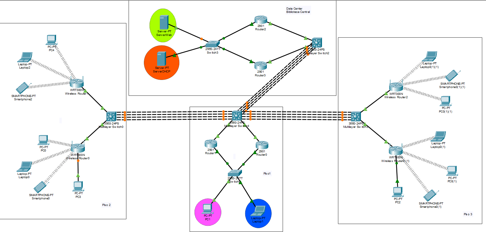
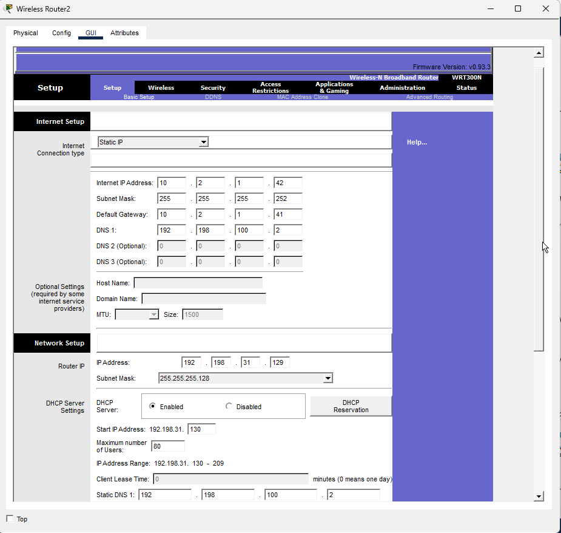
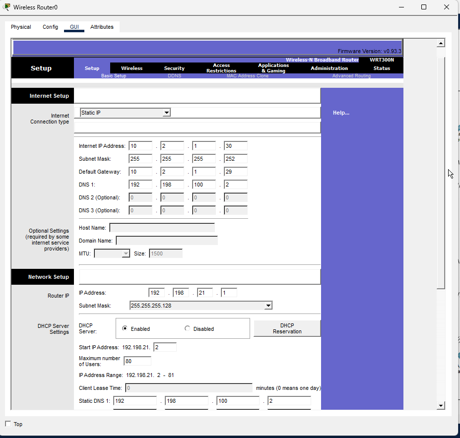
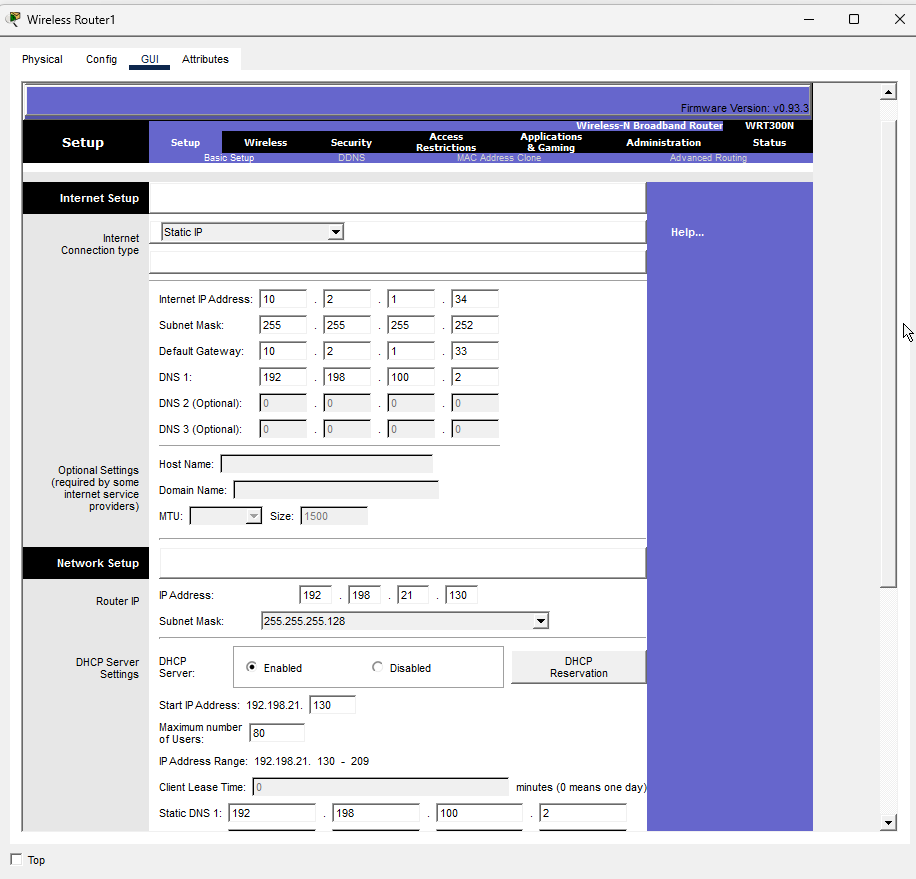

# Práctica 2: La Facultad de Ingeniería y su Problema de Conectividad en la Biblioteca

**Universidad San Carlos de Guatemala**
**Facultad de Ingeniería**
**Ingeniería en Ciencias y Sistemas**
**Curso: Redes de Computadoras 2**

## Datos del Grupo

| Campo            | Detalle    |
| ---------------- | ---------- |
| Número de Grupo  | 28         |
| Fecha de Entrega | 10/04/2026 |

## Integrantes

| No. | Nombre Completo                  | Carné       |
| --- | -------------------------------- | ----------- |
| 1   | _David Estuardo Barrios Ramírez_ | _202300670_ |
| 2   | _Marcos Daniel Bonifasi de Leon_ | _202202410_ |
| 3   | _Enner Esaí Mendizabal Castro_   | _202302220_ |

## Índice

- [1. Introducción](#1-introducción)
- [2. Objetivos](#2-objetivos)
- [3. Descripción del Problema](#3-descripción-del-problema)
- [4. Topología Propuesta](#4-topología-propuesta)
- [5. Subnetting](#5-subnetting)
- [6. Configuración de VLANs](#6-configuración-de-vlans)
- [7. Configuración DHCP](#7-configuración-dhcp)
- [8. Configuración Inalámbrica](#8-configuración-inalámbrica)
- [9. Configuración DNS y Servidor Web](#9-configuración-dns-y-servidor-web)
- [10. Configuración OSPF](#10-configuración-ospf)
- [11. Configuración LACP](#11-configuración-lacp)
- [12. Configuración HSRP](#12-configuración-hsrp)
- [13. Comandos de Verificación](#13-comandos-de-verificación)
- [14. Pruebas de Conectividad](#14-pruebas-de-conectividad)
- [15. Notas Importantes](#15-notas-importantes)

---

## 1. Introducción

La Facultad de Ingeniería de la Universidad de San Carlos de Guatemala (USAC) atraviesa un proceso de modernización de su infraestructura tecnológica, impulsado por el crecimiento continuo de su población estudiantil y la creciente demanda de servicios digitales dentro del campus. En este contexto, el edificio de la biblioteca representa un área crítica que requiere atención inmediata.

La presente práctica documenta el diseño, configuración e implementación de una nueva topología de red para el edificio de la biblioteca de ingeniería, desarrollada en el simulador **Cisco Packet Tracer**.

> **Nota sobre el número de grupo:** Según el manual de práctica, para grupos de 2 dígitos se debe realizar la suma de ambos hasta obtener un solo dígito. Para el Grupo 28: 2 + 8 = 10 → 1 + 0 = **X = 1**. Por lo tanto, todas las referencias a "GX" en este documento corresponden a **G1**.

## 2. Objetivos

### 2.1 Objetivo General

Diseñar e implementar una infraestructura de red completa para el edificio de la biblioteca de la Facultad de Ingeniería de la USAC, garantizando alta disponibilidad, seguridad y escalabilidad.

### 2.2 Objetivos Específicos

- Configurar la red cableada del primer piso con VLANs diferenciadas para administración y estudiantes.
- Implementar zonas de acceso inalámbrico seguras en el segundo y tercer piso mediante routers inalámbricos con WPA2 Personal.
- Configurar un servidor DHCP centralizado en el Data Center.
- Implementar un servidor Web con servicios DNS y HTTP.
- Configurar el protocolo de enrutamiento dinámico OSPF.
- Establecer enlaces LACP de 4 interfaces entre cada par de edificios.
- Configurar HSRP en el primer piso y en el Data Center para redundancia de gateway.

## 3. Descripción del Problema

La biblioteca de la Facultad de Ingeniería de la USAC presenta deficiencias críticas en su infraestructura de red:

- Falta de cobertura inalámbrica en los pisos superiores.
- Ausencia de redundancia en los dispositivos de enrutamiento.
- Segmentación inadecuada de la red.
- Servicios centralizados inexistentes.
- Ancho de banda insuficiente entre edificios.

## 4. Topología Propuesta



## 5. Subnetting

### 5.1 Resumen de Redes Asignadas (X = 1)

> **Cálculo de X:** Para el Grupo 28: 2 + 8 = 10 → 1 + 0 = **X = 1**

| Red          | Dirección Base   | Uso                                |
| ------------ | ---------------- | ---------------------------------- |
| Piso 1       | 192.198.11.0/24 | Red cableada (ADMIN + ESTUDIANTES) |
| Piso 2       | 192.198.21.0/24 | Red inalámbrica (WLAN1 + WLAN2)    |
| Piso 3       | 192.198.31.0/24 | Red inalámbrica (WLAN1 + WLAN2)    |
| Data Center  | 192.198.100.0/24 | Servidores (WEB + DHCP)            |
| Enrutamiento | 10.2.1.0/24     | Enlaces entre routers y switches   |

### 5.2 Piso 1 — VLSM (192.198.11.0/24)

> Se aplica VLSM para aprovechar el espacio: primero la subred más grande (ESTUDIANTES/60 hosts), luego ADMIN (10 hosts).

| VLAN | Nombre      | Hosts Requeridos | Subred Asignada    | Máscara         | Rango Usable                     | Broadcast       |
| ---- | ----------- | ---------------- | ------------------ | --------------- | -------------------------------- | --------------- |
| 21   | ESTUDIANTES | 60               | 192.198.11.0/25   | 255.255.255.128 | 192.198.11.1 – 192.198.11.126   | 192.198.11.127  |
| 11   | ADMIN       | 10               | 192.198.11.128/27 | 255.255.255.224 | 192.198.11.129 – 192.198.11.158 | 192.198.11.159  |

> **Distribución de IPs Piso 1:**
> - VLAN 21: .1(HSRP), .2(R0), .3(R1) reservadas | **.4 - .126 → DHCP (123 hosts)**
> - VLAN 11: .129(HSRP), .130(R1), .131(R0) reservadas | **.132 - .158 → DHCP (27 hosts)**
>
> Con la arquitectura actual, las IPs .132-.137 ya no se reservan para infraestructura (Multilayer Switch0/Multilayer Switch3 usan el espacio 10.2.1.x). El pool DHCP ADMIN puede arrancar directamente en .132.

### 5.3 Piso 2 — FLSM (192.198.21.0/24)

| WLAN  | Hosts | Subred Asignada    | Máscara         | Rango DHCP              |
| ----- | ----- | ------------------ | --------------- | ------------------------ |
| WLAN1 | 80    | 192.198.21.0/25   | 255.255.255.128 | .2 - .126 (125 hosts)   |
| WLAN2 | 80    | 192.198.21.128/25 | 255.255.255.128 | .130 - .254 (125 hosts) |

### 5.4 Piso 3 — FLSM (192.198.31.0/24)

| WLAN  | Hosts | Subred Asignada    | Máscara         | Rango DHCP              |
| ----- | ----- | ------------------ | --------------- | ------------------------ |
| WLAN1 | 80    | 192.198.31.0/25   | 255.255.255.128 | .2 - .126 (125 hosts)   |
| WLAN2 | 80    | 192.198.31.128/25 | 255.255.255.128 | .130 - .254 (125 hosts) |

### 5.5 Data Center — FLSM (192.198.100.0/24)

> La red 192.198.100.0/24 se divide en 2 partes iguales (/25) para WEB_SERVERS y DHCP_SERVERS.

| VLAN | Nombre       | Subred Asignada    | Máscara         | IPs Reservadas                             |
| ---- | ------------ | ------------------ | --------------- | ------------------------------------------ |
| 31   | WEB_SERVERS  | 192.198.100.0/25  | 255.255.255.128 | .1(HSRP), .2(ServerWeb), .3(R2), .4(R3)  |
| 41   | DHCP_SERVERS | 192.198.100.128/25 | 255.255.255.128 | .129(HSRP), .130(ServerDHCP), .131(R2), .132(R3) |

### 5.6 Red de Enrutamiento — 10.2.1.0/24 (VLSM con /30)

| Enlace                                   | Subred         | IP A              | IP B              |
| ---------------------------------------- | -------------- | ----------------- | ----------------- |
| R2 ↔ Multilayer Switch2                         | 10.2.1.0/30   | .1 (R2)          | .2 (Multilayer Switch2)  |
| R3 ↔ Multilayer Switch2                         | 10.2.1.4/30   | .5 (R3)          | .6 (Multilayer Switch2)  |
| Multilayer Switch4 ↔ R1                         | 10.2.1.8/30   | .9 (Multilayer Switch4) | .10 (R1)          |
| Multilayer Switch4 ↔ R0                         | 10.2.1.12/30  | .13 (Multilayer Switch4) | .14 (R0)         |
| Multilayer Switch4 ↔ Multilayer Switch0 (Piso 2) | 10.2.1.16/30 | .17 (Multilayer Switch4) | .18 (Multilayer Switch0) |
| Multilayer Switch4 ↔ Multilayer Switch3 (Piso 3) | 10.2.1.20/30 | .21 (Multilayer Switch4) | .22 (Multilayer Switch3) |
| Multilayer Switch4 ↔ Multilayer Switch2 (Data Center) | 10.2.1.24/30 | .25 (Multilayer Switch4) | .26 (Multilayer Switch2) |
| **Multilayer Switch0 ↔ WRT300N Piso2-R1 (WLAN1)** | **10.2.1.28/30** | **.29 (Multilayer Switch0)** | **.30 (WRT-P2R1)** |
| **Multilayer Switch0 ↔ WRT300N Piso2-R2 (WLAN2)** | **10.2.1.32/30** | **.33 (Multilayer Switch0)** | **.34 (WRT-P2R2)** |
| **Multilayer Switch3 ↔ WRT300N Piso3-R1 (WLAN1)** | **10.2.1.36/30** | **.37 (Multilayer Switch3)** | **.38 (WRT-P3R1)** |
| **Multilayer Switch3 ↔ WRT300N Piso3-R2 (WLAN2)** | **10.2.1.40/30** | **.41 (Multilayer Switch3)** | **.42 (WRT-P3R2)** |

> **Por qué subredes separadas por WRT300N:** Cada WRT300N necesita un gateway propio y único. Usar un gateway en 192.198.11.128/27 (la subred de Piso 1) causaba que los WRT300Ns apuntaran a la HSRP VIP (.129) pero esa IP sólo se anuncia en el segmento L2 de Switch0 (Piso 1). Multilayer Switch0 y Multilayer Switch3 están en un segmento L2 completamente diferente. El ARP para .129 nunca se respondía desde Multilayer Switch0, dejando a los WRT300Ns sin conectividad con su gateway.

## 6. Configuración de VLANs

| VLAN ID | Nombre       | Segmento                    |
| ------- | ------------ | --------------------------- |
| 11      | ADMIN        | Administración — Piso 1     |
| 21      | ESTUDIANTES  | Estudiantes — Piso 1        |
| 31      | WEB_SERVERS  | Servidor Web — Data Center  |
| 41      | DHCP_SERVERS | Servidor DHCP — Data Center |

### 6.1 Switch3 (Data Center)

```bash
enable
configure terminal

vlan 31
name WEB_SERVERS
exit

vlan 41
name DHCP_SERVERS
exit

! ServerWeb
interface FastEthernet0/24
switchport mode access
switchport access vlan 31
no shutdown
exit

! ServerDHCP
interface FastEthernet0/23
switchport mode access
switchport access vlan 41
no shutdown
exit

! Trunk hacia R2
interface GigabitEthernet0/1
switchport mode trunk
switchport trunk allowed vlan 31,41
no shutdown
exit

! Trunk hacia R3
interface GigabitEthernet0/2
switchport mode trunk
switchport trunk allowed vlan 31,41
no shutdown
exit

end
write memory
```


### 6.2 Multilayer Switch2 (Data Center)

```bash
enable
configure terminal

ip routing

! Routed ports hacia routers
interface GigabitEthernet0/1
no switchport
ip address 10.2.1.2 255.255.255.252
no shutdown
exit

interface GigabitEthernet0/2
no switchport
ip address 10.2.1.6 255.255.255.252
no shutdown
exit

end
write memory
```


### 6.3 Switch0 (Piso 1)

```bash
enable
configure terminal

vlan 11
name ADMIN
exit

vlan 21
name ESTUDIANTES
exit

! Laptop1 - VLAN 11 ADMIN
interface FastEthernet0/23
switchport mode access
switchport access vlan 11
spanning-tree portfast
no shutdown
exit

! PC1 - VLAN 21 ESTUDIANTES
interface FastEthernet0/24
switchport mode access
switchport access vlan 21
spanning-tree portfast
no shutdown
exit

! Trunk hacia Router1
interface GigabitEthernet0/1
switchport mode trunk
switchport trunk allowed vlan 11,21
no shutdown
exit

! Trunk hacia Router0
interface GigabitEthernet0/2
switchport mode trunk
switchport trunk allowed vlan 11,21
no shutdown
exit

end
write memory
```


### 6.4 Multilayer Switch4 (Piso 1 - Core)

```bash
enable
configure terminal

ip routing

vlan 11
name ADMIN
exit

vlan 21
name ESTUDIANTES
exit

vlan 31
name WEB_SERVERS
exit

vlan 41
name DHCP_SERVERS
exit

! Routed ports hacia routers de Piso 1
interface GigabitEthernet0/1
no switchport
ip address 10.2.1.9 255.255.255.252
no shutdown
exit

interface GigabitEthernet0/2
no switchport
ip address 10.2.1.13 255.255.255.252
no shutdown
exit

end
write memory
```

### 6.5 Multilayer Switch0 (Piso 2) — ARQUITECTURA CORREGIDA

> **⚠️ CAMBIO ARQUITECTÓNICO:** Multilayer Switch0 ya NO tiene SVI VLAN 11 ni puertos access en VLAN 11. En su lugar, usa **routed ports** (no switchport) directamente conectados al puerto WAN de cada WRT300N. Esto elimina el conflicto de subred 192.198.11.128/27 en OSPF y permite que cada WRT300N tenga un gateway real y alcanzable.

```bash
enable
configure terminal

ip routing

! Routed port hacia WRT300N Piso 2 - WLAN1
interface GigabitEthernet0/1
no switchport
ip address 10.2.1.29 255.255.255.252
no shutdown
exit

! Routed port hacia WRT300N Piso 2 - WLAN2
interface GigabitEthernet0/2
no switchport
ip address 10.2.1.33 255.255.255.252
no shutdown
exit

! LACP hacia Multilayer Switch4 (Piso 1) - LAYER 3
interface range FastEthernet0/21 - 24
no switchport
channel-group 2 mode passive
no shutdown
exit

interface Port-channel2
ip address 10.2.1.18 255.255.255.252
no shutdown
exit

end
write memory
```

### 6.6 Multilayer Switch3 (Piso 3) — ARQUITECTURA CORREGIDA

> **⚠️ CAMBIO ARQUITECTÓNICO:** Igual que Multilayer Switch0. Ya NO tiene SVI VLAN 11. Usa routed ports /30 independientes para cada WRT300N.

```bash
enable
configure terminal

ip routing

! Routed port hacia WRT300N Piso 3 - WLAN1
interface GigabitEthernet0/1
no switchport
ip address 10.2.1.37 255.255.255.252
no shutdown
exit

! Routed port hacia WRT300N Piso 3 - WLAN2
interface GigabitEthernet0/2
no switchport
ip address 10.2.1.41 255.255.255.252
no shutdown
exit

! LACP hacia Multilayer Switch4 (Piso 1) - LAYER 3
interface range FastEthernet0/21 - 24
no switchport
channel-group 3 mode passive
no shutdown
exit

interface Port-channel3
ip address 10.2.1.22 255.255.255.252
no shutdown
exit

end
write memory
```

## 7. Configuración DHCP

### 7.1 ServerWeb (IP Estática)

| Parámetro       | Valor             |
| --------------- | ----------------- |
| IP Address      | `192.198.100.2`   |
| Subnet Mask     | `255.255.255.128` |
| Default Gateway | `192.198.100.1`   |
| DNS Server      | `127.0.0.1`       |

### 7.2 ServerDHCP (IP Estática)

| Parámetro       | Valor             |
| --------------- | ----------------- |
| IP Address      | `192.198.100.130` |
| Subnet Mask     | `255.255.255.128` |
| Default Gateway | `192.198.100.129` |
| DNS Server      | `192.198.100.2`   |

### 7.3 Pools DHCP en ServerDHCP

> **IMPORTANTE:** Las Start IP NO pueden coincidir con IPs de gateways HSRP ni de routers.

**Pool 1 — VLAN 11 (ADMIN)**

| Parámetro        | Valor              |
| ---------------- | ------------------ |
| Pool Name        | `POOL_ADMIN`       |
| Default Gateway  | `192.198.11.129`   |
| DNS Server       | `192.198.100.2`    |
| Start IP Address | `192.198.11.132`   |
| Subnet Mask      | `255.255.255.224`  |
| Max Users        | `27`               |


**Pool 2 — VLAN 21 (ESTUDIANTES)**

| Parámetro        | Valor               |
| ---------------- | ------------------- |
| Pool Name        | `POOL_ESTUDIANTES`  |
| Default Gateway  | `192.198.11.1`      |
| DNS Server       | `192.198.100.2`     |
| Start IP Address | `192.198.11.4`      |
| Subnet Mask      | `255.255.255.128`   |
| Max Users        | `123`               |


**Pool 3 — VLAN 31 (WEB_SERVERS)**

| Parámetro        | Valor             |
| ---------------- | ----------------- |
| Pool Name        | `POOL_WEB_SERVERS` |
| Default Gateway  | `192.198.100.1`   |
| DNS Server       | `192.198.100.2`   |
| Start IP Address | `192.198.100.5`   |
| Subnet Mask      | `255.255.255.128` |
| Max Users        | `121`             |

> .1(HSRP), .2(ServerWeb), .3(R2), .4(R3) reservadas. Pool inicia en .5.

**Pool 4 — VLAN 41 (DHCP_SERVERS)**

| Parámetro        | Valor               |
| ---------------- | ------------------- |
| Pool Name        | `POOL_DHCP_SERVERS` |
| Default Gateway  | `192.198.100.129`  |
| DNS Server       | `192.198.100.2`    |
| Start IP Address | `192.198.100.133`  |
| Subnet Mask      | `255.255.255.128`  |
| Max Users        | `121`              |

> .129(HSRP), .130(ServerDHCP), .131(R2), .132(R3) reservadas. Pool inicia en .133.

### 7.4 Router2 (Data Center - HSRP Activo)

```bash
enable
configure terminal

! Hacia Multilayer Switch2
interface GigabitEthernet0/0
ip address 10.2.1.1 255.255.255.252
no shutdown
exit

! Hacia Switch3
interface GigabitEthernet0/1
no shutdown
exit

! VLAN 31 - WEB_SERVERS (HSRP ACTIVO)
interface GigabitEthernet0/1.31
encapsulation dot1Q 31
ip address 192.198.100.3 255.255.255.128
standby 31 ip 192.198.100.1
standby 31 priority 110
standby 31 preempt
no shutdown
exit

! VLAN 41 - DHCP_SERVERS (HSRP ACTIVO)
interface GigabitEthernet0/1.41
encapsulation dot1Q 41
ip address 192.198.100.131 255.255.255.128
standby 41 ip 192.198.100.129
standby 41 priority 110
standby 41 preempt
no shutdown
exit

end
write memory
```


### 7.5 Router3 (Data Center - HSRP Standby)

```bash
enable
configure terminal

! Hacia Multilayer Switch2
interface GigabitEthernet0/0
ip address 10.2.1.5 255.255.255.252
no shutdown
exit

! Hacia Switch3
interface GigabitEthernet0/1
no shutdown
exit

! VLAN 31 - WEB_SERVERS (HSRP STANDBY)
interface GigabitEthernet0/1.31
encapsulation dot1Q 31
ip address 192.198.100.4 255.255.255.128
standby 31 ip 192.198.100.1
standby 31 priority 100
no shutdown
exit

! VLAN 41 - DHCP_SERVERS (HSRP STANDBY)
interface GigabitEthernet0/1.41
encapsulation dot1Q 41
ip address 192.198.100.132 255.255.255.128
standby 41 ip 192.198.100.129
standby 41 priority 100
no shutdown
exit

end
write memory
```


### 7.6 Router1 (Piso 1 - HSRP Activo VLAN 11, Standby VLAN 21)

```bash
enable
configure terminal
no ip domain-lookup

! Hacia Multilayer Switch4
interface GigabitEthernet0/0
ip address 10.2.1.10 255.255.255.252
no shutdown
exit

! Hacia Switch0
interface GigabitEthernet0/1
no shutdown
exit

! VLAN 11 - ADMIN (HSRP ACTIVO)
interface GigabitEthernet0/1.11
encapsulation dot1Q 11
ip address 192.198.11.130 255.255.255.224
ip helper-address 192.198.100.130
standby 11 ip 192.198.11.129
standby 11 priority 110
standby 11 preempt
no shutdown
exit

! VLAN 21 - ESTUDIANTES (HSRP STANDBY)
interface GigabitEthernet0/1.21
encapsulation dot1Q 21
ip address 192.198.11.3 255.255.255.128
ip helper-address 192.198.100.130
standby 21 ip 192.198.11.1
standby 21 priority 90
no shutdown
exit

end
write memory
```

### 7.7 Router0 (Piso 1 - HSRP Activo VLAN 21, Standby VLAN 11)

```bash
enable
configure terminal
no ip domain-lookup

! Hacia Multilayer Switch4
interface GigabitEthernet0/0
ip address 10.2.1.14 255.255.255.252
no shutdown
exit

! Hacia Switch0
interface GigabitEthernet0/1
no shutdown
exit

! VLAN 11 - ADMIN (HSRP STANDBY)
interface GigabitEthernet0/1.11
encapsulation dot1Q 11
ip address 192.198.11.131 255.255.255.224
ip helper-address 192.198.100.130
standby 11 ip 192.198.11.129
standby 11 priority 90
no shutdown
exit

! VLAN 21 - ESTUDIANTES (HSRP ACTIVO)
interface GigabitEthernet0/1.21
encapsulation dot1Q 21
ip address 192.198.11.2 255.255.255.128
ip helper-address 192.198.100.130
standby 21 ip 192.198.11.1
standby 21 priority 110
standby 21 preempt
no shutdown
exit

end
write memory
```

## 8. Configuración Inalámbrica

### 8.1 Parámetros WiFi

| Parámetro             | Piso 2              | Piso 3              |
| --------------------- | ------------------- | ------------------- |
| SSID (Router 1)       | PISO2_G1_R1        | PISO3_G1_R1        |
| SSID (WLAN2)          | PISO2_G1_R2        | PISO3_G1_R3        |
| Broadcast SSID        | Deshabilitado (No) | Habilitado (Sí)    |
| Seguridad             | WPA2 Personal       | WPA2 Personal       |
| Contraseña de Red     | G1_PISO2           | G1_PISO3           |
| Contraseña del Router | Grupo1_P2          | Grupo1_P3           |

### 8.2 Configuración WRT300N (GUI de Packet Tracer)

Los puertos WAN usan subredes /30 del espacio 10.2.1.x. El gateway apunta directamente al routed port del Multilayer Switch0/Multilayer Switch3 correspondiente. No se usa 192.198.11.128/27 en los WRT300Ns.

#### Wireless Router0 (Piso 2 - WLAN1)

| Sección | Parámetro | Valor |
|---------|-----------|-------|
| **Internet (WAN)** | Connection Type | Static IP |
| **Internet** | IP Address | `10.2.1.30` |
| **Internet** | Subnet Mask | `255.255.255.252` |
| **Internet** | Default Gateway | `10.2.1.29` |
| **Internet** | DNS Server | `192.198.100.2` |
| **LAN Settings** | IP Address | `192.198.21.1` |
| **LAN Settings** | Subnet Mask | `255.255.255.128` |
| **DHCP** | Enable | On |
| **DHCP** | Start IP | `192.198.21.2` |
| **DHCP** | Max Users | `80` |
| **DHCP** | DNS Server | `192.198.100.2` |
| **Wireless** | SSID | `PISO2_G1_R1` |
| **Wireless** | Broadcast | Disabled |
| **Wireless Security** | Mode | WPA2 Personal |
| **Wireless Security** | Passphrase | `G1_PISO2` |
| **Administration** | Router Password | `Grupo1_P2` |


#### Wireless Router0(1) (Piso 2 - WLAN2)

| Sección | Parámetro | Valor |
|---------|-----------|-------|
| **Internet (WAN)** | Connection Type | Static IP |
| **Internet** | IP Address | `10.2.1.34` |
| **Internet** | Subnet Mask | `255.255.255.252` |
| **Internet** | Default Gateway | `10.2.1.33` |
| **Internet** | DNS Server | `192.198.100.2` |
| **LAN Settings** | IP Address | `192.198.21.129` |
| **LAN Settings** | Subnet Mask | `255.255.255.128` |
| **DHCP** | Enable | On |
| **DHCP** | Start IP | `192.198.21.130` |
| **DHCP** | Max Users | `80` |
| **DHCP** | DNS Server | `192.198.100.2` |
| **Wireless** | SSID | `PISO2_G1_R2` |
| **Wireless** | Broadcast | Disabled |
| **Wireless Security** | Mode | WPA2 Personal |
| **Wireless Security** | Passphrase | `G1_PISO2` |
| **Administration** | Router Password | `Grupo1_P2` |



#### Wireless Router2 (Piso 3 - WLAN1)

| Sección | Parámetro | Valor |
|---------|-----------|-------|
| **Internet (WAN)** | Connection Type | Static IP |
| **Internet** | IP Address | `10.2.1.38` |
| **Internet** | Subnet Mask | `255.255.255.252` |
| **Internet** | Default Gateway | `10.2.1.37` |
| **Internet** | DNS Server | `192.198.100.2` |
| **LAN Settings** | IP Address | `192.198.31.1` |
| **LAN Settings** | Subnet Mask | `255.255.255.128` |
| **DHCP** | Enable | On |
| **DHCP** | Start IP | `192.198.31.2` |
| **DHCP** | Max Users | `80` |
| **DHCP** | DNS Server | `192.198.100.2` |
| **Wireless** | SSID | `PISO3_G1_R1` |
| **Wireless** | Broadcast | Enabled |
| **Wireless Security** | Mode | WPA2 Personal |
| **Wireless Security** | Passphrase | `G1_PISO3` |
| **Administration** | Router Password | `Grupo1_P3` |



#### Wireless Router3 (Piso 3 - WLAN2)

| Sección | Parámetro | Valor |
|---------|-----------|-------|
| **Internet (WAN)** | Connection Type | Static IP |
| **Internet** | IP Address | `10.2.1.42` |
| **Internet** | Subnet Mask | `255.255.255.252` |
| **Internet** | Default Gateway | `10.2.1.41` |
| **Internet** | DNS Server | `192.198.100.2` |
| **LAN Settings** | IP Address | `192.198.31.129` |
| **LAN Settings** | Subnet Mask | `255.255.255.128` |
| **DHCP** | Enable | On |
| **DHCP** | Start IP | `192.198.31.130` |
| **DHCP** | Max Users | `80` |
| **DHCP** | DNS Server | `192.198.100.2` |
| **Wireless** | SSID | `PISO3_G1_R3` |
| **Wireless** | Broadcast | Enabled |
| **Wireless Security** | Mode | WPA2 Personal |
| **Wireless Security** | Passphrase | `G1_PISO3` |
| **Administration** | Router Password | `Grupo1_P3` |



### 8.3 Conexión Física Multilayer Switch0/Multilayer Switch3 → WRT300N

> **CRÍTICO:** Los puertos de Multilayer Switch0/Multilayer Switch3 hacia los WRT300Ns son **routed ports** (no switchport), cada uno en su propia subred /30. Conectar el cable desde el routed port del switch al puerto **Internet** (WAN) del WRT300N. NO usar access port ni VLAN 11.

**En Multilayer Switch0 (Piso 2):**
```bash
! Puerto hacia WRT300N WLAN1 - ROUTED PORT
interface GigabitEthernet0/1
no switchport
ip address 10.2.1.29 255.255.255.252
no shutdown
exit

! Puerto hacia WRT300N WLAN2 - ROUTED PORT
interface GigabitEthernet0/2
no switchport
ip address 10.2.1.33 255.255.255.252
no shutdown
exit
```

**En Multilayer Switch3 (Piso 3):**
```bash
! Puerto hacia WRT300N WLAN1 - ROUTED PORT
interface GigabitEthernet0/1
no switchport
ip address 10.2.1.37 255.255.255.252
no shutdown
exit

! Puerto hacia WRT300N WLAN2 - ROUTED PORT
interface GigabitEthernet0/2
no switchport
ip address 10.2.1.41 255.255.255.252
no shutdown
exit
```

**En cada WRT300N:**
- Conectar cable desde el puerto Gi del Multilayer Switch al puerto **Internet** del WRT300N.
- Configurar WAN como Static IP con los valores de la sección 8.2.
- El gateway del WRT300N es directamente el IP del routed port del Multilayer Switch.


### 8.4 Conexión de Clientes Cableados a WRT300N (PC2, PC3)

En la topología original, algunos equipos de escritorio en los pisos 2 y 3 se conectan de manera cableada a los routers inalámbricos. 
El router WRT300N actúa como un switch para sus puertos LAN, uniendo la red cableada e inalámbrica en el mismo dominio de broadcast.

**Configuración física:**
- Se utiliza cable de cobre directo (Straight-Through).
- Conectar desde el puerto `FastEthernet0` de la PC hacia cualquiera de los puertos `Ethernet 1, 2, 3 o 4` del WRT300N.
- Las PCs deben estar configuradas para obtener su direccionamiento por DHCP. Recibirán IP del mismo pool local que los clientes WiFi y tendrán la misma salida NAT hacia los servidores.


## 9. Configuración DNS y Servidor Web

### 9.1 DNS en ServerWeb

1. ServerWeb → Services → DNS → On
2. Agregar registros:

| Name | Type | Address |
|------|------|---------|
| www.practica2_Grupo1.com | A | 192.198.100.2 |
| practica2_Grupo1.com | A | 192.198.100.2 |


### 9.2 HTTP en ServerWeb

```html
<!DOCTYPE html>
<html lang="es">
  <head>
    <meta charset="UTF-8" />
    <title>Practica 2 - Grupo 28</title>
    <style>
      body {
        font-family: Arial, sans-serif;
        background-color: #f0f4f8;
        display: flex;
        justify-content: center;
        align-items: center;
        height: 100vh;
        margin: 0;
      }
      .container {
        background-color: white;
        border-radius: 10px;
        padding: 40px;
        box-shadow: 0 4px 12px rgba(0, 0, 0, 0.1);
        max-width: 600px;
        width: 100%;
      }
      h1 {
        color: #1a3c6e;
        text-align: center;
        border-bottom: 2px solid #1a3c6e;
        padding-bottom: 10px;
      }
      h2 {
        color: #2e5fa3;
        margin-top: 20px;
      }
      table {
        width: 100%;
        border-collapse: collapse;
        margin-top: 10px;
      }
      th {
        background-color: #1a3c6e;
        color: white;
        padding: 10px;
        text-align: left;
      }
      td {
        padding: 8px 10px;
        border-bottom: 1px solid #ddd;
      }
      tr:hover {
        background-color: #f5f5f5;
      }
      .grupo {
        text-align: center;
        font-size: 18px;
        font-weight: bold;
        color: #1a3c6e;
        margin-top: 20px;
      }
    </style>
  </head>
  <body>
    <div class="container">
      <h1>Redes de Computadoras 2</h1>
      <h2>Practica 2: Conectividad Biblioteca FIUSAC</h2>
      <h2>Integrantes del Grupo</h2>
      <table>
        <tr>
          <th>No.</th>
          <th>Nombre</th>
          <th>Carne</th>
        </tr>
        <tr>
          <td>1</td>
          <td>David Estuardo Barrios Ramirez</td>
          <td>202300670</td>
        </tr>
        <tr>
          <td>2</td>
          <td>Marcos Daniel Bonifasi de Leon</td>
          <td>202202410</td>
        </tr>
        <tr>
          <td>3</td>
          <td>Enner Esai Mendizabal Castro</td>
          <td>202302220</td>
        </tr>
      </table>
      <p class="grupo">Grupo No. 28</p>
      <p class="grupo">Universidad San Carlos de Guatemala</p>
      <p class="grupo">Facultad de Ingenieria - FIUSAC</p>
    </div>
  </body>
</html>
```

## 10. Configuración OSPF

> **Grupo 28 es par → OSPF** (la suma 2+8=10, 1+0=1; el número de grupo 28 es par).

### 10.1 Tabla de Router IDs

| Dispositivo | Router ID    | Redes OSPF anunciadas                                           |
| ----------- | ------------ | --------------------------------------------------------------- |
| Router2     | 2.2.2.2      | 10.2.1.0/30, 192.198.100.0/25, 192.198.100.128/25             |
| Router3     | 3.3.3.3      | 10.2.1.4/30, 192.198.100.0/25, 192.198.100.128/25             |
| Multilayer Switch2  | 22.22.22.22  | 10.2.1.0/30, 10.2.1.4/30, 10.2.1.24/30                        |
| Multilayer Switch4  | 44.44.44.44  | 10.2.1.8/30, 10.2.1.12/30, 10.2.1.16/30, 10.2.1.20/30, 10.2.1.24/30 |
| Router1     | 1.1.1.1      | 10.2.1.8/30, 192.198.11.0/25, 192.198.11.128/27               |
| Router0     | 5.5.5.5      | 10.2.1.12/30, 192.198.11.0/25, 192.198.11.128/27              |
| Multilayer Switch0  | 33.33.33.33  | 10.2.1.16/30, **10.2.1.28/30, 10.2.1.32/30**                  |
| Multilayer Switch3  | 34.34.34.34  | 10.2.1.20/30, **10.2.1.36/30, 10.2.1.40/30**                  |

> **⚠️ Nota:** Multilayer Switch0 y Multilayer Switch3 **NO** anuncian 192.198.11.128/27. Ese prefijo únicamente es anunciado por R1 y R0, que son los únicos routers físicamente conectados al segmento L2 de Piso 1. Anunciar 192.198.11.128/27 desde Multilayer Switch0/Multilayer Switch3 (en segmentos L2 distintos) causa routing ambiguo en Multilayer Switch4 y hace que el gateway de los WRT300Ns sea inalcanzable. Cada segmento /30 es único y no hay superposición.

### 10.2 Router2

```bash
router ospf 1
router-id 2.2.2.2
network 10.2.1.0 0.0.0.3 area 0
network 192.198.100.0 0.0.0.127 area 0
network 192.198.100.128 0.0.0.127 area 0
passive-interface GigabitEthernet0/1.31
passive-interface GigabitEthernet0/1.41
exit
```

### 10.3 Router3

```bash
router ospf 1
router-id 3.3.3.3
network 10.2.1.4 0.0.0.3 area 0
network 192.198.100.0 0.0.0.127 area 0
network 192.198.100.128 0.0.0.127 area 0
passive-interface GigabitEthernet0/1.31
passive-interface GigabitEthernet0/1.41
exit
```

### 10.4 Multilayer Switch2

```bash
router ospf 1
router-id 22.22.22.22
network 10.2.1.0 0.0.0.3 area 0
network 10.2.1.4 0.0.0.3 area 0
network 10.2.1.24 0.0.0.3 area 0
exit
```

### 10.5 Multilayer Switch4

```bash
router ospf 1
router-id 44.44.44.44
network 10.2.1.8 0.0.0.3 area 0
network 10.2.1.12 0.0.0.3 area 0
network 10.2.1.16 0.0.0.3 area 0
network 10.2.1.20 0.0.0.3 area 0
network 10.2.1.24 0.0.0.3 area 0
exit
```

### 10.6 Router1

```bash
router ospf 1
router-id 1.1.1.1
network 10.2.1.8 0.0.0.3 area 0
network 192.198.11.0 0.0.0.127 area 0
network 192.198.11.128 0.0.0.31 area 0
passive-interface GigabitEthernet0/1.11
passive-interface GigabitEthernet0/1.21
exit
```

### 10.7 Router0

```bash
router ospf 1
router-id 5.5.5.5
network 10.2.1.12 0.0.0.3 area 0
network 192.198.11.0 0.0.0.127 area 0
network 192.198.11.128 0.0.0.31 area 0
passive-interface GigabitEthernet0/1.11
passive-interface GigabitEthernet0/1.21
exit
```

### 10.8 Multilayer Switch0

```bash
router ospf 1
router-id 33.33.33.33
network 10.2.1.16 0.0.0.3 area 0
network 10.2.1.28 0.0.0.3 area 0
network 10.2.1.32 0.0.0.3 area 0
passive-interface GigabitEthernet0/1
passive-interface GigabitEthernet0/2
exit
```

### 10.9 Multilayer Switch3

```bash
router ospf 1
router-id 34.34.34.34
network 10.2.1.20 0.0.0.3 area 0
network 10.2.1.36 0.0.0.3 area 0
network 10.2.1.40 0.0.0.3 area 0
passive-interface GigabitEthernet0/1
passive-interface GigabitEthernet0/2
exit
```

### 10.10 Verificación OSPF

```bash
show ip ospf neighbor
show ip route ospf
```

**Resultado esperado en Multilayer Switch4:**
```
Neighbor ID     Pri   State           Dead Time   Address         Interface
1.1.1.1          1   FULL/DR         00:00:38    10.2.1.10       Gi0/1
5.5.5.5          1   FULL/DR         00:00:36    10.2.1.14       Gi0/2
33.33.33.33      1   FULL/BDR        00:00:35    10.2.1.18       Po6
34.34.34.34      1   FULL/BDR        00:00:37    10.2.1.22       Po7
22.22.22.22      1   FULL/BDR        00:00:33    10.2.1.26       Po8
```

> **Nota técnica (Packet Tracer):** En enlaces enrutados punto a punto entre equipos que sí ejecutan OSPF, el estado del vecino puede mostrarse como `FULL/-` sin designación explícita DR/BDR. Este comportamiento es normal y no representa un error de configuración. En esta topología, los enlaces hacia WRT300N están en `passive-interface`, por lo que no deben formar vecindad OSPF.

## 11. Configuración LACP

> **⚠️ ORDEN DE IMPLEMENTACIÓN CRÍTICO:** Los Port-channels deben existir y estar activos **antes** de aplicar los comandos OSPF. El orden correcto al configurar desde cero es:
> ```
> 1. VLANs e interfaces básicas
> 2. LACP (crear EtherChannels y asignar IPs a Port-channels)
> 3. OSPF (los network statements encontrarán las interfaces Po activas)
> 4. HSRP
> ```
> Si se aplica OSPF antes que LACP, los `network` statements que referencian Po6, Po7, Po8 (Multilayer Switch4), Po2 (Multilayer Switch0), Po3 (Multilayer Switch3) y Po1 (Multilayer Switch2) no encontrarán interfaces activas.

### 11.1 Resumen EtherChannels

| Port-Channel | Enlace      | Multilayer Switch4 Interfaces | Remoto | IP Multilayer Switch4 | IP Remoto  | Modo Switch4 | Modo Remoto |
|--------------|-------------|----------------|--------|------------|------------|----------|-------------|
| Po6          | P1 ↔ P2    | Fa0/17-20      | Multilayer Switch0 Po2 | 10.2.1.17 | 10.2.1.18 | active   | passive     |
| Po7          | P1 ↔ P3    | Fa0/13-16      | Multilayer Switch3 Po3 | 10.2.1.21 | 10.2.1.22 | active   | passive     |
| Po8          | P1 ↔ DC    | Fa0/21-24      | Multilayer Switch2 Po1 | 10.2.1.25 | 10.2.1.26 | active   | passive     |

> **Nota:** active + passive es la combinación correcta para LACP. Dos passive no forman canal.

### 11.2 Multilayer Switch4

```bash
! Po6 - Hacia Piso 2
interface range FastEthernet0/17 - 20
no switchport
channel-group 6 mode active
no shutdown
exit

interface Port-channel6
ip address 10.2.1.17 255.255.255.252
no shutdown
exit

! Po7 - Hacia Piso 3
interface range FastEthernet0/13 - 16
no switchport
channel-group 7 mode active
no shutdown
exit

interface Port-channel7
ip address 10.2.1.21 255.255.255.252
no shutdown
exit

! Po8 - Hacia Data Center
interface range FastEthernet0/21 - 24
no switchport
channel-group 8 mode active
no shutdown
exit

interface Port-channel8
ip address 10.2.1.25 255.255.255.252
no shutdown
exit
```


### 11.3 Multilayer Switch2

```bash
interface range FastEthernet0/21 - 24
no switchport
channel-group 1 mode passive
no shutdown
exit

interface Port-channel1
ip address 10.2.1.26 255.255.255.252
no shutdown
exit
```


### 11.4 Multilayer Switch0

```bash
interface range FastEthernet0/21 - 24
no switchport
channel-group 2 mode passive
no shutdown
exit

interface Port-channel2
ip address 10.2.1.18 255.255.255.252
no shutdown
exit
```

### 11.5 Multilayer Switch3

```bash
interface range FastEthernet0/21 - 24
no switchport
channel-group 3 mode passive
no shutdown
exit

interface Port-channel3
ip address 10.2.1.22 255.255.255.252
no shutdown
exit
```

### 11.6 Verificación LACP

```bash
show etherchannel summary
show etherchannel 6 detail
```

## 12. Configuración HSRP

### 12.1 HSRP Piso 1

| Router  | VLAN 11 (ADMIN)       | VLAN 21 (ESTUDIANTES) |
| ------- | --------------------- | --------------------- |
| Router1 | **Activo** (prio 110) | Standby (prio 90)     |
| Router0 | Standby (prio 90)     | **Activo** (prio 110) |

| IP Reservada     | Función               |
| ---------------- | --------------------- |
| 192.198.11.1     | HSRP Virtual IP VLAN 21 |
| 192.198.11.2     | Router0 VLAN 21       |
| 192.198.11.3     | Router1 VLAN 21       |
| 192.198.11.129   | HSRP Virtual IP VLAN 11 |
| 192.198.11.130   | Router1 VLAN 11       |
| 192.198.11.131   | Router0 VLAN 11       |

### 12.2 HSRP Data Center

| Router  | VLAN 31 (WEB)        | VLAN 41 (DHCP)       |
| ------- | -------------------- | -------------------- |
| Router2 | **Activo** (prio 110) | **Activo** (prio 110) |
| Router3 | Standby (prio 100)   | Standby (prio 100)   |

| IP Reservada        | Función                    |
| ------------------- | -------------------------- |
| 192.198.100.1       | HSRP Virtual IP VLAN 31    |
| 192.198.100.2       | ServerWeb (estático)       |
| 192.198.100.3       | Router2 VLAN 31            |
| 192.198.100.4       | Router3 VLAN 31            |
| 192.198.100.129     | HSRP Virtual IP VLAN 41    |
| 192.198.100.130     | ServerDHCP (estático)      |
| 192.198.100.131     | Router2 VLAN 41            |
| 192.198.100.132     | Router3 VLAN 41            |

### 12.3 Verificación HSRP

```bash
show standby brief
show standby
```

**Router1:**
```
Interface   Grp  Pri P State    Active          Standby         Virtual IP
Gi0/1.11    11   110 P Active   local           192.198.11.131  192.198.11.129
Gi0/1.21    21   90    Standby  192.198.11.2    local           192.198.11.1
```

**Router0:**
```
Interface   Grp  Pri P State    Active          Standby         Virtual IP
Gi0/1.11    11   90    Standby  192.198.11.130  local           192.198.11.129
Gi0/1.21    21   110 P Active   local           192.198.11.3    192.198.11.1
```

**Router2:**
```
Interface   Grp  Pri P State    Active          Standby         Virtual IP
Gi0/1.31    31   110 P Active   local           192.198.100.4   192.198.100.1
Gi0/1.41    41   110 P Active   local           192.198.100.132 192.198.100.129
```

**Router3:**
```
Interface   Grp  Pri   State    Active          Standby         Virtual IP
Gi0/1.31    31   100   Standby  192.198.100.3   local           192.198.100.1
Gi0/1.41    41   100   Standby  192.198.100.131 local           192.198.100.129
```

## 13. Comandos de Verificación

```bash
! VLANs
show vlan brief
show interfaces trunk

! LACP
show etherchannel summary
show etherchannel 6 detail

! OSPF
show ip ospf neighbor
show ip route ospf

! HSRP
show standby brief
show standby

! Routing general
show ip route
ping 192.198.100.2

! Verificar conectividad WiFi → Data Center
! Desde un cliente WiFi del Piso 2 hacer ping a 192.198.100.2
```

## 14. Pruebas de Conectividad

- [x] PC1 (VLAN 21) → Laptop1 (VLAN 11)
- [x] PC1 → ServerWeb (192.198.100.2)
- [x] Laptop1 → ServerDHCP (192.198.100.130)
- [x] Dispositivo WiFi Piso 2 → ServerWeb
- [x] Dispositivo WiFi Piso 3 → ServerWeb
- [x] DNS resuelve www.practica2_Grupo1.com desde Piso 1
- [x] DNS resuelve www.practica2_Grupo1.com desde Piso 2 (WiFi)
- [x] DNS resuelve www.practica2_Grupo1.com desde Piso 3 (WiFi)
- [x] Página web se muestra en los 3 pisos
- [x] HSRP failover (apagar Router1 → Router0 toma el control)
- [x] HSRP failover Data Center (apagar Router2 → Router3 asume)
- [x] LACP failover (desconectar un enlace del bundle → tráfico continúa)
- [x] PC por cable en WRT300N (Piso 2/3) recibe IP local y resuelve DNS hacia Servidor Web

## 15. Notas Importantes

1. **WRT300N en Packet Tracer**: El puerto WAN/Internet NO soporta 802.1Q. Debe conectarse a un routed port o access port, nunca a un trunk.

2. **Routed Ports Multilayer Switch0/Multilayer Switch3 → WRT300N**: Multilayer Switch0 y Multilayer Switch3 usan routed ports directos en subredes /30 (10.2.1.28/30, .32/30, .36/30, .40/30) para conectar los WRT300Ns. Esto elimina el conflicto de prefijo OSPF y garantiza que el WRT300N pueda alcanzar su gateway. Ya NO se usan SVIs VLAN 11 en Multilayer Switch0/Multilayer Switch3.

3. **Subnetting**: VLAN 21 usa 192.198.11.0/25 (123 hosts DHCP). VLAN 11 usa 192.198.11.128/27 (27 hosts DHCP disponibles). Esta subred ADMIN solo existe en Piso 1 (Switch0 + R0 + R1). Los pisos 2 y 3 usan 10.2.1.x para tránsito.

4. **LACP**: Multilayer Switch4 usa `active`, Multilayer Switch0/Multilayer Switch3/Multilayer Switch2 usan `passive`. Combinación correcta para LACP.

5. **OSPF**: Multilayer Switch0/Multilayer Switch3 únicamente anuncian sus enlaces /30 propios. La red 192.198.11.128/27 es exclusiva de R0 y R1 (únicos con interfaces físicas en ese segmento L2). Anunciar esa red desde Multilayer Switch0/Multilayer Switch3 causaba routing ambiguo y gateway inalcanzable en los WRT300Ns.

6. **DNS en WRT300N**: Todos los WRT300N tienen configurado DNS Server `192.198.100.2` para que los clientes WiFi puedan resolver www.practica2_Grupo1.com.

7. **Flujo NAT WiFi**: Los clientes WiFi obtienen IPs en 192.198.21.x o 192.198.31.x. El WRT300N hace NAT hacia su WAN (10.2.1.x/30). Multilayer Switch0/Multilayer Switch3 enrutan hacia Multilayer Switch4, que enruta hacia el Data Center. El retorno funciona por OSPF.

8. **Puertos LAN del WRT300N:** Los puertos Ethernet 1-4 de los WRT300N comparten la misma configuración LAN y DHCP que la interfaz inalámbrica. Los equipos cableados a estos puertos experimentan el mismo proceso de NAT al salir hacia el Data Center.

---

**Manual Técnico - Práctica 2**
**Grupo 28 - Redes de Computadoras 2**
**Universidad San Carlos de Guatemala**
**Facultad de Ingeniería**
