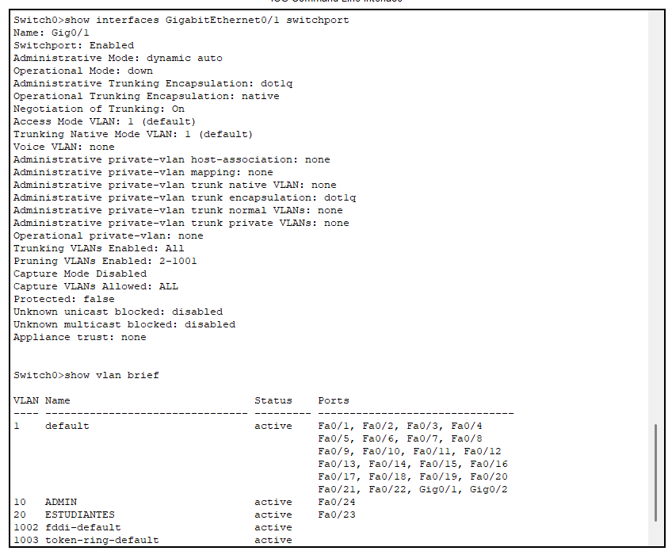
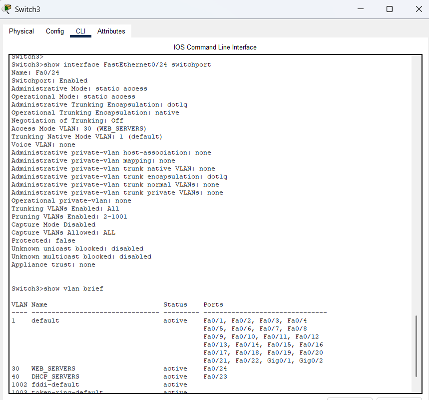
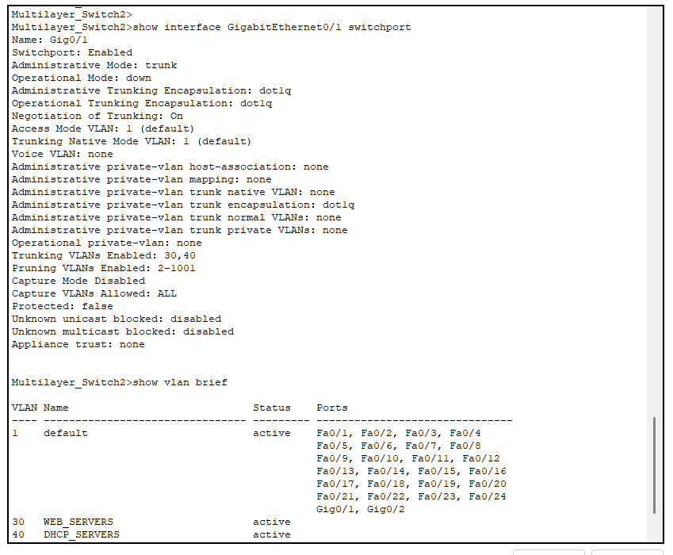

# Práctica 2: La Facultad de Ingeniería y su Problema de Conectividad en la Biblioteca

**Universidad San Carlos de Guatemala**  
**Facultad de Ingeniería**  
**Ingeniería en Ciencias y Sistemas**  
**Curso: Redes de Computadoras 2**

---

## Datos del Grupo

| Campo            | Detalle    |
| ---------------- | ---------- |
| Número de Grupo  | 28         |
| Valor de X       | 0          |
| Fecha de Entrega | 27/03/2026 |

---

## Integrantes

| No. | Nombre Completo                  | Carné       |
| --- | -------------------------------- | ----------- |
| 1   | _David Estuardo Barrios Ramírez_ | _202300670_ |
| 2   | _Marcos Daniel Bonifasi de Leon_ | _202202410_ |
| 3   | _Enner Esaí Mendizabal Castro_   | _202302220_ |

---

## Índice

1. [Introducción](#1-introducción)
2. [Objetivos](#2-objetivos)
3. [Descripción del Problema](#3-descripción-del-problema)
4. [Topología Propuesta](#4-topología-propuesta)
5. [Subnetting](#5-subnetting)
6. [Configuración de VLANs](#6-configuración-de-vlans)
7. [Configuración DHCP](#7-configuración-dhcp)
8. [Configuración Inalámbrica](#8-configuración-inalámbrica)
9. [Configuración DNS y Servidor Web](#9-configuración-dns-y-servidor-web)
10. [Configuración OSPF](#10-configuración-ospf)
11. [Configuración LACP](#11-configuración-lacp)
12. [Configuración HSRP](#12-configuración-hsrp)
13. [Comandos Utilizados](#13-comandos-utilizados)
14. [Pruebas de Conectividad](#14-pruebas-de-conectividad)
15. [Conclusiones](#15-conclusiones)

---

## 1. Introducción

La Facultad de Ingeniería de la Universidad de San Carlos de Guatemala (USAC) atraviesa un proceso de modernización de su infraestructura tecnológica, impulsado por el crecimiento continuo de su población estudiantil y la creciente demanda de servicios digitales dentro del campus. En este contexto, el edificio de la biblioteca representa un área crítica que requiere atención inmediata, ya que su red actual no satisface adecuadamente las necesidades de conectividad y rendimiento que exigen las actividades académicas diarias.

La presente práctica documenta el diseño, configuración e implementación de una nueva topología de red para el edificio de la biblioteca de ingeniería, desarrollada en el simulador **Cisco Packet Tracer**. La solución propuesta abarca tres pisos del edificio: el primero con infraestructura cableada tradicional y los pisos segundo y tercero con zonas de acceso inalámbrico (WiFi), todo interconectado con el Data Center de la Biblioteca Central del campus.

La arquitectura diseñada integra tecnologías de capa 2 y capa 3, incluyendo VLANs, LACP, OSPF, HSRP, DHCP, DNS y HTTP, con el objetivo de garantizar alta disponibilidad, seguridad, escalabilidad y tolerancia a fallos en las comunicaciones internas y externas del edificio.

---

## 2. Objetivos

### 2.1 Objetivo General

Diseñar e implementar una infraestructura de red completa para el edificio de la biblioteca de la Facultad de Ingeniería de la USAC, garantizando alta disponibilidad, seguridad y escalabilidad mediante el uso de tecnologías y protocolos de red modernos.

### 2.2 Objetivos Específicos

- Configurar la red cableada del primer piso con VLANs diferenciadas para administración y estudiantes, aplicando subnetting VLSM para un uso eficiente del espacio de direccionamiento.
- Implementar zonas de acceso inalámbrico seguras en el segundo y tercer piso mediante routers inalámbricos con WPA2 Personal, aplicando subnetting FLSM.
- Configurar un servidor DHCP centralizado en el Data Center capaz de entregar direccionamiento dinámico a todos los dispositivos de la red.
- Implementar un servidor Web con servicios DNS y HTTP accesibles desde todos los pisos de la red.
- Configurar el protocolo de enrutamiento dinámico OSPF para garantizar conectividad entre todos los segmentos de la red.
- Establecer enlaces LACP de 4 interfaces entre cada par de edificios para aumentar el ancho de banda disponible y proporcionar tolerancia a fallos a nivel de enlace.
- Configurar HSRP en el primer piso y en el Data Center para asegurar redundancia de gateway y alta disponibilidad ante fallos de routers.
- Elaborar un manual técnico detallado que documente todas las configuraciones realizadas.

---

## 3. Descripción del Problema

La biblioteca de la Facultad de Ingeniería de la USAC presenta deficiencias críticas en su infraestructura de red que impactan negativamente el desempeño académico de los estudiantes. Los principales problemas identificados son los siguientes:

- **Falta de cobertura inalámbrica** en los pisos superiores del edificio, impidiendo que los estudiantes accedan a recursos digitales desde sus dispositivos móviles.
- **Ausencia de redundancia** en los dispositivos de enrutamiento, lo que provoca interrupciones totales del servicio ante cualquier fallo de hardware.
- **Segmentación inadecuada** de la red, sin separación entre el tráfico administrativo y el tráfico de estudiantes.
- **Servicios centralizados inexistentes**, como DHCP y DNS, que obliguen a los administradores a configurar manualmente cada dispositivo.
- **Ancho de banda insuficiente** en los enlaces entre edificios del campus, generando cuellos de botella en horas pico.

Para resolver estos problemas, el equipo de especialistas en redes del **Grupo 28** propone la topología descrita en este documento, que aborda cada uno de los puntos anteriores mediante el uso de tecnologías estándar de la industria.

---

## 4. Topología Propuesta

> _Insertar imagen de la topología implementada en Cisco Packet Tracer_

La red está compuesta por cuatro secciones principales interconectadas:

| Sección                          | Equipos principales                                                              | Tipo de red |
| -------------------------------- | -------------------------------------------------------------------------------- | ----------- |
| Piso 1 — Biblioteca Ingeniería   | 2x Router 2901, 1x Multilayer Switch 3560, 1x Switch 2960                        | Cableada    |
| Piso 2 — Biblioteca Ingeniería   | 1x Multilayer Switch 3560, 2x Wireless Router WRT300N                            | Inalámbrica |
| Piso 3 — Biblioteca Ingeniería   | 1x Multilayer Switch 3560, 2x Wireless Router WRT300N                            | Inalámbrica |
| Data Center — Biblioteca Central | 2x Router 2901, 1x Multilayer Switch 3560, 1x Switch 2960, ServerWeb, ServerDHCP | Cableada    |

La interconexión entre secciones se realiza mediante **EtherChannel LACP** utilizando 4 interfaces físicas por enlace, lo que proporciona un mayor ancho de banda agregado y redundancia ante fallos de enlace individuales.

**Data Center - Biblioteca Central**
| Dispositivo Origen | Puerto | Dispositivo Destino |Puerto |
| -------------------------------- | -------------------------------------------------------------------------------- | ----------- |----------- |
| Multilayer Switch2 | GigabitEthernet0/1 | Router2 | GigabitEthernet0/0 |
| Multilayer Switch2 | GigabitEthernet0/2 | Router3 | GigabitEthernet0/0 |
| Router2 | GigabitEthernet0/1 | Switch3 | GigabitEthernet0/1 |
| Router3 | GigabitEthernet0/1 | Switch3 | GigabitEthernet0/2 |
| Switch3 | FastEthernet0/24 | Server Web | FastEthernet0 |
| Switch3 | FastEthernet0/23 | Server DHCP | FastEthernet0 |

**Piso 1**

| Dispositivo Origen | Puerto             | Dispositivo Destino | Puerto             |
| ------------------ | ------------------ | ------------------- | ------------------ |
| Multilayer Switch4 | GigabitEthernet0/1 | Router1             | GigabitEthernet0/0 |
| Multilayer Switch4 | GigabitEthernet0/2 | Router0             | GigabitEthernet0/0 |
| Router1            | GigabitEthernet0/1 | Switch0             | GigabitEthernet0/1 |
| Router0            | GigabitEthernet0/1 | Switch0             | GigabitEthernet0/2 |
| Switch0            | FastEthernet0/24   | PC1                 | FastEthernet0      |
| Switch0            | FastEthernet0/23   | Laptop1             | FastEthernet0      |

**Conexión Data Center - Piso1**

| Dispositivo Origen | Puerto           | Dispositivo Destino | Puerto           |
| ------------------ | ---------------- | ------------------- | ---------------- |
| Multilayer Switch2 | FastEthernet0/24 | Multilayer Switch4  | FastEthernet0/24 |
| Multilayer Switch2 | FastEthernet0/23 | Multilayer Switch4  | FastEthernet0/23 |
| Multilayer Switch2 | FastEthernet0/22 | Multilayer Switch4  | FastEthernet0/22 |
| Multilayer Switch2 | FastEthernet0/21 | Multilayer Switch4  | FastEthernet0/21 |

**Piso 2**
| Dispositivo Origen | Puerto | Dispositivo Destino | Puerto |
| ------------------ | -------------- | ------------------- | -------------- |
| Multilayer Switch0 | GigabitEthernet0/1 | Wireless Router0 | Internet|
| Multilayer Switch0 | GigabitEthernet0/2 | Wireless Router1 | Internet|
| Wireless Router0 | Ethernet1 | PC3 | FastEthernet0 |

**Conexión de Piso 2 con Piso 1**

| Dispositivo Origen | Puerto           | Dispositivo Destino | Puerto           |
| ------------------ | ---------------- | ------------------- | ---------------- |
| Multilayer Switch0 | FastEthernet0/24 | Multilayer Switch4  | FastEthernet0/20 |
| Multilayer Switch0 | FastEthernet0/23 | Multilayer Switch4  | FastEthernet0/19 |
| Multilayer Switch0 | FastEthernet0/22 | Multilayer Switch4  | FastEthernet0/18 |
| Multilayer Switch0 | FastEthernet0/21 | Multilayer Switch4  | FastEthernet0/17 |

**Piso 3**

| Dispositivo Origen  | Puerto             | Dispositivo Destino | Puerto        |
| ------------------- | ------------------ | ------------------- | ------------- |
| Multilayer Switch3  | GigabitEthernet0/1 | Wireless Router2    | Internet      |
| Multilayer Switch3  | GigabitEthernet0/2 | Wireless Router0(1) | Internet      |
| Wireless Router0(1) | Ethernet1          | PC2                 | FastEthernet0 |

**Conexión Piso 1 - Piso 3**

| Dispositivo Origen | Puerto           | Dispositivo Destino | Puerto           |
| ------------------ | ---------------- | ------------------- | ---------------- |
| Multilayer Switch3 | FastEthernet0/24 | Multilayer Switch4  | FastEthernet0/16 |
| Multilayer Switch3 | FastEthernet0/23 | Multilayer Switch4  | FastEthernet0/15 |
| Multilayer Switch3 | FastEthernet0/22 | Multilayer Switch4  | FastEthernet0/14 |
| Multilayer Switch3 | FastEthernet0/21 | Multilayer Switch4  | FastEthernet0/13 |

## 5. Subnetting

### 5.1 Resumen de Redes Asignadas (X = 0)

| Red          | Dirección Base   | Uso                                |
| ------------ | ---------------- | ---------------------------------- |
| Piso 1       | 192.198.10.0/24  | Red cableada (ADMIN + ESTUDIANTES) |
| Piso 2       | 192.198.20.0/24  | Red inalámbrica (WLAN1 + WLAN2)    |
| Piso 3       | 192.198.30.0/24  | Red inalámbrica (WLAN1 + WLAN2)    |
| Data Center  | 192.198.100.0/24 | Servidores (WEB + DHCP)            |
| Enrutamiento | 10.2.0.0/24      | Enlaces entre routers y switches   |

### 5.2 Piso 1 — VLSM (192.198.10.0/24)

Se aplica VLSM ya que los dos segmentos del piso 1 tienen requerimientos de hosts distintos.

| VLAN | Nombre      | Hosts Requeridos | Subred Asignada  | Máscara         | Rango Usable                   | Broadcast      |
| ---- | ----------- | ---------------- | ---------------- | --------------- | ------------------------------ | -------------- |
| 10   | ADMIN       | 10               | 192.198.10.0/28  | 255.255.255.240 | 192.198.10.1 – 192.198.10.14   | 192.198.10.15  |
| 20   | ESTUDIANTES | 60               | 192.198.10.64/26 | 255.255.255.192 | 192.198.10.65 – 192.198.10.126 | 192.198.10.127 |

### 5.3 Piso 2 — FLSM (192.198.20.0/24)

Se aplica FLSM ya que ambas WLANs tienen el mismo requerimiento de 80 hosts.

| WLAN  | Hosts Requeridos | Subred Asignada   | Máscara         | Rango Usable                    | Broadcast      |
| ----- | ---------------- | ----------------- | --------------- | ------------------------------- | -------------- |
| WLAN1 | 80               | 192.198.20.0/25   | 255.255.255.128 | 192.198.20.1 – 192.198.20.126   | 192.198.20.127 |
| WLAN2 | 80               | 192.198.20.128/25 | 255.255.255.128 | 192.198.20.129 – 192.198.20.254 | 192.198.20.255 |

### 5.4 Piso 3 — FLSM (192.198.30.0/24)

| WLAN  | Hosts Requeridos | Subred Asignada   | Máscara         | Rango Usable                    | Broadcast      |
| ----- | ---------------- | ----------------- | --------------- | ------------------------------- | -------------- |
| WLAN1 | 80               | 192.198.30.0/25   | 255.255.255.128 | 192.198.30.1 – 192.198.30.126   | 192.198.30.127 |
| WLAN2 | 80               | 192.198.30.128/25 | 255.255.255.128 | 192.198.30.129 – 192.198.30.254 | 192.198.30.255 |

### 5.5 Data Center — FLSM (192.198.100.0/24)

La red del Data Center se divide en 2 partes iguales.

| VLAN | Nombre       | Subred Asignada    | Máscara         | Rango Usable                      | Broadcast       |
| ---- | ------------ | ------------------ | --------------- | --------------------------------- | --------------- |
| 30   | WEB_SERVERS  | 192.198.100.0/25   | 255.255.255.128 | 192.198.100.1 – 192.198.100.126   | 192.198.100.127 |
| 40   | DHCP_SERVERS | 192.198.100.128/25 | 255.255.255.128 | 192.198.100.129 – 192.198.100.254 | 192.198.100.255 |

### 5.6 Red de Enrutamiento — 10.2.0.0/24

Se utilizan subredes /30 para cada enlace punto a punto entre routers y multilayer switches.

| Enlace                                              | Subred       | IP Dispositivo A | IP Dispositivo B |
| --------------------------------------------------- | ------------ | ---------------- | ---------------- |
| Router2 ↔ Multilayer Switch2                        | 10.2.0.0/30  | 10.2.0.1         | 10.2.0.2         |
| Router3 ↔ Multilayer Switch2                        | 10.2.0.4/30  | 10.2.0.5         | 10.2.0.6         |
| Router0 ↔ Multilayer Switch0                        | 10.2.0.8/30  | 10.2.0.9         | 10.2.0.10        |
| Router1 ↔ Multilayer Switch0                        | 10.2.0.12/30 | 10.2.0.13        | 10.2.0.14        |
| Multilayer Switch0 ↔ Multilayer Switch2 (LACP)      | 10.2.0.16/30 | 10.2.0.17        | 10.2.0.18        |
| Multilayer Switch0 ↔ Multilayer Switch Piso2 (LACP) | 10.2.0.20/30 | 10.2.0.21        | 10.2.0.22        |
| Multilayer Switch0 ↔ Multilayer Switch Piso3 (LACP) | 10.2.0.24/30 | 10.2.0.25        | 10.2.0.26        |

## 6. Configuración de VLANs

Las VLANs (Virtual Local Area Network) son una tecnología de segmentación lógica de red que permite dividir un mismo switch físico en múltiples redes virtuales independientes. Esto mejora la seguridad al aislar el trafico entre grupos de usuarios, optimiza el rendimiento al reducir los dominios broadcast, y facilita la adminsitración de la red sin necesidad de modificar la infraestructura física.

En esta práctica se configuraron 4 VLANs, cada una correspondiente a su segmento específico de la red:

| VLAN ID | Nombre       | Segmento                    |
| ------- | ------------ | --------------------------- |
| 10      | ADMIN        | Administración — Piso 1     |
| 20      | ESTUDIANTES  | Estudiantes — Piso 1        |
| 30      | WEB_SERVERS  | Servidor Web — Data Center  |
| 40      | DHCP_SERVERS | Servidor DHCP — Data Center |

### 6.1 Configuración de VLANs en Switch3 (Data Center)

Switch3 es el switch de acceso del Data Center. Conectar directamente el ServerWeb (VLAN30) y el ServerDHCP (VLAN 40). Sus puertos hacia los servidores se configuran como acceso, y su puerto hacia el Multilayer Switch2 se configurán como trunk para transportar ambas VLANs.

```bash
# Acceder al modo de configuración
enable
configure terminal

# Crear VLAN 30
vlan 30
name WEB_SERVERS
exit

# Crear VLAN 40
vlan 40
name DHCP_SERVERS
exit

# Asignar puerto de acceso al ServerWeb (FastEthernet0/24)
interface FastEthernet0/24
switchport mode access
switchport access vlan 30
no shutdown
exit

# Asignar puerto de acceso al ServerDHCP (FastEthernet0/23)
interface FastEthernet0/23
switchport mode access
switchport access vlan 40
no shutdown
exit

# Configurar puerto trunk hacia Router2 (GigabitEthernet0/1)
interface GigabitEthernet0/1
switchport mode trunk
switchport trunk allowed vlan 30,40
no shutdown
exit

# Configurar puerto trunk hacia Router3 (GigabitEthernet0/2)
interface GigabitEthernet0/2
switchport mode trunk
switchport trunk allowed vlan 30,40
no shutdown
exit

# Guardar configuración
end
write memory
```

### 6.2 Configuración de VLANs en Multilayer Switch2 (Data Center)

El Multilaer Switch2 actúa como switch de distrbición del Data Center. Debe tener las VLANs 30 y 40 creadas, y sus interfaces hacia los router configruadas como trunk. Además, se le habilita el enrutamiento IP (ip routing) para que pueda funcionar como dispositivo de capa 3.

```bash
enable
configure terminal

# Habilitar enrutamiento IP en el multilayer switch
ip routing

# Crear VLAN 30
vlan 30
name WEB_SERVERS
exit

# Crear VLAN 40
vlan 40
name DHCP_SERVERS
exit

# Crear SVI (interfaz virtual) para VLAN 30
interface vlan 30
ip address 192.198.100.3 255.255.255.128
no shutdown
exit

# Crear SVI (interfaz virtual) para VLAN 40
interface vlan 40
ip address 192.198.100.131 255.255.255.128
no shutdown
exit

# Configurar puerto trunk hacia Router2 (GigabitEthernet0/1)
interface GigabitEthernet0/1
switchport trunk encapsulation dot1q
switchport mode trunk
switchport trunk allowed vlan 30,40
no shutdown
exit

# Configurar puerto trunk hacia Router3 (GigabitEthernet0/2)
interface GigabitEthernet0/2
switchport trunk encapsulation dot1q
switchport mode trunk
switchport trunk allowed vlan 30,40
no shutdown
exit

# Guardar configuración
end
write memory
```

### 6.3 Configuración de VLANs en Switch0 (Piso 1)

Switch0 es el switch de acceso del Piso 1. Conecta directamente a PC1 (VLAN 10 - ADMIN) y a Laptop1 (VLAN 20 - ESTUDIANTES). Sus puertos hacia los routers se configuran como trunk.

```bash
enable
configure terminal

# Crear VLAN 10
vlan 10
name ADMIN
exit

# Crear VLAN 20
vlan 20
name ESTUDIANTES
exit

# Asignar puerto de acceso a PC1 — VLAN 10 (FastEthernet0/24)
interface FastEthernet0/24
switchport mode access
switchport access vlan 10
no shutdown
exit

# Asignar puerto de acceso a Laptop1 — VLAN 20 (FastEthernet0/23)
interface FastEthernet0/23
switchport mode access
switchport access vlan 20
no shutdown
exit

# Configurar puerto trunk hacia Router1 (GigabitEthernet0/1)
interface GigabitEthernet0/1
switchport mode trunk
switchport trunk allowed vlan 10,20
no shutdown
exit

# Configurar puerto trunk hacia Router0 (GigabitEthernet0/2)
interface GigabitEthernet0/2
switchport mode trunk
switchport trunk allowed vlan 10,20
no shutdown
exit

# Guardar configuración
end
write memory
```

### 6.4 Configuración de VLANs en Multilayer Switch4 (Piso 1)

El Multilayer Switch4 es el switch de distribución del Piso 1 y el núcleo de interconexión de toda la red. Debe conocer todas las VLANs de la red y manejar los EtherChannels LACP hacia los tres edificios. Se habilita `ip routing` para enrutamiento entre VLANs.

```bash
enable
configure terminal

# Habilitar enrutamiento IP
ip routing

# Crear todas las VLANs conocidas
vlan 10
name ADMIN
exit

vlan 20
name ESTUDIANTES
exit

vlan 30
name WEB_SERVERS
exit

vlan 40
name DHCP_SERVERS
exit

# Crear SVI para VLAN 10
interface vlan 10
ip address 192.198.10.2 255.255.255.240
no shutdown
exit

# Crear SVI para VLAN 20
interface vlan 20
ip address 192.198.10.66 255.255.255.192
no shutdown
exit

# Configurar puertos trunk hacia Router1 (GigabitEthernet0/1)
interface GigabitEthernet0/1
switchport trunk encapsulation dot1q
switchport mode trunk
switchport trunk allowed vlan 10,20
no shutdown
exit

# Configurar puertos trunk hacia Router0 (GigabitEthernet0/2)
interface GigabitEthernet0/2
switchport trunk encapsulation dot1q
switchport mode trunk
switchport trunk allowed vlan 10,20
no shutdown
exit

# Guardar configuración
end
write memory
```

_Nota: Los puertos FastEthernet del Multilayer Switch4 destinados a los EtherChannels LACP (Fa0/13–Fa0/24) se configurarán en la Sección 11 — Configuración LACP._

### 6.5 Configuración de VLANs en Multilayer Switch0 (Piso 2)

El Multilayer Switch0 del Piso 2 conecta los dos Wireless Routers hacia arriba y el EtherChannel hacia el Piso 1 hacia abajo. No necesita VLANs de acceso cableado, pero sí debe pasar el tráfico de los clientes inalámbricos correctamente.

```bash
enable
configure terminal

# Habilitar enrutamiento IP
ip routing

# Crear VLANs relevantes para el piso 2
vlan 10
name ADMIN
exit

vlan 20
name ESTUDIANTES
exit

# Configurar puertos hacia Wireless Router0 (GigabitEthernet0/1)
interface GigabitEthernet0/1
switchport trunk encapsulation dot1q
switchport mode trunk
no shutdown
exit

# Configurar puertos hacia Wireless Router1 (GigabitEthernet0/2)
interface GigabitEthernet0/2
switchport trunk encapsulation dot1q
switchport mode trunk
no shutdown
exit

# Guardar configuración
end
write memory
```

### 6.6 Configuración de VLANs en Multilayer Switch3 (Piso 3)

Configuración equivalente al Multilayer Switch0 del Piso 2, pero para el Piso 3.

```bash
enable
configure terminal

# Habilitar enrutamiento IP
ip routing

# Crear VLANs relevantes para el piso 3
vlan 10
name ADMIN
exit

vlan 20
name ESTUDIANTES
exit

# Configurar puertos hacia Wireless Router2 (GigabitEthernet0/1)
interface GigabitEthernet0/1
switchport trunk encapsulation dot1q
switchport mode trunk
no shutdown
exit

# Configurar puertos hacia Wireless Router0(1) (GigabitEthernet0/2)
interface GigabitEthernet0/2
switchport trunk encapsulation dot1q
switchport mode trunk
no shutdown
exit

# Guardar configuración
end
write memory
```

### 6.7 Verificación de VLANs

Una vez configuradas todas las VLANs, se pueden verificar con los siguientes comandos en cualquier switch:

```bash
# Ver todas las VLANs creadas y sus puertos asignados
show vlan brief

# Ver configuración de un puerto específico
show interfaces FastEthernet0/24 switchport

# Ver interfaces trunk activas
show interfaces trunk

# Ver las SVIs configuradas en un multilayer switch
show ip interface brief
```

- **Switch 0**



- **Switch 3**



- **Multilayer Switch 2**



## 7. Configuración DHCP

El protocolo DHCP (Dynamic Host Configuration Protocol) es un servicio de red que asigna automáticamente direcciones IP y parámetros de configuración (máscara de subred, gateway predeterminado y servidor DNS) a los dispositivos finales de la red. Esto elimina la necesidad de configurar manualmente cada host, facilitando la administración y escalabilidad de la red.

En esta práctica, el **ServerDHCP** ubicado en el Data Center es el servidor centralizado encargado de entregar direccionamiento dinámico a todos los dispositivos de la red cableada del Piso 1 (VLAN 10 y VLAN 20). Dado que las solicitudes DHCP son mensajes broadcast y estos no atraviesan routers por defecto, se configura el comando `ip helper-address` en las subinterfaces de Router0 y Router1 para reenviar dichas solicitudes como unicast hacia el ServerDHCP.

Los Wireless Routers de los pisos 2 y 3 actúan como servidores DHCP locales para sus propias redes inalámbricas, por lo que se configuran de forma independiente y se documentan en la **Sección 8 — Configuración Inalámbrica**.

---

### 7.1 Configuración de IP estática en ServerWeb

El ServerWeb requiere una dirección IP estática ya que es el servidor DNS y HTTP de toda la red. Los dispositivos clientes apuntarán a esta IP para resolver nombres de dominio, por lo que no puede cambiar dinámicamente.

**Pasos en Packet Tracer (interfaz gráfica):**

1. Hacer clic en **ServerWeb** → pestaña **Desktop** → **IP Configuration**
2. Seleccionar **Static** e ingresar los siguientes valores:

| Parámetro       | Valor             |
| --------------- | ----------------- |
| IP Address      | `192.198.100.2`   |
| Subnet Mask     | `255.255.255.128` |
| Default Gateway | `192.198.100.1`   |
| DNS Server      | `127.0.0.1`       |

> **Nota:** El DNS Server apunta a `127.0.0.1` (loopback) porque el propio ServerWeb es el servidor DNS. Esto es necesario para que Packet Tracer active correctamente el servicio DNS en el servidor.

---

### 7.2 Configuración de IP estática en ServerDHCP

El ServerDHCP también requiere una dirección IP estática para que los routers puedan reenviarle las solicitudes DHCP mediante `ip helper-address` de forma consistente.

**Pasos en Packet Tracer (interfaz gráfica):**

1. Hacer clic en **ServerDHCP** → pestaña **Desktop** → **IP Configuration**
2. Seleccionar **Static** e ingresar los siguientes valores:

| Parámetro       | Valor             |
| --------------- | ----------------- |
| IP Address      | `192.198.100.130` |
| Subnet Mask     | `255.255.255.128` |
| Default Gateway | `192.198.100.129` |
| DNS Server      | `192.198.100.2`   |

> **Nota:** El DNS Server apunta a `192.198.100.2` que es la IP del ServerWeb, ya que este es quien provee el servicio DNS para toda la red.

---

### 7.3 Configuración de Pools DHCP en ServerDHCP

El ServerDHCP debe tener un pool configurado por cada VLAN que requiere direccionamiento dinámico. En Packet Tracer, esto se realiza desde la interfaz gráfica del servidor.

**Pasos en Packet Tracer (interfaz gráfica):**

1. Hacer clic en **ServerDHCP** → pestaña **Services** → **DHCP**
2. Activar el servicio con el botón **On**
3. Crear cada pool con los siguientes valores:

**Pool 1 — VLAN 10 (ADMIN)**

| Parámetro        | Valor             |
| ---------------- | ----------------- |
| Pool Name        | `POOL_ADMIN`      |
| Default Gateway  | `192.198.10.1`    |
| DNS Server       | `192.198.100.2`   |
| Start IP Address | `192.198.10.1`    |
| Subnet Mask      | `255.255.255.240` |
| Max Users        | `14`              |

**Pool 2 — VLAN 20 (ESTUDIANTES)**

| Parámetro        | Valor              |
| ---------------- | ------------------ |
| Pool Name        | `POOL_ESTUDIANTES` |
| Default Gateway  | `192.198.10.65`    |
| DNS Server       | `192.198.100.2`    |
| Start IP Address | `192.198.10.65`    |
| Subnet Mask      | `255.255.255.192`  |
| Max Users        | `62`               |

**Pool 3 — VLAN 30 (WEB_SERVERS)**

| Parámetro        | Valor              |
| ---------------- | ------------------ |
| Pool Name        | `POOL_WEB_SERVERS` |
| Default Gateway  | `192.198.100.1`    |
| DNS Server       | `192.198.100.2`    |
| Start IP Address | `192.198.100.2`    |
| Subnet Mask      | `255.255.255.128`  |
| Max Users        | `126`              |

**Pool 4 — VLAN 40 (DHCP_SERVERS)**

| Parámetro        | Valor               |
| ---------------- | ------------------- |
| Pool Name        | `POOL_DHCP_SERVERS` |
| Default Gateway  | `192.198.100.129`   |
| DNS Server       | `192.198.100.2`     |
| Start IP Address | `192.198.100.130`   |
| Subnet Mask      | `255.255.255.128`   |
| Max Users        | `126`               |

> **Nota:** Los pools de VLAN 30 y 40 se crean como respaldo, pero los servidores (ServerWeb y ServerDHCP) tienen IP estática, por lo que no solicitarán IP dinámica. El pool existe para cualquier dispositivo adicional que se agregue a esas VLANs en el futuro.

---

### 7.4 Configuración de subinterfaces en Router2 (Data Center — HSRP Activo)

Router2 necesita subinterfaces para cada VLAN del Data Center, permitiendo el enrutamiento entre VLANs y la comunicación con los servidores.

```bash
enable
configure terminal

# Activar interfaz física hacia Switch3
interface GigabitEthernet0/0
no shutdown
exit

# Subinterfaz para VLAN 30 - WEB_SERVERS
interface GigabitEthernet0/0.30
encapsulation dot1Q 30
ip address 192.198.100.3 255.255.255.128
no shutdown
exit

# Subinterfaz para VLAN 40 - DHCP_SERVERS
interface GigabitEthernet0/0.40
encapsulation dot1Q 40
ip address 192.198.100.131 255.255.255.128
no shutdown
exit

# Activar interfaz física hacia Multilayer Switch2
interface GigabitEthernet0/1
ip address 10.2.0.1 255.255.255.252
no shutdown
exit

end
write memory
```

---

### 7.5 Configuración de subinterfaces en Router3 (Data Center — HSRP Standby)

Router3 es el router de respaldo en HSRP para el Data Center. Necesita subinterfaces con IPs distintas a Router2 pero en la misma subred, para poder participar en HSRP.

```bash
enable
configure terminal

# Activar interfaz física hacia Switch3
interface GigabitEthernet0/0
no shutdown
exit

# Subinterfaz para VLAN 30 - WEB_SERVERS
interface GigabitEthernet0/0.30
encapsulation dot1Q 30
ip address 192.198.100.4 255.255.255.128
no shutdown
exit

# Subinterfaz para VLAN 40 - DHCP_SERVERS
interface GigabitEthernet0/0.40
encapsulation dot1Q 40
ip address 192.198.100.132 255.255.255.128
no shutdown
exit

# Activar interfaz física hacia Multilayer Switch2
interface GigabitEthernet0/1
ip address 10.2.0.5 255.255.255.252
no shutdown
exit

end
write memory
```

---

### 7.6 Configuración de subinterfaces en Router1 (Piso 1 — HSRP Activo)

Router1 es el router activo del Piso 1. Además de las subinterfaces para cada VLAN, se configura `ip helper-address` apuntando al ServerDHCP para que los clientes del Piso 1 puedan obtener IPs dinámicamente desde el servidor centralizado.

```bash
enable
configure terminal

# Activar interfaz física hacia Switch0
interface GigabitEthernet0/0
no shutdown
exit

# Subinterfaz para VLAN 10 - ADMIN
interface GigabitEthernet0/0.10
encapsulation dot1Q 10
ip address 192.198.10.1 255.255.255.240
ip helper-address 192.198.100.130
no shutdown
exit

# Subinterfaz para VLAN 20 - ESTUDIANTES
interface GigabitEthernet0/0.20
encapsulation dot1Q 20
ip address 192.198.10.65 255.255.255.192
ip helper-address 192.198.100.130
no shutdown
exit

# Activar interfaz física hacia Multilayer Switch4
interface GigabitEthernet0/1
ip address 10.2.0.13 255.255.255.252
no shutdown
exit

end
write memory
```

---

### 7.7 Configuración de subinterfaces en Router0 (Piso 1 — HSRP Standby)

Router0 es el router standby del Piso 1. También necesita `ip helper-address` para que cuando tome el rol activo en HSRP, pueda continuar reenviando solicitudes DHCP correctamente.

```bash
enable
configure terminal

# Activar interfaz física hacia Switch0
interface GigabitEthernet0/0
no shutdown
exit

# Subinterfaz para VLAN 10 - ADMIN
interface GigabitEthernet0/0.10
encapsulation dot1Q 10
ip address 192.198.10.2 255.255.255.240
ip helper-address 192.198.100.130
no shutdown
exit

# Subinterfaz para VLAN 20 - ESTUDIANTES
interface GigabitEthernet0/0.20
encapsulation dot1Q 20
ip address 192.198.10.66 255.255.255.192
ip helper-address 192.198.100.130
no shutdown
exit

# Activar interfaz física hacia Multilayer Switch4
interface GigabitEthernet0/1
ip address 10.2.0.9 255.255.255.252
no shutdown
exit

end
write memory
```

---

### 7.8 Verificación de DHCP

Una vez configurados todos los dispositivos, se puede verificar el correcto funcionamiento del servicio DHCP con los siguientes comandos:

```bash
# En Router1 o Router0 — verificar que el helper-address está activo
show ip interface GigabitEthernet0/0.10
show ip interface GigabitEthernet0/0.20

# En Router1 o Router0 — verificar subinterfaces configuradas
show ip interface brief

# En un PC cliente del Piso 1 — solicitar IP dinámica
# (desde el Command Prompt del PC en Packet Tracer)
ipconfig /renew

# Ver la IP asignada
ipconfig
```

## 8-configuración-inalámbrica
