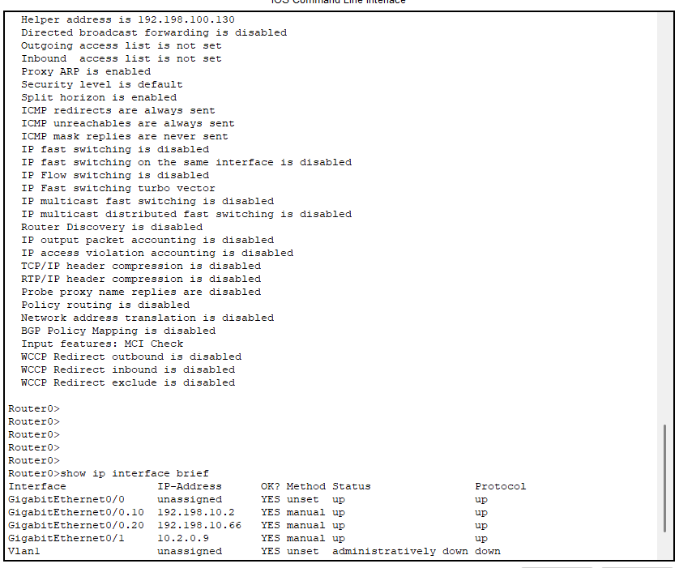
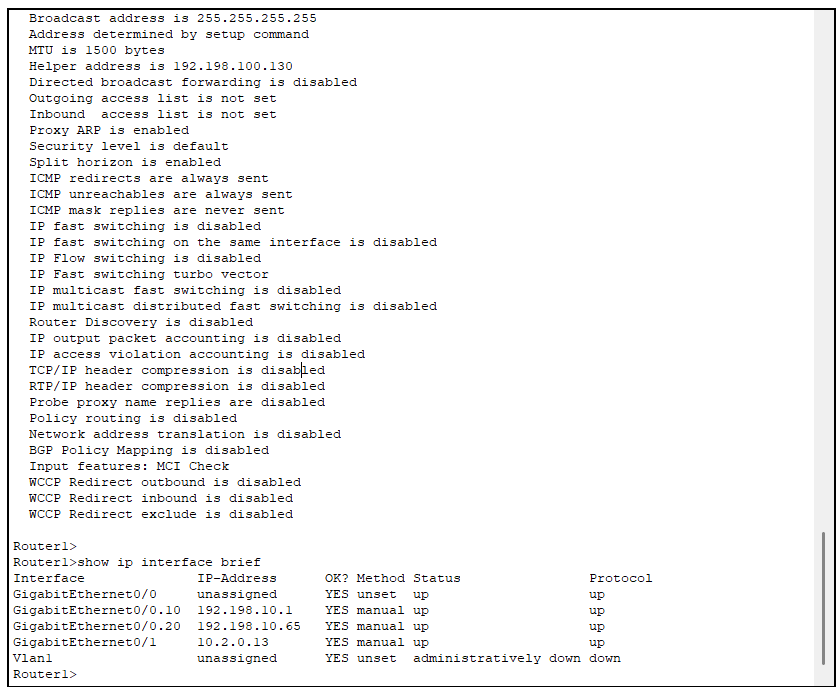
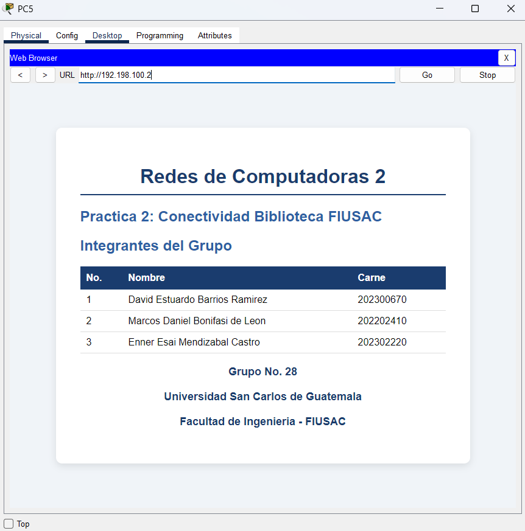
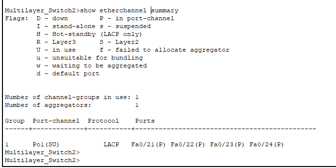
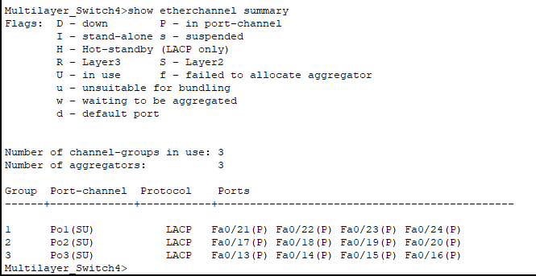

# Práctica 2: La Facultad de Ingeniería y su Problema de Conectividad en la Biblioteca

**Universidad San Carlos de Guatemala**  
**Facultad de Ingeniería**  
**Ingeniería en Ciencias y Sistemas**  
**Curso: Redes de Computadoras 2**

---

## Datos del Grupo

| Campo            | Detalle    |
| ---------------- | ---------- |
| Número de Grupo  | 28         |
| Valor de X       | 0          |
| Fecha de Entrega | 27/03/2026 |

---

## Integrantes

| No. | Nombre Completo                  | Carné       |
| --- | -------------------------------- | ----------- |
| 1   | _David Estuardo Barrios Ramírez_ | _202300670_ |
| 2   | _Marcos Daniel Bonifasi de Leon_ | _202202410_ |
| 3   | _Enner Esaí Mendizabal Castro_   | _202302220_ |

---

## Índice

1. [Introducción](#1-introducción)
2. [Objetivos](#2-objetivos)
3. [Descripción del Problema](#3-descripción-del-problema)
4. [Topología Propuesta](#4-topología-propuesta)
5. [Subnetting](#5-subnetting)
6. [Configuración de VLANs](#6-configuración-de-vlans)
7. [Configuración DHCP](#7-configuración-dhcp)
8. [Configuración Inalámbrica](#8-configuración-inalámbrica)
9. [Configuración DNS y Servidor Web](#9-configuración-dns-y-servidor-web)
10. [Configuración OSPF](#10-configuración-ospf)
11. [Configuración LACP](#11-configuración-lacp)
12. [Configuración HSRP](#12-configuración-hsrp)
13. [Comandos Utilizados](#13-comandos-utilizados)
14. [Pruebas de Conectividad](#14-pruebas-de-conectividad)
15. [Conclusiones](#15-conclusiones)

---

## 1. Introducción

La Facultad de Ingeniería de la Universidad de San Carlos de Guatemala (USAC) atraviesa un proceso de modernización de su infraestructura tecnológica, impulsado por el crecimiento continuo de su población estudiantil y la creciente demanda de servicios digitales dentro del campus. En este contexto, el edificio de la biblioteca representa un área crítica que requiere atención inmediata, ya que su red actual no satisface adecuadamente las necesidades de conectividad y rendimiento que exigen las actividades académicas diarias.

La presente práctica documenta el diseño, configuración e implementación de una nueva topología de red para el edificio de la biblioteca de ingeniería, desarrollada en el simulador **Cisco Packet Tracer**. La solución propuesta abarca tres pisos del edificio: el primero con infraestructura cableada tradicional y los pisos segundo y tercero con zonas de acceso inalámbrico (WiFi), todo interconectado con el Data Center de la Biblioteca Central del campus.

La arquitectura diseñada integra tecnologías de capa 2 y capa 3, incluyendo VLANs, LACP, OSPF, HSRP, DHCP, DNS y HTTP, con el objetivo de garantizar alta disponibilidad, seguridad, escalabilidad y tolerancia a fallos en las comunicaciones internas y externas del edificio.

---

## 2. Objetivos

### 2.1 Objetivo General

Diseñar e implementar una infraestructura de red completa para el edificio de la biblioteca de la Facultad de Ingeniería de la USAC, garantizando alta disponibilidad, seguridad y escalabilidad mediante el uso de tecnologías y protocolos de red modernos.

### 2.2 Objetivos Específicos

- Configurar la red cableada del primer piso con VLANs diferenciadas para administración y estudiantes, aplicando subnetting VLSM para un uso eficiente del espacio de direccionamiento.
- Implementar zonas de acceso inalámbrico seguras en el segundo y tercer piso mediante routers inalámbricos con WPA2 Personal, aplicando subnetting FLSM.
- Configurar un servidor DHCP centralizado en el Data Center capaz de entregar direccionamiento dinámico a todos los dispositivos de la red.
- Implementar un servidor Web con servicios DNS y HTTP accesibles desde todos los pisos de la red.
- Configurar el protocolo de enrutamiento dinámico OSPF para garantizar conectividad entre todos los segmentos de la red.
- Establecer enlaces LACP de 4 interfaces entre cada par de edificios para aumentar el ancho de banda disponible y proporcionar tolerancia a fallos a nivel de enlace.
- Configurar HSRP en el primer piso y en el Data Center para asegurar redundancia de gateway y alta disponibilidad ante fallos de routers.
- Elaborar un manual técnico detallado que documente todas las configuraciones realizadas.

---

## 3. Descripción del Problema

La biblioteca de la Facultad de Ingeniería de la USAC presenta deficiencias críticas en su infraestructura de red que impactan negativamente el desempeño académico de los estudiantes. Los principales problemas identificados son los siguientes:

- **Falta de cobertura inalámbrica** en los pisos superiores del edificio, impidiendo que los estudiantes accedan a recursos digitales desde sus dispositivos móviles.
- **Ausencia de redundancia** en los dispositivos de enrutamiento, lo que provoca interrupciones totales del servicio ante cualquier fallo de hardware.
- **Segmentación inadecuada** de la red, sin separación entre el tráfico administrativo y el tráfico de estudiantes.
- **Servicios centralizados inexistentes**, como DHCP y DNS, que obliguen a los administradores a configurar manualmente cada dispositivo.
- **Ancho de banda insuficiente** en los enlaces entre edificios del campus, generando cuellos de botella en horas pico.

Para resolver estos problemas, el equipo de especialistas en redes del **Grupo 28** propone la topología descrita en este documento, que aborda cada uno de los puntos anteriores mediante el uso de tecnologías estándar de la industria.

---

## 4. Topología Propuesta

> _Insertar imagen de la topología implementada en Cisco Packet Tracer_

La red está compuesta por cuatro secciones principales interconectadas:

| Sección                          | Equipos principales                                                              | Tipo de red |
| -------------------------------- | -------------------------------------------------------------------------------- | ----------- |
| Piso 1 — Biblioteca Ingeniería   | 2x Router 2901, 1x Multilayer Switch 3560, 1x Switch 2960                        | Cableada    |
| Piso 2 — Biblioteca Ingeniería   | 1x Multilayer Switch 3560, 2x Wireless Router WRT300N                            | Inalámbrica |
| Piso 3 — Biblioteca Ingeniería   | 1x Multilayer Switch 3560, 2x Wireless Router WRT300N                            | Inalámbrica |
| Data Center — Biblioteca Central | 2x Router 2901, 1x Multilayer Switch 3560, 1x Switch 2960, ServerWeb, ServerDHCP | Cableada    |

La interconexión entre secciones se realiza mediante **EtherChannel LACP** utilizando 4 interfaces físicas por enlace, lo que proporciona un mayor ancho de banda agregado y redundancia ante fallos de enlace individuales.

**Data Center - Biblioteca Central**
| Dispositivo Origen | Puerto | Dispositivo Destino |Puerto |
| -------------------------------- | -------------------------------------------------------------------------------- | ----------- |----------- |
| Multilayer Switch2 | GigabitEthernet0/1 | Router2 | GigabitEthernet0/0 |
| Multilayer Switch2 | GigabitEthernet0/2 | Router3 | GigabitEthernet0/0 |
| Router2 | GigabitEthernet0/1 | Switch3 | GigabitEthernet0/1 |
| Router3 | GigabitEthernet0/1 | Switch3 | GigabitEthernet0/2 |
| Switch3 | FastEthernet0/24 | Server Web | FastEthernet0 |
| Switch3 | FastEthernet0/23 | Server DHCP | FastEthernet0 |

**Piso 1**

| Dispositivo Origen | Puerto             | Dispositivo Destino | Puerto             |
| ------------------ | ------------------ | ------------------- | ------------------ |
| Multilayer Switch4 | GigabitEthernet0/1 | Router1             | GigabitEthernet0/0 |
| Multilayer Switch4 | GigabitEthernet0/2 | Router0             | GigabitEthernet0/0 |
| Router1            | GigabitEthernet0/1 | Switch0             | GigabitEthernet0/1 |
| Router0            | GigabitEthernet0/1 | Switch0             | GigabitEthernet0/2 |
| Switch0            | FastEthernet0/24   | PC1                 | FastEthernet0      |
| Switch0            | FastEthernet0/23   | Laptop1             | FastEthernet0      |

**Conexión Data Center - Piso1**

| Dispositivo Origen | Puerto           | Dispositivo Destino | Puerto           |
| ------------------ | ---------------- | ------------------- | ---------------- |
| Multilayer Switch2 | FastEthernet0/24 | Multilayer Switch4  | FastEthernet0/24 |
| Multilayer Switch2 | FastEthernet0/23 | Multilayer Switch4  | FastEthernet0/23 |
| Multilayer Switch2 | FastEthernet0/22 | Multilayer Switch4  | FastEthernet0/22 |
| Multilayer Switch2 | FastEthernet0/21 | Multilayer Switch4  | FastEthernet0/21 |

**Piso 2**
| Dispositivo Origen | Puerto | Dispositivo Destino | Puerto |
| ------------------ | -------------- | ------------------- | -------------- |
| Multilayer Switch0 | GigabitEthernet0/1 | Wireless Router0 | Internet|
| Multilayer Switch0 | GigabitEthernet0/2 | Wireless Router1 | Internet|
| Wireless Router0 | Ethernet1 | PC3 | FastEthernet0 |

**Conexión de Piso 2 con Piso 1**

| Dispositivo Origen | Puerto           | Dispositivo Destino | Puerto           |
| ------------------ | ---------------- | ------------------- | ---------------- |
| Multilayer Switch0 | FastEthernet0/24 | Multilayer Switch4  | FastEthernet0/20 |
| Multilayer Switch0 | FastEthernet0/23 | Multilayer Switch4  | FastEthernet0/19 |
| Multilayer Switch0 | FastEthernet0/22 | Multilayer Switch4  | FastEthernet0/18 |
| Multilayer Switch0 | FastEthernet0/21 | Multilayer Switch4  | FastEthernet0/17 |

**Piso 3**

| Dispositivo Origen  | Puerto             | Dispositivo Destino | Puerto        |
| ------------------- | ------------------ | ------------------- | ------------- |
| Multilayer Switch3  | GigabitEthernet0/1 | Wireless Router2    | Internet      |
| Multilayer Switch3  | GigabitEthernet0/2 | Wireless Router0(1) | Internet      |
| Wireless Router0(1) | Ethernet1          | PC2                 | FastEthernet0 |

**Conexión Piso 1 - Piso 3**

| Dispositivo Origen | Puerto           | Dispositivo Destino | Puerto           |
| ------------------ | ---------------- | ------------------- | ---------------- |
| Multilayer Switch3 | FastEthernet0/24 | Multilayer Switch4  | FastEthernet0/16 |
| Multilayer Switch3 | FastEthernet0/23 | Multilayer Switch4  | FastEthernet0/15 |
| Multilayer Switch3 | FastEthernet0/22 | Multilayer Switch4  | FastEthernet0/14 |
| Multilayer Switch3 | FastEthernet0/21 | Multilayer Switch4  | FastEthernet0/13 |

## 5. Subnetting

### 5.1 Resumen de Redes Asignadas (X = 0)

| Red          | Dirección Base   | Uso                                |
| ------------ | ---------------- | ---------------------------------- |
| Piso 1       | 192.198.10.0/24  | Red cableada (ADMIN + ESTUDIANTES) |
| Piso 2       | 192.198.20.0/24  | Red inalámbrica (WLAN1 + WLAN2)    |
| Piso 3       | 192.198.30.0/24  | Red inalámbrica (WLAN1 + WLAN2)    |
| Data Center  | 192.198.100.0/24 | Servidores (WEB + DHCP)            |
| Enrutamiento | 10.2.0.0/24      | Enlaces entre routers y switches   |

### 5.2 Piso 1 — VLSM (192.198.10.0/24)

Se aplica VLSM ya que los dos segmentos del piso 1 tienen requerimientos de hosts distintos.

| VLAN | Nombre      | Hosts Requeridos | Subred Asignada  | Máscara         | Rango Usable                   | Broadcast      |
| ---- | ----------- | ---------------- | ---------------- | --------------- | ------------------------------ | -------------- |
| 10   | ADMIN       | 10               | 192.198.10.0/28  | 255.255.255.240 | 192.198.10.1 – 192.198.10.14   | 192.198.10.15  |
| 20   | ESTUDIANTES | 60               | 192.198.10.64/26 | 255.255.255.192 | 192.198.10.65 – 192.198.10.126 | 192.198.10.127 |

### 5.3 Piso 2 — FLSM (192.198.20.0/24)

Se aplica FLSM ya que ambas WLANs tienen el mismo requerimiento de 80 hosts.

| WLAN  | Hosts Requeridos | Subred Asignada   | Máscara         | Rango Usable                    | Broadcast      |
| ----- | ---------------- | ----------------- | --------------- | ------------------------------- | -------------- |
| WLAN1 | 80               | 192.198.20.0/25   | 255.255.255.128 | 192.198.20.1 – 192.198.20.126   | 192.198.20.127 |
| WLAN2 | 80               | 192.198.20.128/25 | 255.255.255.128 | 192.198.20.129 – 192.198.20.254 | 192.198.20.255 |

### 5.4 Piso 3 — FLSM (192.198.30.0/24)

| WLAN  | Hosts Requeridos | Subred Asignada   | Máscara         | Rango Usable                    | Broadcast      |
| ----- | ---------------- | ----------------- | --------------- | ------------------------------- | -------------- |
| WLAN1 | 80               | 192.198.30.0/25   | 255.255.255.128 | 192.198.30.1 – 192.198.30.126   | 192.198.30.127 |
| WLAN2 | 80               | 192.198.30.128/25 | 255.255.255.128 | 192.198.30.129 – 192.198.30.254 | 192.198.30.255 |

### 5.5 Data Center — FLSM (192.198.100.0/24)

La red del Data Center se divide en 2 partes iguales.

| VLAN | Nombre       | Subred Asignada    | Máscara         | Rango Usable                      | Broadcast       |
| ---- | ------------ | ------------------ | --------------- | --------------------------------- | --------------- |
| 30   | WEB_SERVERS  | 192.198.100.0/25   | 255.255.255.128 | 192.198.100.1 – 192.198.100.126   | 192.198.100.127 |
| 40   | DHCP_SERVERS | 192.198.100.128/25 | 255.255.255.128 | 192.198.100.129 – 192.198.100.254 | 192.198.100.255 |

### 5.6 Red de Enrutamiento — 10.2.0.0/24

Se utilizan subredes /30 para cada enlace punto a punto entre routers y multilayer switches.

| Enlace                                         | Subred       | IP Dispositivo A | IP Dispositivo B |
| ---------------------------------------------- | ------------ | ---------------- | ---------------- |
| Router2 ↔ Multilayer Switch2                   | 10.2.0.0/30  | 10.2.0.1 (R2)    | 10.2.0.2 (MS2)   |
| Router3 ↔ Multilayer Switch2                   | 10.2.0.4/30  | 10.2.0.5 (R3)    | 10.2.0.6 (MS2)   |
| Router0 ↔ Multilayer Switch4                   | 10.2.0.8/30  | 10.2.0.9 (R0)    | 10.2.0.10 (MS4)  |
| Router1 ↔ Multilayer Switch4                   | 10.2.0.12/30 | 10.2.0.13 (R1)   | 10.2.0.14 (MS4)  |
| Multilayer Switch2 ↔ Multilayer Switch4 (LACP) | 10.2.0.16/30 | 10.2.0.17 (MS2)  | 10.2.0.18 (MS4)  |

## 6. Configuración de VLANs

Las VLANs (Virtual Local Area Network) son una tecnología de segmentación lógica de red que permite dividir un mismo switch físico en múltiples redes virtuales independientes. Esto mejora la seguridad al aislar el trafico entre grupos de usuarios, optimiza el rendimiento al reducir los dominios broadcast, y facilita la adminsitración de la red sin necesidad de modificar la infraestructura física.

En esta práctica se configuraron 4 VLANs, cada una correspondiente a su segmento específico de la red:

| VLAN ID | Nombre       | Segmento                    |
| ------- | ------------ | --------------------------- |
| 10      | ADMIN        | Administración — Piso 1     |
| 20      | ESTUDIANTES  | Estudiantes — Piso 1        |
| 30      | WEB_SERVERS  | Servidor Web — Data Center  |
| 40      | DHCP_SERVERS | Servidor DHCP — Data Center |

### 6.1 Configuración de VLANs en Switch3 (Data Center)

Switch3 es el switch de acceso del Data Center. Conectar directamente el ServerWeb (VLAN30) y el ServerDHCP (VLAN 40). Sus puertos hacia los servidores se configuran como acceso, y su puerto hacia el Multilayer Switch2 se configurán como trunk para transportar ambas VLANs.

```bash
# Acceder al modo de configuración
enable
configure terminal

# Crear VLAN 30
vlan 30
name WEB_SERVERS
exit

# Crear VLAN 40
vlan 40
name DHCP_SERVERS
exit

# Asignar puerto de acceso al ServerWeb (FastEthernet0/24)
interface FastEthernet0/24
switchport mode access
switchport access vlan 30
no shutdown
exit

# Asignar puerto de acceso al ServerDHCP (FastEthernet0/23)
interface FastEthernet0/23
switchport mode access
switchport access vlan 40
no shutdown
exit

# Configurar puerto trunk hacia Router2 (GigabitEthernet0/1)
interface GigabitEthernet0/1
switchport mode trunk
switchport trunk allowed vlan 30,40
no shutdown
exit

# Configurar puerto trunk hacia Router3 (GigabitEthernet0/2)
interface GigabitEthernet0/2
switchport mode trunk
switchport trunk allowed vlan 30,40
no shutdown
exit

# Guardar configuración
end
write memory
```

### 6.2 Configuración de VLANs en Multilayer Switch2 (Data Center)

El Multilaer Switch2 actúa como switch de distrbición del Data Center. Debe tener las VLANs 30 y 40 creadas, y sus interfaces hacia los router configruadas como trunk. Además, se le habilita el enrutamiento IP (ip routing) para que pueda funcionar como dispositivo de capa 3.

```bash
enable
configure terminal

# Habilitar enrutamiento IP en el multilayer switch
ip routing

# Crear VLAN 30
vlan 30
name WEB_SERVERS
exit

# Crear VLAN 40
vlan 40
name DHCP_SERVERS
exit

# Configurar Gi0/1 como routed port hacia Router2
interface GigabitEthernet0/1
no switchport
ip address 10.2.0.2 255.255.255.252
no shutdown
exit

# Configurar Gi0/2 como routed port hacia Router3
interface GigabitEthernet0/2
no switchport
ip address 10.2.0.6 255.255.255.252
no shutdown
exit

# Agregar VLANs 10 y 20 para transporte por Port-Channel
vlan 10
name ADMIN
exit

vlan 20
name ESTUDIANTES
exit

# Crear SVI VLAN 10 para enlace OSPF con Multilayer Switch4
interface vlan 10
ip address 10.2.0.17 255.255.255.252
no shutdown
exit

# Guardar configuración
end
write memory
```

### 6.3 Configuración de VLANs en Switch0 (Piso 1)

Switch0 es el switch de acceso del Piso 1. Conecta directamente a PC1 (VLAN 10 - ADMIN) y a Laptop1 (VLAN 20 - ESTUDIANTES). Sus puertos hacia los routers se configuran como trunk.

```bash
enable
configure terminal

# Crear VLAN 10
vlan 10
name ADMIN
exit

# Crear VLAN 20
vlan 20
name ESTUDIANTES
exit

# Asignar puerto de acceso a PC1 — VLAN 10 (FastEthernet0/24)
interface FastEthernet0/24
switchport mode access
switchport access vlan 10
no shutdown
exit

# Asignar puerto de acceso a Laptop1 — VLAN 20 (FastEthernet0/23)
interface FastEthernet0/23
switchport mode access
switchport access vlan 20
no shutdown
exit

# Configurar puerto trunk hacia Router1 (GigabitEthernet0/1)
interface GigabitEthernet0/1
switchport mode trunk
switchport trunk allowed vlan 10,20
no shutdown
exit

# Configurar puerto trunk hacia Router0 (GigabitEthernet0/2)
interface GigabitEthernet0/2
switchport mode trunk
switchport trunk allowed vlan 10,20
no shutdown
exit

# Guardar configuración
end
write memory
```

### 6.4 Configuración de VLANs en Multilayer Switch4 (Piso 1)

El Multilayer Switch4 es el switch de distribución del Piso 1 y el núcleo de interconexión de toda la red. Debe conocer todas las VLANs de la red y manejar los EtherChannels LACP hacia los tres edificios. Se habilita `ip routing` para enrutamiento entre VLANs.

```bash
enable
configure terminal

# Habilitar enrutamiento IP
ip routing

# Crear todas las VLANs conocidas
vlan 10
name ADMIN
exit

vlan 20
name ESTUDIANTES
exit

vlan 30
name WEB_SERVERS
exit

vlan 40
name DHCP_SERVERS
exit

# Configurar Gi0/1 como routed port hacia Router1
interface GigabitEthernet0/1
no switchport
ip address 10.2.0.14 255.255.255.252
no shutdown
exit

# Configurar Gi0/2 como routed port hacia Router0
interface GigabitEthernet0/2
no switchport
ip address 10.2.0.10 255.255.255.252
no shutdown
exit

# Crear SVI VLAN 10 para enlace OSPF con Multilayer Switch2
interface vlan 10
ip address 10.2.0.18 255.255.255.252
no shutdown
exit

# Guardar configuración
end
write memory
```

_Nota: Los puertos FastEthernet del Multilayer Switch4 destinados a los EtherChannels LACP (Fa0/13–Fa0/24) se configurarán en la Sección 11 — Configuración LACP._

### 6.5 Configuración de VLANs en Multilayer Switch0 (Piso 2)

El Multilayer Switch0 del Piso 2 conecta los dos Wireless Routers hacia arriba y el EtherChannel hacia el Piso 1 hacia abajo. No necesita VLANs de acceso cableado, pero sí debe pasar el tráfico de los clientes inalámbricos correctamente.

```bash
enable
configure terminal

# Habilitar enrutamiento IP
ip routing

# Crear VLANs relevantes para el piso 2
vlan 10
name ADMIN
exit

vlan 20
name ESTUDIANTES
exit

# Configurar puertos hacia Wireless Router0 (GigabitEthernet0/1)
interface GigabitEthernet0/1
switchport trunk encapsulation dot1q
switchport mode trunk
no shutdown
exit

# Configurar puertos hacia Wireless Router1 (GigabitEthernet0/2)
interface GigabitEthernet0/2
switchport trunk encapsulation dot1q
switchport mode trunk
no shutdown
exit

# Guardar configuración
end
write memory
```

### 6.6 Configuración de VLANs en Multilayer Switch3 (Piso 3)

Configuración equivalente al Multilayer Switch0 del Piso 2, pero para el Piso 3.

```bash
enable
configure terminal

# Habilitar enrutamiento IP
ip routing

# Crear VLANs relevantes para el piso 3
vlan 10
name ADMIN
exit

vlan 20
name ESTUDIANTES
exit

# Configurar puertos hacia Wireless Router2 (GigabitEthernet0/1)
interface GigabitEthernet0/1
switchport trunk encapsulation dot1q
switchport mode trunk
no shutdown
exit

# Configurar puertos hacia Wireless Router0(1) (GigabitEthernet0/2)
interface GigabitEthernet0/2
switchport trunk encapsulation dot1q
switchport mode trunk
no shutdown
exit

# Guardar configuración
end
write memory
```

### 6.7 Verificación de VLANs

Una vez configuradas todas las VLANs, se pueden verificar con los siguientes comandos en cualquier switch:

```bash
# Ver todas las VLANs creadas y sus puertos asignados
show vlan brief

# Ver configuración de un puerto específico
show interfaces FastEthernet0/24 switchport

# Ver interfaces trunk activas
show interfaces trunk

# Ver las SVIs configuradas en un multilayer switch
show ip interface brief
```

- **Switch 0**


- **Switch 3**


- **Multilayer Switch 2**


## 7. Configuración DHCP

El protocolo DHCP (Dynamic Host Configuration Protocol) es un servicio de red que asigna automáticamente direcciones IP y parámetros de configuración (máscara de subred, gateway predeterminado y servidor DNS) a los dispositivos finales de la red. Esto elimina la necesidad de configurar manualmente cada host, facilitando la administración y escalabilidad de la red.

En esta práctica, el **ServerDHCP** ubicado en el Data Center es el servidor centralizado encargado de entregar direccionamiento dinámico a todos los dispositivos de la red cableada del Piso 1 (VLAN 10 y VLAN 20). Dado que las solicitudes DHCP son mensajes broadcast y estos no atraviesan routers por defecto, se configura el comando `ip helper-address` en las subinterfaces de Router0 y Router1 para reenviar dichas solicitudes como unicast hacia el ServerDHCP.

Los Wireless Routers de los pisos 2 y 3 actúan como servidores DHCP locales para sus propias redes inalámbricas, por lo que se configuran de forma independiente y se documentan en la **Sección 8 — Configuración Inalámbrica**.

---

### 7.1 Configuración de IP estática en ServerWeb

El ServerWeb requiere una dirección IP estática ya que es el servidor DNS y HTTP de toda la red. Los dispositivos clientes apuntarán a esta IP para resolver nombres de dominio, por lo que no puede cambiar dinámicamente.

**Pasos en Packet Tracer (interfaz gráfica):**

1. Hacer clic en **ServerWeb** → pestaña **Desktop** → **IP Configuration**
2. Seleccionar **Static** e ingresar los siguientes valores:

| Parámetro       | Valor             |
| --------------- | ----------------- |
| IP Address      | `192.198.100.2`   |
| Subnet Mask     | `255.255.255.128` |
| Default Gateway | `192.198.100.1`   |
| DNS Server      | `127.0.0.1`       |

> **Nota:** El DNS Server apunta a `127.0.0.1` (loopback) porque el propio ServerWeb es el servidor DNS. Esto es necesario para que Packet Tracer active correctamente el servicio DNS en el servidor.

> **Nota sobre el Default Gateway:** El gateway `192.198.100.1` es la **IP virtual HSRP** de la VLAN 30, configurada en la Sección 12. Mientras HSRP no esté configurado, se puede usar temporalmente `192.198.100.3` (IP real de Router2) para pruebas de conectividad. Una vez configurado HSRP, se debe restaurar a `192.198.100.1`.

---

### 7.2 Configuración de IP estática en ServerDHCP

El ServerDHCP también requiere una dirección IP estática para que los routers puedan reenviarle las solicitudes DHCP mediante `ip helper-address` de forma consistente.

**Pasos en Packet Tracer (interfaz gráfica):**

1. Hacer clic en **ServerDHCP** → pestaña **Desktop** → **IP Configuration**
2. Seleccionar **Static** e ingresar los siguientes valores:

| Parámetro       | Valor             |
| --------------- | ----------------- |
| IP Address      | `192.198.100.130` |
| Subnet Mask     | `255.255.255.128` |
| Default Gateway | `192.198.100.129` |
| DNS Server      | `192.198.100.2`   |

> **Nota:** El DNS Server apunta a `192.198.100.2` que es la IP del ServerWeb, ya que este es quien provee el servicio DNS para toda la red.

---

### 7.3 Configuración de Pools DHCP en ServerDHCP

El ServerDHCP debe tener un pool configurado por cada VLAN que requiere direccionamiento dinámico. En Packet Tracer, esto se realiza desde la interfaz gráfica del servidor.

**Pasos en Packet Tracer (interfaz gráfica):**

1. Hacer clic en **ServerDHCP** → pestaña **Services** → **DHCP**
2. Activar el servicio con el botón **On**
3. Crear cada pool con los siguientes valores:

**Pool 1 — VLAN 10 (ADMIN)**

| Parámetro        | Valor             |
| ---------------- | ----------------- |
| Pool Name        | `POOL_ADMIN`      |
| Default Gateway  | `192.198.10.1`    |
| DNS Server       | `192.198.100.2`   |
| Start IP Address | `192.198.10.1`    |
| Subnet Mask      | `255.255.255.240` |
| Max Users        | `14`              |

**Pool 2 — VLAN 20 (ESTUDIANTES)**

| Parámetro        | Valor              |
| ---------------- | ------------------ |
| Pool Name        | `POOL_ESTUDIANTES` |
| Default Gateway  | `192.198.10.65`    |
| DNS Server       | `192.198.100.2`    |
| Start IP Address | `192.198.10.65`    |
| Subnet Mask      | `255.255.255.192`  |
| Max Users        | `62`               |

**Pool 3 — VLAN 30 (WEB_SERVERS)**

| Parámetro        | Valor              |
| ---------------- | ------------------ |
| Pool Name        | `POOL_WEB_SERVERS` |
| Default Gateway  | `192.198.100.1`    |
| DNS Server       | `192.198.100.2`    |
| Start IP Address | `192.198.100.2`    |
| Subnet Mask      | `255.255.255.128`  |
| Max Users        | `126`              |

**Pool 4 — VLAN 40 (DHCP_SERVERS)**

| Parámetro        | Valor               |
| ---------------- | ------------------- |
| Pool Name        | `POOL_DHCP_SERVERS` |
| Default Gateway  | `192.198.100.129`   |
| DNS Server       | `192.198.100.2`     |
| Start IP Address | `192.198.100.130`   |
| Subnet Mask      | `255.255.255.128`   |
| Max Users        | `126`               |

> **Nota:** Los pools de VLAN 30 y 40 se crean como respaldo, pero los servidores (ServerWeb y ServerDHCP) tienen IP estática, por lo que no solicitarán IP dinámica. El pool existe para cualquier dispositivo adicional que se agregue a esas VLANs en el futuro.

---

### 7.4 Configuración de subinterfaces en Router2 (Data Center — HSRP Activo)

Router2 tiene dos interfaces físicas con roles distintos:

- `GigabitEthernet0/0` → conectado a **Multilayer Switch2** (enlace de enrutamiento)
- `GigabitEthernet0/1` → conectado a **Switch3** (subinterfaces hacia los servidores)

```bash
enable
configure terminal

# Activar interfaz física hacia Multilayer Switch2
interface GigabitEthernet0/0
ip address 10.2.0.1 255.255.255.252
no shutdown
exit

# Activar interfaz física hacia Switch3
interface GigabitEthernet0/1
no shutdown
exit

# Subinterfaz para VLAN 30 - WEB_SERVERS
interface GigabitEthernet0/1.30
encapsulation dot1Q 30
ip address 192.198.100.3 255.255.255.128
no shutdown
exit

# Subinterfaz para VLAN 40 - DHCP_SERVERS
interface GigabitEthernet0/1.40
encapsulation dot1Q 40
ip address 192.198.100.131 255.255.255.128
no shutdown
exit

end
write memory
```

---

### 7.5 Configuración de subinterfaces en Router3 (Data Center — HSRP Standby)

Router3 es el router de respaldo en HSRP para el Data Center. Al igual que Router2:

- `GigabitEthernet0/0` → conectado a **Multilayer Switch2** (enlace de enrutamiento)
- `GigabitEthernet0/1` → conectado a **Switch3** (subinterfaces hacia los servidores)

```bash
enable
configure terminal

# Activar interfaz física hacia Multilayer Switch2
interface GigabitEthernet0/0
ip address 10.2.0.5 255.255.255.252
no shutdown
exit

# Activar interfaz física hacia Switch3
interface GigabitEthernet0/1
no shutdown
exit

# Subinterfaz para VLAN 30 - WEB_SERVERS
interface GigabitEthernet0/1.30
encapsulation dot1Q 30
ip address 192.198.100.4 255.255.255.128
no shutdown
exit

# Subinterfaz para VLAN 40 - DHCP_SERVERS
interface GigabitEthernet0/1.40
encapsulation dot1Q 40
ip address 192.198.100.132 255.255.255.128
no shutdown
exit

end
write memory
```

---

### 7.6 Configuración de subinterfaces en Router1 (Piso 1 — HSRP Activo)

Router1 tiene dos interfaces físicas con roles distintos:

- `GigabitEthernet0/0` → conectado a **Multilayer Switch4** (enlace de enrutamiento)
- `GigabitEthernet0/1` → conectado a **Switch0** (subinterfaces hacia los PCs)

```bash
enable
configure terminal

# Activar interfaz física hacia Multilayer Switch4
interface GigabitEthernet0/0
ip address 10.2.0.13 255.255.255.252
no shutdown
exit

# Activar interfaz física hacia Switch0
interface GigabitEthernet0/1
no shutdown
exit

# Subinterfaz para VLAN 10 - ADMIN
interface GigabitEthernet0/1.10
encapsulation dot1Q 10
ip address 192.198.10.1 255.255.255.240
ip helper-address 192.198.100.130
no shutdown
exit

# Subinterfaz para VLAN 20 - ESTUDIANTES
interface GigabitEthernet0/1.20
encapsulation dot1Q 20
ip address 192.198.10.65 255.255.255.192
ip helper-address 192.198.100.130
no shutdown
exit

end
write memory
```

---

### 7.7 Configuración de subinterfaces en Router0 (Piso 1 — HSRP Standby)

Router0 es el router standby del Piso 1. Al igual que Router1:

- `GigabitEthernet0/0` → conectado a **Multilayer Switch4** (enlace de enrutamiento)
- `GigabitEthernet0/1` → conectado a **Switch0** (subinterfaces hacia los PCs)

```bash
enable
configure terminal

# Activar interfaz física hacia Multilayer Switch4
interface GigabitEthernet0/0
ip address 10.2.0.9 255.255.255.252
no shutdown
exit

# Activar interfaz física hacia Switch0
interface GigabitEthernet0/1
no shutdown
exit

# Subinterfaz para VLAN 10 - ADMIN
interface GigabitEthernet0/1.10
encapsulation dot1Q 10
ip address 192.198.10.2 255.255.255.240
ip helper-address 192.198.100.130
no shutdown
exit

# Subinterfaz para VLAN 20 - ESTUDIANTES
interface GigabitEthernet0/1.20
encapsulation dot1Q 20
ip address 192.198.10.66 255.255.255.192
ip helper-address 192.198.100.130
no shutdown
exit

end
write memory
```

---

### 7.8 Verificación de DHCP

Una vez configurados todos los dispositivos, se puede verificar el correcto funcionamiento del servicio DHCP con los siguientes comandos:

```bash
# En Router1 o Router0 — verificar que el helper-address está activo
show ip interface GigabitEthernet0/1.10
show ip interface GigabitEthernet0/1.20

# En Router2 o Router3 — verificar subinterfaces del Data Center
show ip interface GigabitEthernet0/1.30
show ip interface GigabitEthernet0/1.40

# En cualquier router — verificar todas las interfaces configuradas
show ip interface brief
```

- **Router0**



- **Router1**



## 8. Configuración-inalámbrica

## 9. Configuración DNS y Servidor Web

El **DNS (Domain Name System)** es un servicio de red que traduce nombres de dominio legibles por humanos (como `www.practica2_Grupo0.com`) en direcciones IP que los dispositivos de red pueden utilizar para establecer comunicaciones. Sin DNS, los usuarios tendrían que recordar la dirección IP numérica de cada servicio al que deseen acceder.

El **servidor HTTP (HyperText Transfer Protocol)** es el servicio encargado de alojar y servir páginas web estáticas o dinámicas a los clientes que las soliciten a través de un navegador web. En esta práctica, el ServerWeb cumple ambos roles simultáneamente: es el servidor DNS de toda la red y el servidor HTTP que aloja la página web del grupo.

El dominio configurado para esta práctica es: **`www.practica2_Grupo0.com`**

Cuando cualquier dispositivo de la red ingrese este dominio en su navegador, el ServerWeb primero resolverá el nombre a la IP `192.198.100.2` mediante DNS, y luego servirá la página web estática mediante HTTP.

> **Nota:** Toda la configuración del ServerWeb se realiza desde la **interfaz gráfica** de Packet Tracer, ya que el dispositivo Server-PT no dispone de CLI para configurar servicios como DNS y HTTP.

---

### 9.1 Configuración del Servicio DNS en ServerWeb

El servicio DNS necesita tener al menos dos tipos de registros configurados:

- **Registro A**: asocia el nombre de dominio con una dirección IP.
- **Registro NS**: indica cuál es el servidor autoritativo para el dominio.

**Pasos en Packet Tracer (interfaz gráfica):**

1. Hacer clic en **ServerWeb** → pestaña **Services** → **DNS**
2. Activar el servicio con el botón **On**
3. Agregar los siguientes registros uno por uno usando el botón **Add**:

**Registro 1 — Tipo A (resolución del dominio principal)**

| Campo   | Valor                      |
| ------- | -------------------------- |
| Name    | `www.practica2_Grupo0.com` |
| Type    | `A Record`                 |
| Address | `192.198.100.2`            |

**Registro 2 — Tipo A (resolución sin prefijo www)**

| Campo   | Valor                  |
| ------- | ---------------------- |
| Name    | `practica2_Grupo0.com` |
| Type    | `A Record`             |
| Address | `192.198.100.2`        |

**Registro 3 — Tipo NS (servidor de nombres autoritativo)**

| Campo       | Valor                      |
| ----------- | -------------------------- |
| Name        | `practica2_Grupo0.com`     |
| Type        | `NS`                       |
| Server Name | `www.practica2_Grupo0.com` |

---

### 9.2 Configuración del Servicio HTTP en ServerWeb

El servicio HTTP aloja la página web estática que se desplegará al ingresar el dominio en el navegador. La página debe mostrar los datos de los integrantes del grupo.

**Pasos en Packet Tracer (interfaz gráfica):**

1. Hacer clic en **ServerWeb** → pestaña **Services** → **HTTP**
2. Verificar que el servicio **HTTP** esté **On**
3. Verificar que el servicio **HTTPS** esté **On**
4. Hacer clic en el archivo **index.html** y luego en **Edit**
5. Reemplazar el contenido existente con el siguiente código HTML:

```html
<!DOCTYPE html>
<html lang="es">
  <head>
    <meta charset="UTF-8" />
    <title>Practica 2 - Grupo 0</title>
    <style>
      body {
        font-family: Arial, sans-serif;
        background-color: #f0f4f8;
        display: flex;
        justify-content: center;
        align-items: center;
        height: 100vh;
        margin: 0;
      }
      .container {
        background-color: white;
        border-radius: 10px;
        padding: 40px;
        box-shadow: 0 4px 12px rgba(0, 0, 0, 0.1);
        max-width: 600px;
        width: 100%;
      }
      h1 {
        color: #1a3c6e;
        text-align: center;
        border-bottom: 2px solid #1a3c6e;
        padding-bottom: 10px;
      }
      h2 {
        color: #2e5fa3;
        margin-top: 20px;
      }
      table {
        width: 100%;
        border-collapse: collapse;
        margin-top: 10px;
      }
      th {
        background-color: #1a3c6e;
        color: white;
        padding: 10px;
        text-align: left;
      }
      td {
        padding: 8px 10px;
        border-bottom: 1px solid #ddd;
      }
      tr:hover {
        background-color: #f5f5f5;
      }
      .grupo {
        text-align: center;
        font-size: 18px;
        font-weight: bold;
        color: #1a3c6e;
        margin-top: 20px;
      }
    </style>
  </head>
  <body>
    <div class="container">
      <h1>Redes de Computadoras 2</h1>
      <h2>Practica 2: Conectividad Biblioteca FIUSAC</h2>
      <h2>Integrantes del Grupo</h2>
      <table>
        <tr>
          <th>No.</th>
          <th>Nombre</th>
          <th>Carne</th>
        </tr>
        <tr>
          <td>1</td>
          <td>David Estuardo Barrios Ramirez</td>
          <td>202300670</td>
        </tr>
        <tr>
          <td>2</td>
          <td>Marcos Daniel Bonifasi de Leon</td>
          <td>202202410</td>
        </tr>
        <tr>
          <td>3</td>
          <td>Enner Esai Mendizabal Castro</td>
          <td>202302220</td>
        </tr>
      </table>
      <p class="grupo">Grupo No. 28</p>
      <p class="grupo">Universidad San Carlos de Guatemala</p>
      <p class="grupo">Facultad de Ingenieria - FIUSAC</p>
    </div>
  </body>
</html>
```

6. Hacer clic en **Save** para guardar los cambios.

---

### 9.3 Verificación del Servicio DNS

Para verificar que el DNS está resolviendo correctamente el dominio, se puede usar el comando `nslookup` desde cualquier PC de la red que ya tenga conectividad con el ServerWeb.

> **Nota:** Esta verificación se podrá realizar completamente una vez que OSPF y LACP estén configurados y la red tenga conectividad total de extremo a extremo.

```bash
# Desde el Command Prompt de cualquier PC cliente en Packet Tracer

# Verificar resolución DNS del dominio
nslookup www.practica2_Grupo0.com

# Resultado esperado:
# Server:  [192.198.100.2]
# Address: 192.198.100.2
# Name:    www.practica2_Grupo0.com
# Address: 192.198.100.2
```

---

### 9.4 Verificación del Servicio HTTP

Para verificar que la página web se despliega correctamente:

1. En cualquier PC cliente de la red en Packet Tracer → pestaña **Desktop** → **Web Browser**
2. En la barra de direcciones ingresar: `www.practica2_Grupo0.com`
3. La página debe cargar mostrando los datos del grupo

También se puede acceder directamente por IP para verificar que HTTP funciona independientemente del DNS:

1. En el Web Browser ingresar directamente: `192.198.100.2`
2. Debe desplegarse la misma página web estática

**PC Provisional, conectada al Switch3**



## 10. Configuración OSPF

**OSPF (Open Shortest Path First)** es un protocolo de enrutamiento dinámico de estado de enlace definido en el RFC 2328. Construye un mapa completo de la topología de la red mediante el intercambio de **LSAs (Link State Advertisements)**, calculando la ruta más corta hacia cada destino usando el algoritmo de Dijkstra.

En esta práctica se utiliza OSPF porque el Grupo 28 es par. Todos los dispositivos se configuran en el **Área 0** (área backbone) con **Process ID 1**.

---

### 10.1 Arquitectura de enrutamiento

El enrutamiento entre edificios sigue esta jerarquía:

```
Router2/3 (Gi0/0) ↔ MS2 (Gi0/1 y Gi0/2)
        MS2 ↔ Port-Channel (capa 2) ↔ MS4
                MS4 (Gi0/1 y Gi0/2) ↔ Router0/1
```

Los Multilayer Switches transportan tráfico en **capa 2** a través del Port-Channel. Para que OSPF funcione entre MS2 y MS4, se utiliza una **SVI en VLAN 10** como medio de transporte IP entre ambos switches.

| Dispositivo | Router ID   | Redes anunciadas                                  |
| ----------- | ----------- | ------------------------------------------------- |
| Router2     | 2.2.2.2     | 10.2.0.0/30, 192.198.100.0/25, 192.198.100.128/25 |
| Router3     | 3.3.3.3     | 10.2.0.4/30, 192.198.100.0/25, 192.198.100.128/25 |
| MS2         | 22.22.22.22 | 10.2.0.0/30, 10.2.0.4/30, 10.2.0.16/30            |
| MS4         | 44.44.44.44 | 10.2.0.8/30, 10.2.0.12/30, 10.2.0.16/30           |
| Router1     | 1.1.1.1     | 10.2.0.12/30, 192.198.10.0/28, 192.198.10.64/26   |
| Router0     | 0.0.0.1     | 10.2.0.8/30, 192.198.10.0/28, 192.198.10.64/26    |

---

### 10.2 Configuración OSPF en Router2 (Data Center)

```bash
enable
configure terminal

router ospf 1
router-id 2.2.2.2
network 10.2.0.0 0.0.0.3 area 0
network 192.198.100.0 0.0.0.127 area 0
network 192.198.100.128 0.0.0.127 area 0
passive-interface GigabitEthernet0/1.30
passive-interface GigabitEthernet0/1.40
exit

end
write memory
```

---

### 10.3 Configuración OSPF en Router3 (Data Center)

```bash
enable
configure terminal

router ospf 1
router-id 3.3.3.3
network 10.2.0.4 0.0.0.3 area 0
network 192.198.100.0 0.0.0.127 area 0
network 192.198.100.128 0.0.0.127 area 0
passive-interface GigabitEthernet0/1.30
passive-interface GigabitEthernet0/1.40
exit

end
write memory
```

---

### 10.4 Configuración OSPF en Multilayer Switch2 (Data Center)

MS2 participa en OSPF a través de sus routed ports (`Gi0/1` hacia Router2 y `Gi0/2` hacia Router3) y su SVI VLAN 10 (`10.2.0.17`) hacia MS4.

```bash
enable
configure terminal

router ospf 1
router-id 22.22.22.22
network 10.2.0.0 0.0.0.3 area 0
network 10.2.0.4 0.0.0.3 area 0
network 10.2.0.16 0.0.0.3 area 0
network 192.198.100.0 0.0.0.127 area 0
network 192.198.100.128 0.0.0.127 area 0
exit

end
write memory
```

---

### 10.5 Configuración OSPF en Multilayer Switch4 (Piso 1)

MS4 participa en OSPF a través de sus routed ports (`Gi0/1` hacia Router1 y `Gi0/2` hacia Router0) y su SVI VLAN 10 (`10.2.0.18`) hacia MS2.

```bash
enable
configure terminal

router ospf 1
router-id 44.44.44.44
network 10.2.0.8 0.0.0.3 area 0
network 10.2.0.12 0.0.0.3 area 0
network 10.2.0.16 0.0.0.3 area 0
exit

end
write memory
```

---

### 10.6 Configuración OSPF en Router1 (Piso 1)

```bash
enable
configure terminal

router ospf 1
router-id 1.1.1.1
network 10.2.0.12 0.0.0.3 area 0
network 192.198.10.0 0.0.0.15 area 0
network 192.198.10.64 0.0.0.63 area 0
passive-interface GigabitEthernet0/1.10
passive-interface GigabitEthernet0/1.20
exit

end
write memory
```

---

### 10.7 Configuración OSPF en Router0 (Piso 1)

```bash
enable
configure terminal

router ospf 1
router-id 0.0.0.1
network 10.2.0.8 0.0.0.3 area 0
network 192.198.10.0 0.0.0.15 area 0
network 192.198.10.64 0.0.0.63 area 0
passive-interface GigabitEthernet0/1.10
passive-interface GigabitEthernet0/1.20
exit

end
write memory
```

---

### 10.8 Verificación de OSPF

```bash
# Ver vecinos OSPF establecidos — deben estar en estado FULL
show ip ospf neighbor

# Ver rutas aprendidas por OSPF — aparecen con código O
show ip route ospf

# Ver tabla de rutas completa
show ip route

# Ver interfaces participando en OSPF
show ip ospf interface

# Ver base de datos OSPF
show ip ospf database
```

**Resultado esperado de `show ip ospf neighbor` en MS2:**

```
Neighbor ID   Pri   State     Address     Interface
2.2.2.2         1   FULL/BDR  10.2.0.1    GigabitEthernet0/1
3.3.3.3         1   FULL/BDR  10.2.0.5    GigabitEthernet0/2
44.44.44.44     1   FULL/DR   10.2.0.18   Vlan10
```

**Resultado esperado de `show ip ospf neighbor` en MS4:**

```
Neighbor ID   Pri   State     Address     Interface
1.1.1.1         1   FULL/BDR  10.2.0.13   GigabitEthernet0/1
0.0.0.1         1   FULL/BDR  10.2.0.9    GigabitEthernet0/2
22.22.22.22     1   FULL/BDR  10.2.0.17   Vlan10
```

> **Nota:** El balanceo de carga OSPF entre Router0 y Router1 (ambos anuncian las mismas redes) causa que algunos pings sean intermitentes al 50%. Esto se resuelve completamente con la configuración de **HSRP** en la Sección 12, que establece un único gateway activo por VLAN.

## 11. Configuración LACP

**LACP (Link Aggregation Control Protocol)** es un protocolo estándar definido en el estándar IEEE 802.3ad que permite combinar múltiples interfaces físicas en un único enlace lógico denominado **EtherChannel** o **Port-Channel**. Esto proporciona dos beneficios principales:

- **Mayor ancho de banda**: al agrupar 4 interfaces FastEthernet de 100 Mbps, se obtiene un enlace lógico de hasta 400 Mbps entre edificios.
- **Tolerancia a fallos**: si una de las interfaces físicas falla, el tráfico se redistribuye automáticamente entre las interfaces restantes sin interrumpir la comunicación.

En esta práctica se configuran tres enlaces LACP, uno por cada conexión entre edificios.

Los puertos utilizados para este enlace son:

| Port-Channel | Enlace               | Puertos Multilayer Switch4 | Puertos Dispositivo Remoto            |
| ------------ | -------------------- | -------------------------- | ------------------------------------- |
| Po1          | Data Center ↔ Piso 1 | `Fa0/21 - Fa0/24`          | Multilayer Switch2: `Fa0/21 - Fa0/24` |
| Po2          | Piso 2 ↔ Piso 1      | `Fa0/17 - Fa0/20`          | Multilayer Switch0: `Fa0/21 - Fa0/24` |
| Po3          | Piso 3 ↔ Piso 1      | `Fa0/13 - Fa0/16`          | Multilayer Switch3: `Fa0/21 - Fa0/24` |

> **Nota importante:** En LACP, un extremo se configura como **active** y el otro como **passive**. El extremo **active** inicia la negociación, mientras que el extremo **passive** responde. En esta práctica, el Multilayer Switch2 (Data Center) será el extremo **active** y el Multilayer Switch4 (Piso 1) será el extremo **passive**.

---

### 11.1 Configuración LACP en Multilayer Switch4 (Piso 1 — Active en todos los enlaces)

```bash
enable
configure terminal

# -----------------------------------------------
# Port-Channel 1 — Enlace hacia Data Center
# Puertos: Fa0/21 - Fa0/24
# -----------------------------------------------
interface range FastEthernet0/21 - 24
switchport trunk encapsulation dot1q
switchport mode trunk
switchport trunk allowed vlan 10,20,30,40
channel-group 1 mode active
no shutdown
exit

# Configurar interfaz lógica Port-Channel1
interface Port-channel1
switchport trunk encapsulation dot1q
switchport mode trunk
switchport trunk allowed vlan 10,20,30,40
no shutdown
exit

# -----------------------------------------------
# Port-Channel 2 — Enlace hacia Piso 2
# Puertos: Fa0/17 - Fa0/20
# -----------------------------------------------
interface range FastEthernet0/17 - 20
switchport trunk encapsulation dot1q
switchport mode trunk
switchport trunk allowed vlan 10,20,30,40
channel-group 2 mode active
no shutdown
exit

# Configurar interfaz lógica Port-Channel2
interface Port-channel2
switchport trunk encapsulation dot1q
switchport mode trunk
switchport trunk allowed vlan 10,20,30,40
no shutdown
exit

# -----------------------------------------------
# Port-Channel 3 — Enlace hacia Piso 3
# Puertos: Fa0/13 - Fa0/16
# -----------------------------------------------
interface range FastEthernet0/13 - 16
switchport trunk encapsulation dot1q
switchport mode trunk
switchport trunk allowed vlan 10,20,30,40
channel-group 3 mode active
no shutdown
exit

# Configurar interfaz lógica Port-Channel3
interface Port-channel3
switchport trunk encapsulation dot1q
switchport mode trunk
switchport trunk allowed vlan 10,20,30,40
no shutdown
exit

end
write memory
```

---

### 11.2 Configuración LACP en Multilayer Switch2 (Data Center — Passive)

```bash
enable
configure terminal

# IMPORTANTE: Primero asignar interfaces al channel-group
# LUEGO configurar trunk en el Port-Channel (no en las interfaces físicas)
interface range FastEthernet0/21 - 24
no shutdown
channel-group 1 mode passive
exit

interface Port-channel1
switchport trunk encapsulation dot1q
switchport mode trunk
switchport trunk allowed vlan 10,20,30,40
no shutdown
exit

end
write memory
```

> **Nota:** La configuración de Multilayer Switch0 (Piso 2) y Multilayer Switch3 (Piso 3) se documenta en las secciones 11.3 y 11.4 respectivamente.

---

### 11.3 Configuración LACP en Multilayer Switch0 (Piso 2 — Passive)

```bash
enable
configure terminal

# Port-Channel 2 — Enlace hacia Piso 1
interface range FastEthernet0/21 - 24
no shutdown
channel-group 2 mode passive
exit

interface Port-channel2
switchport trunk encapsulation dot1q
switchport mode trunk
switchport trunk allowed vlan 10,20,30,40
no shutdown
exit

end
write memory
```

---

### 11.4 Configuración LACP en Multilayer Switch3 (Piso 3 — Passive)

```bash
enable
configure terminal

# Port-Channel 3 — Enlace hacia Piso 1
interface range FastEthernet0/21 - 24
no shutdown
channel-group 3 mode passive
exit

interface Port-channel3
switchport trunk encapsulation dot1q
switchport mode trunk
switchport trunk allowed vlan 10,20,30,40
no shutdown
exit

end
write memory
```

### 11.5 Verificación de LACP

Una vez configurado en ambos extremos de cada enlace, se puede verificar el estado con los siguientes comandos en cualquiera de los switches involucrados:

```bash
# Ver resumen de todos los EtherChannels configurados
# Debe mostrar Po1, Po2 y Po3 en estado SU (layer2, in use)
show etherchannel summary

# Ver detalle de un Port-Channel específico
show etherchannel 1 detail
show etherchannel 2 detail
show etherchannel 3 detail

# Ver estado de la interfaz lógica
show interfaces Port-channel1
show interfaces Port-channel2
show interfaces Port-channel3

# Ver que los trunks están activos en los Port-Channels
show interfaces trunk

# Ver que todas las VLANs están permitidas
show vlan brief
```

- **MS2**



- **MS4**



Los indicadores significan:

- `SU` — EtherChannel activo y funcionando en capa 2
- `P` — Puerto activo y formando parte del canal
- `D` — Puerto caído, no forma parte del canal activo
- `I` — Puerto independiente, no negoció correctamente con el extremo remoto

## 12. Configuración HSRP

**HSRP (Hot Standby Router Protocol)** es un protocolo propietario de Cisco definido en el RFC 2281 que proporciona redundancia de gateway en redes locales. Permite que dos o más routers compartan una **dirección IP virtual**, de manera que si el router activo falla, el router standby toma el control automáticamente sin interrumpir la conectividad de los dispositivos finales.

En esta práctica, HSRP se configura en el **Data Center** para las VLANs 30 y 40, garantizando que si Router2 o Router3 fallan, los servidores sigan teniendo gateway disponible.

Los roles son los siguientes:

| Router  | VLAN 30 | VLAN 40 | Prioridad            |
| ------- | ------- | ------- | -------------------- |
| Router2 | Activo  | Activo  | 110 (mayor)          |
| Router3 | Standby | Standby | 100 (menor, default) |

Las IPs virtuales HSRP son:

| VLAN                   | IP Virtual HSRP   | Uso                    |
| ---------------------- | ----------------- | ---------------------- |
| VLAN 30 — WEB_SERVERS  | `192.198.100.1`   | Gateway del ServerWeb  |
| VLAN 40 — DHCP_SERVERS | `192.198.100.129` | Gateway del ServerDHCP |

> **Importante:** HSRP se configura en las **subinterfaces** `Gi0/1.30` y `Gi0/1.40` de cada router, ya que es por `Gi0/1` donde están conectados los servidores a través de Switch3.

---

### 12.1 Configuración HSRP en Router2 (Activo)

```bash
enable
configure terminal

# HSRP en VLAN 30 — Router2 es ACTIVO (prioridad 110)
interface GigabitEthernet0/1.30
standby 30 ip 192.198.100.1
standby 30 priority 110
standby 30 preempt
exit

# HSRP en VLAN 40 — Router2 es ACTIVO (prioridad 110)
interface GigabitEthernet0/1.40
standby 40 ip 192.198.100.129
standby 40 priority 110
standby 40 preempt
exit

end
write memory
```

---

### 12.2 Configuración HSRP en Router3 (Standby)

```bash
enable
configure terminal

# HSRP en VLAN 30 — Router3 es STANDBY (prioridad default 100)
interface GigabitEthernet0/1.30
standby 30 ip 192.198.100.1
exit

# HSRP en VLAN 40 — Router3 es STANDBY (prioridad default 100)
interface GigabitEthernet0/1.40
standby 40 ip 192.198.100.129
exit

end
write memory
```

---

### 12.3 Restaurar gateways de los servidores

Una vez configurado HSRP, los servidores deben usar la **IP virtual** como gateway, no la IP real de Router2. Esto garantiza que si Router2 falla, los servidores sigan funcionando a través de Router3.

**En ServerWeb → Desktop → IP Configuration:**

| Parámetro       | Valor             |
| --------------- | ----------------- |
| IP Address      | `192.198.100.2`   |
| Subnet Mask     | `255.255.255.128` |
| Default Gateway | `192.198.100.1`   |
| DNS Server      | `127.0.0.1`       |

**En ServerDHCP → Desktop → IP Configuration:**

| Parámetro       | Valor             |
| --------------- | ----------------- |
| IP Address      | `192.198.100.130` |
| Subnet Mask     | `255.255.255.128` |
| Default Gateway | `192.198.100.129` |
| DNS Server      | `192.198.100.2`   |

---

### 12.4 Verificación de HSRP

```bash
# Ver estado HSRP en Router2 — debe mostrar Active en ambas VLANs
show standby brief

# Ver detalle completo de HSRP
show standby

# Verificar en Router3 — debe mostrar Standby en ambas VLANs
show standby brief
```

**Resultado esperado en Router2:**

```
Interface   Grp  Pri P State    Active          Standby         Virtual IP
Gi0/1.30    30   110 P Active   local           192.198.100.4   192.198.100.1
Gi0/1.40    40   110 P Active   local           192.198.100.132 192.198.100.129
```

**Resultado esperado en Router3:**

```
Interface   Grp  Pri P State    Active          Standby         Virtual IP
Gi0/1.30    30   100   Standby  192.198.100.3   local           192.198.100.1
Gi0/1.40    40   100   Standby  192.198.100.131 local           192.198.100.129
```

---

### 12.5 Prueba de failover HSRP

Para verificar que HSRP funciona correctamente ante un fallo:

1. Con Router2 activo, hacer ping desde Router1 hacia `192.198.100.2` — debe responder ✅
2. Apagar Router2 en Packet Tracer (clic derecho → Power Off)
3. Esperar 10 segundos para que Router3 tome el rol activo
4. Hacer ping nuevamente desde Router1 hacia `192.198.100.2` — debe seguir respondiendo ✅
5. Encender Router2 nuevamente — debe retomar el rol activo gracias a `preempt` ✅

```bash
# Desde Router1 — prueba antes del fallo
ping 192.198.100.2

# Desde Router1 — prueba después de apagar Router2
ping 192.198.100.2

# Ver que Router3 tomó el rol activo
show standby brief
```
